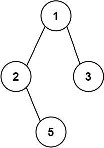

# 257. 二叉树的所有路径

Easy · [力扣原题](https://leetcode.cn/problems/binary-tree-paths/)

所在刷题路径：labuladong、灵神题单·链表树与回溯

| 作者 | 题解 | 动画讲解 |
|---|---|---|
| 灵茶山艾府 | [📄 题解](灵茶山艾府.md) | [▶︎ 0257 二叉树的所有路径 · 灵茶山艾府.mp4](0257%20二叉树的所有路径%20·%20灵茶山艾府.mp4) |
| yiduobo | [📄 题解](yiduobo.md) | [▶︎ 0257 二叉树的所有路径 · yiduobo.mp4](0257%20二叉树的所有路径%20·%20yiduobo.mp4) |

## 题目描述

给你一个二叉树的根节点 `root`。

按 **任意顺序** ，返回所有 **从根节点到叶子节点** 的路径。

**叶子节点** 是指没有子节点的节点。

**示例 1：**



```

输入：root = [1,2,3,null,5]
输出：["1->2->5","1->3"]
```

**示例 2：**

```

输入：root = [1]
输出：["1"]
```

**提示：**

- 树中节点的数目在范围 `[1, 100]` 内

- `-100 <= Node.val <= 100`

---
[↑ 返回 0200-0299](../README.md) · [总索引](../../../索引.md) · [仓库首页](../../../README.md)
