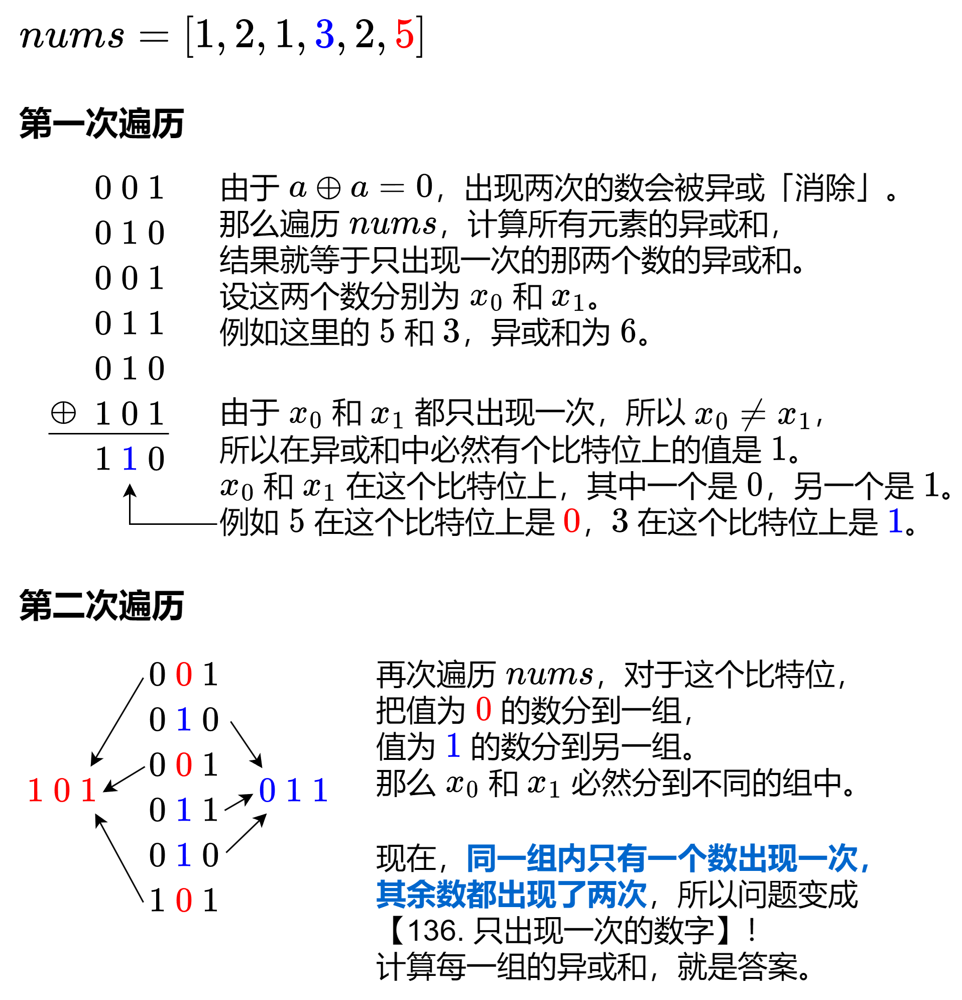

# 【图解】一张图秒懂！转换成 136！（Python/Java/C++/Go/JS/Rust）

> **[260. 只出现一次的数字 III](https://leetcode.cn/problems/single-number-iii/solutions/2484352/tu-jie-yi-zhang-tu-miao-dong-zhuan-huan-np9d2/) · Medium**

> **所属题单**
> - [位运算 · 九、其他](../../../刷题路径/灵神原版题单/位运算/九、其他.md)

> **题目描述**
> 给你一个整数数组 `nums`，其中恰好有两个元素只出现一次，其余所有元素均出现两次。 找出只出现一次的那两个元素。你可以按 **任意顺序** 返回答案。
>
> 你必须设计并实现线性时间复杂度的算法且仅使用常量额外空间来解决此问题。
>
> **示例 1：**
>
> ```
>
> 输入：nums = [1,2,1,3,2,5]
> 输出：[3,5]
> 解释：[5, 3] 也是有效的答案。
> ```
>
> **示例 2：**
>
> ```
>
> 输入：nums = [-1,0]
> 输出：[-1,0]
> ```
>
> **示例 3：**
>
> ```
>
> 输入：nums = [0,1]
> 输出：[1,0]
> ```
>
> **提示：**
>
> - `2 <= nums.length <= 3 * 10⁴`
>
> - `-2³¹ <= nums[i] <= 2³¹ - 1`
>
> - 除两个只出现一次的整数外，`nums` 中的其他数字都出现两次

> **题解**
> 
>
> 代码实现时，需要找到异或和中的某个值为 $1$ 的比特位，用于区分 $\textit{nums}[i]$ 是在第一组还是在第二组。
>
> ## 写法一
>
> 第一种方式是计算异或和的 **lowbit**，即二进制最低位的 $1$，举例如下：
>
>
> 更多位运算技巧，请看 [从集合论到位运算，常见位运算技巧分类总结！](https://leetcode.cn/circle/discuss/CaOJ45/)
>
> ```python
> class Solution:
>     def singleNumber(self, nums: List[int]) -> List[int]:
>         xor_all = reduce(xor, nums)
>         lowbit = xor_all & -xor_all  # 用来区分元素在哪一组
>
>         ans = [0, 0]
>         for x in nums:
>             if (x & lowbit) == 0:  # x 在第一组
>                 ans[0] ^= x
>             else:  # x 在第二组
>                 ans[1] ^= x
>         return ans
> ```
>
>
> ## 写法二
>
> 第二种方式是计算异或和的**尾零的个数**，这样可以直接取到 $\textit{nums}[i]$ 在该比特位上的值，从而避免 $\texttt{if-else}$。
>
> > 注：如果没有计算尾零个数的库函数，可改为计算二进制的长度减一。
>
> ```python
> class Solution:
>     def singleNumber(self, nums: List[int]) -> List[int]:
>         xor_all = reduce(xor, nums)
>         shift = xor_all.bit_length() - 1 if xor_all > 0 else 31
>
>         ans = [0, 0]
>         for x in nums:
>             ans[x >> shift & 1] ^= x
>         return ans
> ```
>
>
> #### 复杂度分析
>
> - 时间复杂度：$\mathcal{O}(n)$，其中 $n$ 为 $\textit{nums}$ 的长度。
> - 空间复杂度：$\mathcal{O}(1)$。仅用到若干额外变量。
>
> ## 相似题目
>
> - [136. 只出现一次的数字](https://leetcode.cn/problems/single-number/)
> - [137. 只出现一次的数字 II](https://leetcode.cn/problems/single-number-ii/)
>
> ## 分类题单
>
> [如何科学刷题？](https://leetcode.cn/circle/discuss/RvFUtj/)
>
> 1. [滑动窗口与双指针（定长/不定长/单序列/双序列/三指针/分组循环）](https://leetcode.cn/circle/discuss/0viNMK/)
> 2. [二分算法（二分答案/最小化最大值/最大化最小值/第K小）](https://leetcode.cn/circle/discuss/SqopEo/)
> 3. [单调栈（基础/矩形面积/贡献法/最小字典序）](https://leetcode.cn/circle/discuss/9oZFK9/)
> 4. [网格图（DFS/BFS/综合应用）](https://leetcode.cn/circle/discuss/YiXPXW/)
> 5. [位运算（基础/性质/拆位/试填/恒等式/思维）](https://leetcode.cn/circle/discuss/dHn9Vk/)
> 6. [图论算法（DFS/BFS/拓扑排序/基环树/最短路/最小生成树/网络流）](https://leetcode.cn/circle/discuss/01LUak/)
> 7. [动态规划（入门/背包/划分/状态机/区间/状压/数位/数据结构优化/树形/博弈/概率期望）](https://leetcode.cn/circle/discuss/tXLS3i/)
> 8. [常用数据结构（前缀和/差分/栈/队列/堆/字典树/并查集/树状数组/线段树）](https://leetcode.cn/circle/discuss/mOr1u6/)
> 9. [数学算法（数论/组合/概率期望/博弈/计算几何/随机算法）](https://leetcode.cn/circle/discuss/IYT3ss/)
> 10. [贪心与思维（基本贪心策略/反悔/区间/字典序/数学/思维/脑筋急转弯/构造）](https://leetcode.cn/circle/discuss/g6KTKL/)
> 11. [链表、二叉树与回溯（前后指针/快慢指针/DFS/BFS/直径/LCA/一般树）](https://leetcode.cn/circle/discuss/K0n2gO/)
> 12. [字符串（KMP/Z函数/Manacher/字符串哈希/AC自动机/后缀数组/子序列自动机）](https://leetcode.cn/circle/discuss/SJFwQI/)
>
> [我的题解精选（已分类）](https://github.com/EndlessCheng/codeforces-go/blob/master/leetcode/SOLUTIONS.md)
>
> 欢迎关注 [B站@灵茶山艾府](https://space.bilibili.com/206214)
