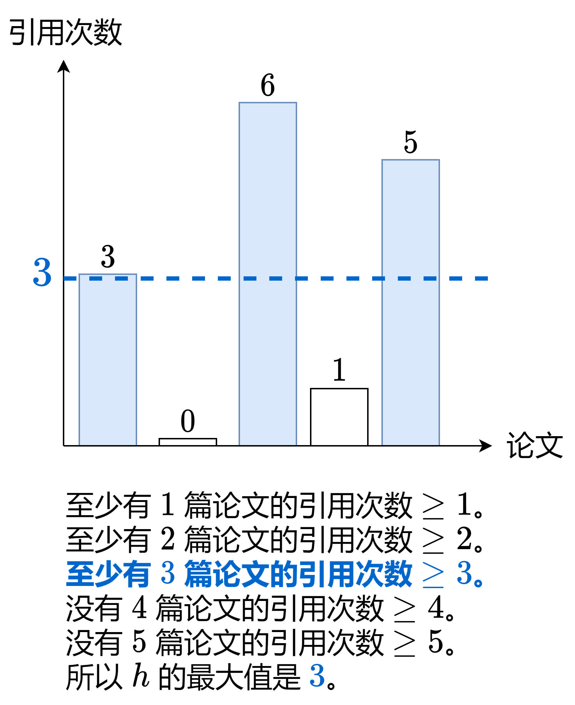

# 没看懂题意？一张图秒懂（Python/Java/C++/Go/JS/Rust）

> **[274. H 指数](https://leetcode.cn/problems/h-index/solutions/2502837/mei-kan-dong-ti-yi-yi-zhang-tu-miao-dong-8zps/) · Medium**

> **所属题单**
> - [面试经典 150 题 · 数组 / 字符串](../../../刷题路径/灵神原版题单/面试经典%20150%20题/数组%20-%20字符串.md)

> **题目描述**
> 给你一个整数数组 `citations` ，其中 `citations[i]` 表示研究者的第 `i` 篇论文被引用的次数。计算并返回该研究者的 **`h` 指数**。
>
> 根据维基百科上 [h 指数的定义](https://baike.baidu.com/item/h-index/3991452?fr=aladdin)：`h` 代表“高引用次数” ，一名科研人员的 `h` **指数** 是指他（她）至少发表了 `h` 篇论文，并且 **至少** 有 `h` 篇论文被引用次数大于等于 `h` 。如果 `h` 有多种可能的值，**`h` 指数** 是其中最大的那个。
>
> **示例 1：**
>
> ```
>
> 输入：citations = [3,0,6,1,5]
> 输出：3
> 解释：给定数组表示研究者总共有 5 篇论文，每篇论文相应的被引用了 3, 0, 6, 1, 5 次。
>      由于研究者有 3 篇论文每篇 至少 被引用了 3 次，其余两篇论文每篇被引用 不多于 3 次，所以她的 h 指数是 3。
> ```
>
> **示例 2：**
>
> ```
>
> 输入：citations = [1,3,1]
> 输出：1
> ```
>
> **提示：**
>
> - `n == citations.length`
>
> - `1 <= n <= 5000`
>
> - `0 <= citations[i] <= 1000`

> **题解**
> 首先解释下示例 1 是怎么算的：
>
> 
>
> **题意**：给你一个数组，求一个最大的 $h$，使得数组中有至少 $h$ 个数都大于等于 $h$。
>
> 本题可以做到 $\mathcal{O}(n)$ 时间。
>
> 设 $n$ 为 $\textit{citations}$ 的长度，即这名研究者发表的论文数。根据题意，$h$ 不可能超过 $n$，所以对于引用次数大于 $n$ 的论文，我们在统计的时候，可以看成是引用次数等于 $n$ 的论文。例如 $n=5$，假设 $h$ 是 $5$，那么无论引用次数是 $6$ 还是 $5$，都满足 $\ge 5$，所以 $6$ 可以看成是 $5$，毕竟我们只需要统计有多少个数字是 $\ge 5$ 的。
>
> 所以，创建一个长为 $n+1$ 的 $\textit{cnt}$ 数组，统计 $\min(\textit{citations}[i], n)$ 的出现次数。
>
> 设 $s$ 为引用次数 $\ge i$ 的论文数，我们需要算出满足 $s\ge i$ 的最大的 $i$。
>
> 为了快速算出有多少论文的引用次数 $\ge i$，我们可以从 $i=n$ 开始倒序循环，每次循环，把 $\textit{cnt}[i]$ 加到 $s$ 中。由于我们是倒序循环的，只要 $s\ge i$ 成立，此时的 $i$ 就是满足 $s\ge i$ 的最大的 $i$，直接返回 $i$ 作为答案。
>
> 例如示例 1，从 $i=5$ 开始：
>
> 1. $i=5$，现在 $s=2<i$，继续循环。
> 2. $i=4$，现在 $s=2<i$，继续循环。
> 3. $i=3$，现在 $s=3\ge i$，返回 $3$。
>
> ```python
> class Solution:
>     def hIndex(self, citations: List[int]) -> int:
>         n = len(citations)
>         cnt = [0] * (n + 1)
>         for c in citations:
>             cnt[min(c, n)] += 1  # 引用次数 > n，等价于引用次数为 n
>         s = 0
>         for i in range(n, -1, -1):  # i=0 的时候，s>=i 一定成立
>             s += cnt[i]
>             if s >= i:  # 说明有至少 i 篇论文的引用次数至少为 i
>                 return i
> ```
>
>
> #### 复杂度分析
>
> - 时间复杂度：$\mathcal{O}(n)$，其中 $n$ 为 $\textit{citations}$ 的长度。
> - 空间复杂度：$\mathcal{O}(n)$。
>
> ## 思考题
>
> 如果数组是有序的，你能想出一个更快的做法吗？
>
> 这题是 [275. H 指数 II](https://leetcode.cn/problems/h-index-ii/)
>
> ## 分类题单
>
> [如何科学刷题？](https://leetcode.cn/circle/discuss/RvFUtj/)
>
> 1. [滑动窗口（定长/不定长/多指针）](https://leetcode.cn/circle/discuss/0viNMK/)
> 2. [二分算法（二分答案/最小化最大值/最大化最小值/第K小）](https://leetcode.cn/circle/discuss/SqopEo/)
> 3. [单调栈（基础/矩形面积/贡献法/最小字典序）](https://leetcode.cn/circle/discuss/9oZFK9/)
> 4. [网格图（DFS/BFS/综合应用）](https://leetcode.cn/circle/discuss/YiXPXW/)
> 5. [位运算（基础/性质/拆位/试填/恒等式/思维）](https://leetcode.cn/circle/discuss/dHn9Vk/)
> 6. [图论算法（DFS/BFS/拓扑排序/最短路/最小生成树/二分图/基环树/欧拉路径）](https://leetcode.cn/circle/discuss/01LUak/)
> 7. [动态规划（入门/背包/状态机/划分/区间/状压/数位/数据结构优化/树形/博弈/概率期望）](https://leetcode.cn/circle/discuss/tXLS3i/)
> 8. [常用数据结构（前缀和/差分/栈/队列/堆/字典树/并查集/树状数组/线段树）](https://leetcode.cn/circle/discuss/mOr1u6/)
> 9. [数学算法（数论/组合/概率期望/博弈/计算几何/随机算法）](https://leetcode.cn/circle/discuss/IYT3ss/)
> 10. [贪心算法（基本贪心策略/反悔/区间/字典序/数学/思维/脑筋急转弯/构造）](https://leetcode.cn/circle/discuss/g6KTKL/)
> 11. [链表、二叉树与一般树（前后指针/快慢指针/DFS/BFS/直径/LCA）](https://leetcode.cn/circle/discuss/K0n2gO/)
>
> [我的题解精选（已分类）](https://github.com/EndlessCheng/codeforces-go/blob/master/leetcode/SOLUTIONS.md)
>
> 欢迎关注 [B站@灵茶山艾府](https://space.bilibili.com/206214)
