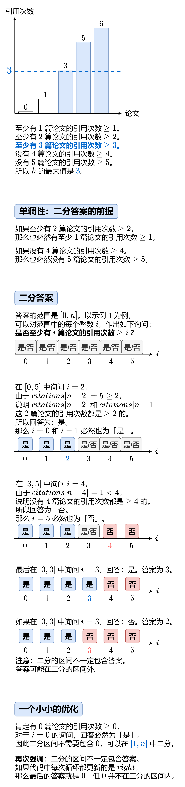

# 【图解】一图掌握二分答案，四种写法（Python/Java/C++/Go/JS/Rust）

> **[275. H 指数 II](https://leetcode.cn/problems/h-index-ii/solutions/2504326/tu-jie-yi-tu-zhang-wo-er-fen-da-an-si-ch-d15k/) · Medium**

> **所属题单**
> - [二分算法 · 二、二分答案](../../../刷题路径/灵神原版题单/二分算法/二、二分答案.md) · §2.2 求最大

> **题目描述**
> 给你一个整数数组 `citations` ，其中 `citations[i]` 表示研究者的第 `i` 篇论文被引用的次数，`citations` 已经按照 **非降序排列** 。计算并返回该研究者的 h 指数。
>
> [h 指数的定义](https://baike.baidu.com/item/h-index/3991452?fr=aladdin)：h 代表“高引用次数”（high citations），一名科研人员的 `h` 指数是指他（她）的 （`n` 篇论文中）**至少** 有 `h` 篇论文分别被引用了**至少** `h` 次。
>
> 请你设计并实现对数时间复杂度的算法解决此问题。
>
> **示例 1：**
>
> ```
>
> 输入：citations = [0,1,3,5,6]
> 输出：3
> 解释：给定数组表示研究者总共有 5 篇论文，每篇论文相应的被引用了 0, 1, 3, 5, 6 次。
>      由于研究者有3篇论文每篇 至少 被引用了 3 次，其余两篇论文每篇被引用 不多于 3 次，所以她的 h 指数是 3 。
> ```
>
> **示例 2：**
>
> ```
>
> 输入：citations = [1,2,100]
> 输出：2
> ```
>
> **提示：**
>
> - `n == citations.length`
>
> - `1 <= n <= 10⁵`
>
> - `0 <= citations[i] <= 1000`
>
> - `citations` 按 **升序排列**

> **题解**
> **题意**：找最大的 $h$，满足 $\textit{citations}[n-h]\ge h$。
>
> {:width=600px}
>
> ⚠**注意**：我们二分的是答案，是**引用次数**，不是 $\textit{citations}$ 的下标。
>
> 关于二分算法的原理，请看视频讲解[【基础算法精讲 04】](https://www.bilibili.com/video/BV1AP41137w7/)。
>
> #### 闭区间写法
>
> ```python
> class Solution:
>     def hIndex(self, citations: List[int]) -> int:
>         # 在区间 [left, right] 内询问
>         left = 1
>         right = len(citations)
>         while left <= right:  # 区间不为空
>             # 循环不变量：
>             # left-1 的回答一定为「是」
>             # right+1 的回答一定为「否」
>             mid = (left + right) // 2
>             # 引用次数最多的 mid 篇论文，引用次数均 >= mid
>             if citations[-mid] >= mid:
>                 left = mid + 1  # 询问范围缩小到 [mid+1, right]
>             else:
>                 right = mid - 1  # 询问范围缩小到 [left, mid-1]
>         # 循环结束后 right 等于 left-1，回答一定为「是」
>         # 根据循环不变量，right 现在是最大的回答为「是」的数
>         return right
> ```
>
>
> #### 左闭右开区间写法
>
> ```python
> class Solution:
>     def hIndex(self, citations: List[int]) -> int:
>         # 在区间 [left, right) 内询问
>         left = 1
>         right = len(citations) + 1
>         while left < right:  # 区间不为空
>             # 循环不变量：
>             # left-1 的回答一定为「是」
>             # right 的回答一定为「否」
>             mid = (left + right) // 2
>             # 引用次数最多的 mid 篇论文，引用次数均 >= mid
>             if citations[-mid] >= mid:
>                 left = mid + 1  # 询问范围缩小到 [mid+1, right)
>             else:
>                 right = mid  # 询问范围缩小到 [left, mid)
>         # 根据循环不变量，left-1 现在是最大的回答为「是」的数
>         return left - 1
> ```
>
>
> #### 左开右闭区间写法
>
> ```python
> class Solution:
>     def hIndex(self, citations: List[int]) -> int:
>         # 在区间 (left, right] 内询问
>         left = 0
>         right = len(citations)
>         while left < right:  # 区间不为空
>             # 循环不变量：
>             # left 的回答一定为「是」
>             # right+1 的回答一定为「否」
>             mid = (left + right + 1) // 2  # 保证 mid 在二分区间内
>             # 引用次数最多的 mid 篇论文，引用次数均 >= mid
>             if citations[-mid] >= mid:
>                 left = mid  # 询问范围缩小到 (mid, right]
>             else:
>                 right = mid - 1  # 询问范围缩小到 (left, mid-1]
>         # 根据循环不变量，left 现在是最大的回答为「是」的数
>         return left
> ```
>
>
> #### 开区间写法
>
> ```python
> class Solution:
>     def hIndex(self, citations: List[int]) -> int:
>         # 在区间 (left, right) 内询问
>         left = 0
>         right = len(citations) + 1
>         while left + 1 < right:  # 区间不为空
>             # 循环不变量：
>             # left 的回答一定为「是」
>             # right 的回答一定为「否」
>             mid = (left + right) // 2
>             # 引用次数最多的 mid 篇论文，引用次数均 >= mid
>             if citations[-mid] >= mid:
>                 left = mid  # 询问范围缩小到 (mid, right)
>             else:
>                 right = mid  # 询问范围缩小到 (left, mid)
>         # 根据循环不变量，left 现在是最大的回答为「是」的数
>         return left
> ```
>
>
> #### 复杂度分析
>
> - 时间复杂度：$\mathcal{O}(\log n)$，其中 $n$ 是 $\textit{citations}$ 的长度。每次循环，都会把二分范围缩短一半，所以会循环 $\mathcal{O}(\log n)$ 次，时间复杂度为 $\mathcal{O}(\log n)$。
> - 空间复杂度：$\mathcal{O}(1)$。
>
> ## 附：其他写法
>
> 二分的初始范围可以进一步缩小至
>
> $$
> [\min(\textit{citations}[0], n) + 1, \min(\textit{citations}[n-1], n)]
> $$
>
> ```python
> class Solution:
>     def hIndex(self, citations: List[int]) -> int:
>         n = len(citations)
>         # 在区间 (left, right) 内询问
>         left = min(citations[0], n)
>         right = min(citations[-1], n) + 1
>         while left + 1 < right:  # 区间不为空
>             # 循环不变量：
>             # left 的回答一定为「是」
>             # right 的回答一定为「否」
>             mid = (left + right) // 2
>             # 引用次数最多的 mid 篇论文，引用次数均 >= mid
>             if citations[-mid] >= mid:
>                 left = mid  # 询问范围缩小到 (mid, right)
>             else:
>                 right = mid  # 询问范围缩小到 (left, mid)
>         # 根据循环不变量，left 现在是最大的回答为「是」的数
>         return left
> ```
>
> #### 复杂度分析
>
> - 时间复杂度：$\mathcal{O}(\log \min(n,U))$，其中 $n$ 是 $\textit{citations}$ 的长度，$U=\textit{citations}[n-1]$。
> - 空间复杂度：$\mathcal{O}(1)$。
>
> ## 分类题单
>
> [如何科学刷题？](https://leetcode.cn/circle/discuss/RvFUtj/)
>
> 1. [滑动窗口与双指针（定长/不定长/单序列/双序列/三指针/分组循环）](https://leetcode.cn/circle/discuss/0viNMK/)
> 2. [二分算法（二分答案/最小化最大值/最大化最小值/第K小）](https://leetcode.cn/circle/discuss/SqopEo/)
> 3. [单调栈（基础/矩形面积/贡献法/最小字典序）](https://leetcode.cn/circle/discuss/9oZFK9/)
> 4. [网格图（DFS/BFS/综合应用）](https://leetcode.cn/circle/discuss/YiXPXW/)
> 5. [位运算（基础/性质/拆位/试填/恒等式/思维）](https://leetcode.cn/circle/discuss/dHn9Vk/)
> 6. [图论算法（DFS/BFS/拓扑排序/基环树/最短路/最小生成树/网络流）](https://leetcode.cn/circle/discuss/01LUak/)
> 7. [动态规划（入门/背包/划分/状态机/区间/状压/数位/数据结构优化/树形/博弈/概率期望）](https://leetcode.cn/circle/discuss/tXLS3i/)
> 8. [常用数据结构（前缀和/差分/栈/队列/堆/字典树/并查集/树状数组/线段树）](https://leetcode.cn/circle/discuss/mOr1u6/)
> 9. [数学算法（数论/组合/概率期望/博弈/计算几何/随机算法）](https://leetcode.cn/circle/discuss/IYT3ss/)
> 10. [贪心与思维（基本贪心策略/反悔/区间/字典序/数学/思维/脑筋急转弯/构造）](https://leetcode.cn/circle/discuss/g6KTKL/)
> 11. [链表、树与回溯（前后指针/快慢指针/DFS/BFS/直径/LCA）](https://leetcode.cn/circle/discuss/K0n2gO/)
> 12. [字符串（KMP/Z函数/Manacher/字符串哈希/AC自动机/后缀数组/子序列自动机）](https://leetcode.cn/circle/discuss/SJFwQI/)
>
> [我的题解精选（已分类）](https://github.com/EndlessCheng/codeforces-go/blob/master/leetcode/SOLUTIONS.md)
>
> 欢迎关注 [B站@灵茶山艾府](https://space.bilibili.com/206214)
