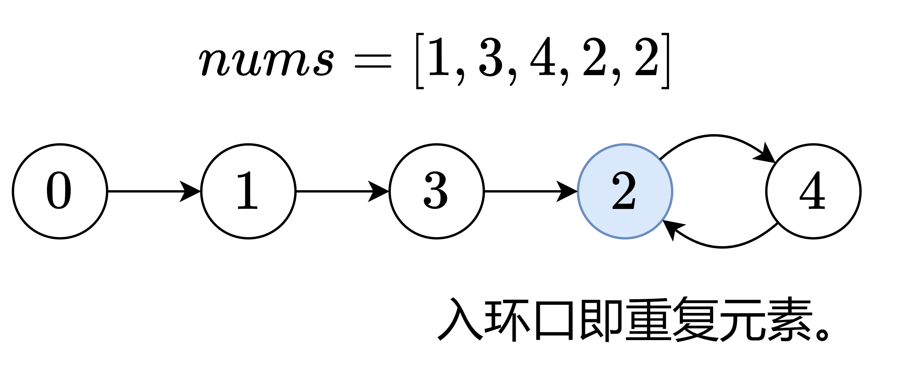
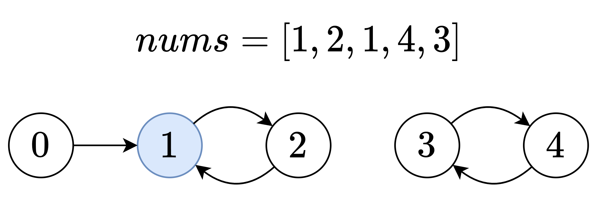

# 用基环树理解，做法同 142. 环形链表 II（Python/Java/C++/C/Go/JS/Rust）

> **[287. 寻找重复数](https://leetcode.cn/problems/find-the-duplicate-number/solutions/3797843/yong-ji-huan-shu-li-jie-zuo-fa-tong-142-tkoc2/) · Medium**

> **所属题单**
> - [链表、二叉树与回溯 · 一、链表](../../../刷题路径/灵神原版题单/链表、二叉树与回溯/一、链表.md) · §1.6 快慢指针
> - [图论算法 · 二、拓扑排序](../../../刷题路径/灵神原版题单/图论算法/二、拓扑排序.md) · §2.3 基环树
> - [LeetCode 热题 100 · 技巧](../../../刷题路径/灵神原版题单/LeetCode%20热题%20100/技巧.md)

> **题目描述**
> 给定一个包含 `n + 1` 个整数的数组 `nums` ，其数字都在 `[1, n]` 范围内（包括 `1` 和 `n`），可知至少存在一个重复的整数。
>
> 假设 `nums` 只有 **一个重复的整数** ，返回 **这个重复的数** 。
>
> 你设计的解决方案必须 **不修改** 数组 `nums` 且只用常量级 `O(1)` 的额外空间。
>
> **示例 1：**
>
> ```
>
> 输入：nums = [1,3,4,2,2]
> 输出：2
> ```
>
> **示例 2：**
>
> ```
>
> 输入：nums = [3,1,3,4,2]
> 输出：3
> ```
>
> **示例 3 :**
>
> ```
>
> 输入：nums = [3,3,3,3,3]
> 输出：3
> ```
>
> **提示：**
>
> - `1 <= n <= 10⁵`
>
> - `nums.length == n + 1`
>
> - `1 <= nums[i] <= n`
>
> - `nums` 中 **只有一个整数** 出现 **两次或多次** ，其余整数均只出现 **一次**
>
> **进阶：**
>
> - 如何证明 `nums` 中至少存在一个重复的数字?
>
> - 你可以设计一个线性级时间复杂度 `O(n)` 的解决方案吗？

> **题解**
> 想象有一个 $n+1$ 个节点的图，节点编号从 $0$ 到 $n$。
>
> 对 $i=0,1,2,\dots,n$，连一条从 $i$ 到 $\textit{nums}[i]$ 的有向边，可以得到一个**有向图**。
>
> {:width=500px}
>
> 每个节点的入度，就是这个节点在 $\textit{nums}$ 中的出现次数。重复元素的入度大于 $1$。上图中的节点 $2$ 的入度为 $2$，所以 $2$ 是重复元素。
>
> 如何找到入度大于 $1$ 的节点？
>
> 在每个节点的出度都是 $1$ 的情况下，$n+1$ 个点 $n+1$ 条边的有向图，又叫**内向基环森林**，每个连通块都恰好有一个环。
>
> 由于 $\textit{nums}[i]\ge 1$，所以节点 $0$ 的入度是 $0$，不在环上。从节点 $0$ 出发，进入基环，基环的入环口，就是入度大于 $1$ 的节点。
>
> ⚠**注意**：如果从非 $0$ 节点出发，可能无法找到答案。如下图，如果从节点 $3$ 出发，无法找到入度大于 $1$ 的节点。
>
> {:width=500px}
>
> 考察包含节点 $0$ 的连通块，其形状和 [142. 环形链表 II](https://leetcode.cn/problems/linked-list-cycle-ii/) 是一样的，所以都可以用**快慢指针**解决，详见 [我的题解](../../0100-0199/0142%20环形链表%20II/灵茶山艾府.md)，包含图解和视频讲解。
>
> 这两题的联系如下表，注意 $i$ 和 $\textit{nums}[i]$ 都是节点。
>
> |  **142. 环形链表 II** |  **287. 寻找重复数**  |
> |---|---|
> | 链表节点 $\textit{node}$  |  $i$ |
> | 下一个节点 $\textit{node}.\textit{next}$  | $\textit{nums}[i]$  |
> | 头节点 $\textit{head}$   |  $0$ |
> | 入环口  |  重复元素 |
>
> 在链表中，我们的移动方式是从节点 $\textit{node}$ 移动到下一个节点 $\textit{node}.\textit{next}$。
>
> 在数组中，我们的移动方式是从节点 $i$ 移动到节点 $\textit{nums}[i]$。由于数组长度是 $n+1$，而 $\textit{nums}[i] < n+1$，所以不会下标越界。
>
> ```python
> # 代码逻辑同 142. 环形链表 II
> class Solution:
>     def findDuplicate(self, nums: List[int]) -> int:
>         slow = fast = 0  # 0 一定不在环上，适合作为起点
>         while True:
>             slow = nums[slow]  # 等价于 slow = slow.next
>             fast = nums[nums[fast]]  # 等价于 fast = fast.next.next
>             if fast == slow:  # 快慢指针移动到同一个节点
>                 break
>
>         head = 0  # 再用一个指针，从起点出发
>         while slow != head:
>             slow = nums[slow]
>             head = nums[head]
>         return slow  # 入环口即重复元素
> ```
>
>
> #### 复杂度分析
>
> - 时间复杂度：$\mathcal{O}(n)$，其中 $n$ 是 $\textit{nums}$ 的长度。理由见[【基础算法精讲 07】](https://www.bilibili.com/video/BV1KG4y1G7cu/)。
> - 空间复杂度：$\mathcal{O}(1)$。
>
> #### 进阶问题
>
> **问**：如何证明 $\textit{nums}$ 中至少存在一个重复的数字?
>
> **答**：视作有 $n+1$ 个球和 $n$ 个抽屉，第 $i$ 个球放入第 $\textit{nums}[i]$ 个抽屉。根据**抽屉原理**（鸽巢原理），存在一个抽屉至少有两个球，这个抽屉的编号即重复元素。
>
> ## 专题训练
>
> 见下面链表题单的「**§1.6 快慢指针**」。
>
> ## 分类题单
>
> [如何科学刷题？](https://leetcode.cn/circle/discuss/RvFUtj/)
>
> 1. [滑动窗口与双指针（定长/不定长/单序列/双序列/三指针/分组循环）](https://leetcode.cn/circle/discuss/0viNMK/)
> 2. [二分算法（二分答案/最小化最大值/最大化最小值/第K小）](https://leetcode.cn/circle/discuss/SqopEo/)
> 3. [单调栈（基础/矩形面积/贡献法/最小字典序）](https://leetcode.cn/circle/discuss/9oZFK9/)
> 4. [网格图（DFS/BFS/综合应用）](https://leetcode.cn/circle/discuss/YiXPXW/)
> 5. [位运算（基础/性质/拆位/试填/恒等式/思维）](https://leetcode.cn/circle/discuss/dHn9Vk/)
> 6. [图论算法（DFS/BFS/拓扑排序/基环树/最短路/最小生成树/网络流）](https://leetcode.cn/circle/discuss/01LUak/)
> 7. [动态规划（入门/背包/划分/状态机/区间/状压/数位/数据结构优化/树形/博弈/概率期望）](https://leetcode.cn/circle/discuss/tXLS3i/)
> 8. [常用数据结构（前缀和/差分/栈/队列/堆/字典树/并查集/树状数组/线段树）](https://leetcode.cn/circle/discuss/mOr1u6/)
> 9. [数学算法（数论/组合/概率期望/博弈/计算几何/随机算法）](https://leetcode.cn/circle/discuss/IYT3ss/)
> 10. [贪心与思维（基本贪心策略/反悔/区间/字典序/数学/思维/脑筋急转弯/构造）](https://leetcode.cn/circle/discuss/g6KTKL/)
> 11. [链表、二叉树与回溯（前后指针/快慢指针/DFS/BFS/直径/LCA/一般树）](https://leetcode.cn/circle/discuss/K0n2gO/)
> 12. [字符串（KMP/Z函数/Manacher/字符串哈希/AC自动机/后缀数组/子序列自动机）](https://leetcode.cn/circle/discuss/SJFwQI/)
>
> [我的题解精选（已分类）](https://github.com/EndlessCheng/codeforces-go/blob/master/leetcode/SOLUTIONS.md)
>
> 欢迎关注 [B站@灵茶山艾府](https://space.bilibili.com/206214)
