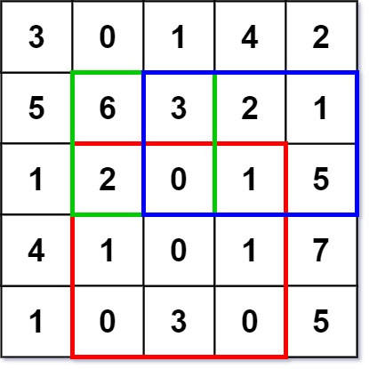

# 304. 二维区域和检索 - 矩阵不可变

Medium · [力扣原题](https://leetcode.cn/problems/range-sum-query-2d-immutable/)

所在刷题路径：labuladong、灵神核心路线、灵神题单·常用数据结构

| 作者 | 题解 | 动画讲解 |
|---|---|---|
| 灵茶山艾府 | [📄 题解](灵茶山艾府.md) | [▶︎ 0304 二维区域和检索 - 矩阵不可变 · 灵茶山艾府.mp4](0304%20二维区域和检索%20-%20矩阵不可变%20·%20灵茶山艾府.mp4) |
| yiduobo | [📄 题解](yiduobo.md) | [▶︎ 0304 二维区域和检索 - 矩阵不可变 · yiduobo.mp4](0304%20二维区域和检索%20-%20矩阵不可变%20·%20yiduobo.mp4) |

## 题目描述

给定一个二维矩阵 `matrix`，以下类型的多个请求：

- 计算其子矩形范围内元素的总和，该子矩阵的 **左上角** 为 `(row1, col1)` ，**右下角** 为 `(row2, col2)` 。

实现 `NumMatrix` 类：

- `NumMatrix(int[][] matrix)` 给定整数矩阵 `matrix` 进行初始化

- `int sumRegion(int row1, int col1, int row2, int col2)` 返回 **左上角** `(row1, col1)` 、**右下角** `(row2, col2)` 所描述的子矩阵的元素 **总和** 。

**示例 1：**



```

输入:
["NumMatrix","sumRegion","sumRegion","sumRegion"]
[[[[3,0,1,4,2],[5,6,3,2,1],[1,2,0,1,5],[4,1,0,1,7],[1,0,3,0,5]]],[2,1,4,3],[1,1,2,2],[1,2,2,4]]
输出:
[null, 8, 11, 12]

解释:
NumMatrix numMatrix = new NumMatrix([[3,0,1,4,2],[5,6,3,2,1],[1,2,0,1,5],[4,1,0,1,7],[1,0,3,0,5]]);
numMatrix.sumRegion(2, 1, 4, 3); // return 8 (红色矩形框的元素总和)
numMatrix.sumRegion(1, 1, 2, 2); // return 11 (绿色矩形框的元素总和)
numMatrix.sumRegion(1, 2, 2, 4); // return 12 (蓝色矩形框的元素总和)
```

**提示：**

- `m == matrix.length`

- `n == matrix[i].length`

- `1 <= m, n <= 200`

- `-10⁵ <= matrix[i][j] <= 10⁵`

- `0 <= row1 <= row2 < m`

- `0 <= col1 <= col2 < n`

- 最多调用 `10⁴` 次 `sumRegion` 方法

---
[↑ 返回 0300-0399](../README.md) · [总索引](../../../索引.md) · [仓库首页](../../../README.md)
