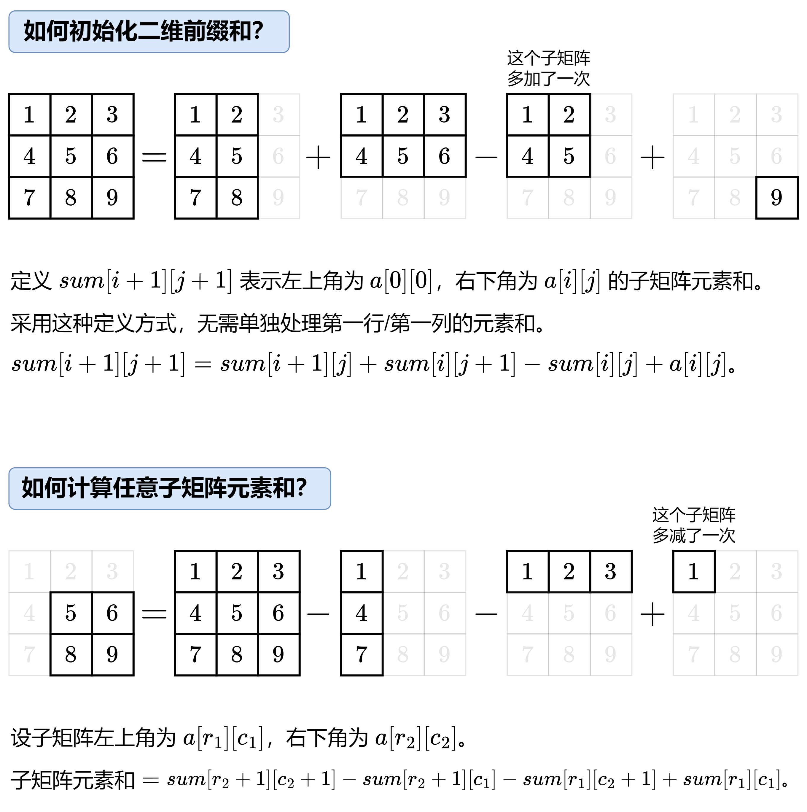

# 【图解】一张图秒懂二维前缀和！（Python/Java/C++/Go/JS/Rust）

> **[304. 二维区域和检索 - 矩阵不可变](https://leetcode.cn/problems/range-sum-query-2d-immutable/solutions/2667331/tu-jie-yi-zhang-tu-miao-dong-er-wei-qian-84qp/) · Medium**

> **所属题单**
> - [常用数据结构 · 一、前缀和](../../../刷题路径/灵神原版题单/常用数据结构/一、前缀和.md) · §1.6 二维前缀和

> **题目描述**
> 给定一个二维矩阵 `matrix`，以下类型的多个请求：
>
> - 计算其子矩形范围内元素的总和，该子矩阵的 **左上角** 为 `(row1, col1)` ，**右下角** 为 `(row2, col2)` 。
>
> 实现 `NumMatrix` 类：
>
> - `NumMatrix(int[][] matrix)` 给定整数矩阵 `matrix` 进行初始化
>
> - `int sumRegion(int row1, int col1, int row2, int col2)` 返回 **左上角** `(row1, col1)` 、**右下角** `(row2, col2)` 所描述的子矩阵的元素 **总和** 。
>
> **示例 1：**
>
> 
>
> ```
>
> 输入:
> ["NumMatrix","sumRegion","sumRegion","sumRegion"]
> [[[[3,0,1,4,2],[5,6,3,2,1],[1,2,0,1,5],[4,1,0,1,7],[1,0,3,0,5]]],[2,1,4,3],[1,1,2,2],[1,2,2,4]]
> 输出:
> [null, 8, 11, 12]
>
> 解释:
> NumMatrix numMatrix = new NumMatrix([[3,0,1,4,2],[5,6,3,2,1],[1,2,0,1,5],[4,1,0,1,7],[1,0,3,0,5]]);
> numMatrix.sumRegion(2, 1, 4, 3); // return 8 (红色矩形框的元素总和)
> numMatrix.sumRegion(1, 1, 2, 2); // return 11 (绿色矩形框的元素总和)
> numMatrix.sumRegion(1, 2, 2, 4); // return 12 (蓝色矩形框的元素总和)
> ```
>
> **提示：**
>
> - `m == matrix.length`
>
> - `n == matrix[i].length`
>
> - `1 <= m, n <= 200`
>
> - `-10⁵ <= matrix[i][j] <= 10⁵`
>
> - `0 <= row1 <= row2 < m`
>
> - `0 <= col1 <= col2 < n`
>
> - 最多调用 `10⁴` 次 `sumRegion` 方法

> **题解**
> 
>
> ```python
> class NumMatrix:
>     def __init__(self, matrix: List[List[int]]):
>         m, n = len(matrix), len(matrix[0])
>         s = [[0] * (n + 1) for _ in range(m + 1)]
>         for i, row in enumerate(matrix):
>             for j, x in enumerate(row):
>                 s[i + 1][j + 1] = s[i + 1][j] + s[i][j + 1] - s[i][j] + x
>         self.s = s
>
>     # 返回左上角在 (r1, c1) 右下角在 (r2, c2) 的子矩阵元素和
>     def sumRegion(self, r1: int, c1: int, r2: int, c2: int) -> int:
>         s = self.s
>         return s[r2 + 1][c2 + 1] - s[r2 + 1][c1] - s[r1][c2 + 1] + s[r1][c1]
> ```
>
>
> #### 复杂度分析
>
> - 时间复杂度：初始化 $\mathcal{O}(mn)$，计算 $\texttt{sumRegion}$ $\mathcal{O}(1)$，其中 $m$ 和 $n$ 分别是 $\textit{matrix}$ 的行数和列数。
> - 空间复杂度：$\mathcal{O}(mn)$。
>
> 更多类似题目，见下面数据结构题单中的「**二维前缀和**」。
>
> ## 分类题单
>
> [如何科学刷题？](https://leetcode.cn/circle/discuss/RvFUtj/)
>
> 1. [滑动窗口与双指针（定长/不定长/单序列/双序列/三指针/分组循环）](https://leetcode.cn/circle/discuss/0viNMK/)
> 2. [二分算法（二分答案/最小化最大值/最大化最小值/第K小）](https://leetcode.cn/circle/discuss/SqopEo/)
> 3. [单调栈（基础/矩形面积/贡献法/最小字典序）](https://leetcode.cn/circle/discuss/9oZFK9/)
> 4. [网格图（DFS/BFS/综合应用）](https://leetcode.cn/circle/discuss/YiXPXW/)
> 5. [位运算（基础/性质/拆位/试填/恒等式/思维）](https://leetcode.cn/circle/discuss/dHn9Vk/)
> 6. [图论算法（DFS/BFS/拓扑排序/基环树/最短路/最小生成树/网络流）](https://leetcode.cn/circle/discuss/01LUak/)
> 7. [动态规划（入门/背包/划分/状态机/区间/状压/数位/数据结构优化/树形/博弈/概率期望）](https://leetcode.cn/circle/discuss/tXLS3i/)
> 8. [常用数据结构（前缀和/差分/栈/队列/堆/字典树/并查集/树状数组/线段树）](https://leetcode.cn/circle/discuss/mOr1u6/)
> 9. [数学算法（数论/组合/概率期望/博弈/计算几何/随机算法）](https://leetcode.cn/circle/discuss/IYT3ss/)
> 10. [贪心与思维（基本贪心策略/反悔/区间/字典序/数学/思维/脑筋急转弯/构造）](https://leetcode.cn/circle/discuss/g6KTKL/)
> 11. [链表、树与回溯（前后指针/快慢指针/DFS/BFS/直径/LCA）](https://leetcode.cn/circle/discuss/K0n2gO/)
> 12. [字符串（KMP/Z函数/Manacher/字符串哈希/AC自动机/后缀数组/子序列自动机）](https://leetcode.cn/circle/discuss/SJFwQI/)
>
> [我的题解精选（已分类）](https://github.com/EndlessCheng/codeforces-go/blob/master/leetcode/SOLUTIONS.md)
>
> 欢迎关注 [B站@灵茶山艾府](https://space.bilibili.com/206214)
