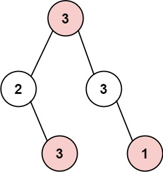
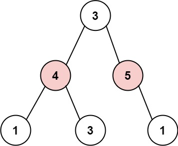

# 337. 打家劫舍 III

Medium · [力扣原题](https://leetcode.cn/problems/house-robber-iii/)

所在刷题路径：灵神题单·动态规划、灵神题单·链表树与回溯

| 作者 | 题解 | 动画讲解 |
|---|---|---|
| 灵茶山艾府 | [📄 题解](灵茶山艾府.md) | [▶︎ 0337 打家劫舍 III · 灵茶山艾府.mp4](0337%20打家劫舍%20III%20·%20灵茶山艾府.mp4) |
| yiduobo | [📄 题解](yiduobo.md) | [▶︎ 0337 打家劫舍 III · yiduobo.mp4](0337%20打家劫舍%20III%20·%20yiduobo.mp4) |

## 题目描述

小偷又发现了一个新的可行窃的地区。这个地区只有一个入口，我们称之为 `root` 。

除了 `root` 之外，每栋房子有且只有一个“父“房子与之相连。一番侦察之后，聪明的小偷意识到“这个地方的所有房屋的排列类似于一棵二叉树”。 如果 **两个直接相连的房子在同一天晚上被打劫** ，房屋将自动报警。

给定二叉树的 `root` 。返回 <em>**在不触动警报的情况下** ，小偷能够盗取的最高金额</em> 。

**示例 1:**



```

输入: root = [3,2,3,null,3,null,1]
输出: 7
解释: 小偷一晚能够盗取的最高金额 3 + 3 + 1 = 7
```

**示例 2:**



```

输入: root = [3,4,5,1,3,null,1]
输出: 9
解释: 小偷一晚能够盗取的最高金额 4 + 5 = 9
```

**提示：**

- 树的节点数在 `[1, 10⁴]` 范围内

- `0 <= Node.val <= 10⁴`

---
[↑ 返回 0300-0399](../README.md) · [总索引](../../../索引.md) · [仓库首页](../../../README.md)
