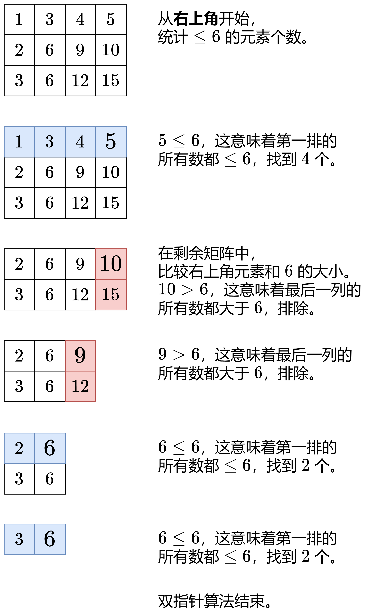

# 【图解】第 k 小/大问题的通用转化方法（Python/Java/C++/C/Go/JS/Rust）

> **[378. 有序矩阵中第 K 小的元素](https://leetcode.cn/problems/kth-smallest-element-in-a-sorted-matrix/solutions/3699846/tu-jie-di-k-xiao-da-wen-ti-de-tong-yong-teznd/) · Medium**

> **所属题单**
> - [二分算法 · 二、二分答案](../../../刷题路径/灵神原版题单/二分算法/二、二分答案.md) · §2.6 第 K 小/大
> - [常用数据结构 · 五、堆（优先队列）](../../../刷题路径/灵神原版题单/常用数据结构/五、堆（优先队列）.md) · §5.3 第 K 小/大

> **题目描述**
> 给你一个 `n x n` 矩阵 `matrix` ，其中每行和每列元素均按升序排序，找到矩阵中第 `k` 小的元素。
>
> 请注意，它是 **排序后** 的第 `k` 小元素，而不是第 `k` 个 **不同** 的元素。
>
> 你必须找到一个内存复杂度优于 `O(n²)` 的解决方案。
>
> **示例 1：**
>
> ```
>
> 输入：matrix = [[1,5,9],[10,11,13],[12,13,15]], k = 8
> 输出：13
> 解释：矩阵中的元素为 [1,5,9,10,11,12,13,13,15]，第 8 小元素是 13
> ```
>
> **示例 2：**
>
> ```
>
> 输入：matrix = [[-5]], k = 1
> 输出：-5
> ```
>
> **提示：**
>
> - `n == matrix.length`
>
> - `n == matrix[i].length`
>
> - `1 <= n <= 300`
>
> - `-10⁹ <= matrix[i][j] <= 10⁹`
>
> - 题目数据 **保证** `matrix` 中的所有行和列都按 **非递减顺序** 排列
>
> - `1 <= k <= n²`
>
> **进阶：**
>
> - 你能否用一个恒定的内存(即 `O(1)` 内存复杂度)来解决这个问题?
>
> - 你能在 `O(n)` 的时间复杂度下解决这个问题吗?这个方法对于面试来说可能太超前了，但是你会发现阅读这篇文章（ [this paper](http://www.cse.yorku.ca/~andy/pubs/X+Y.pdf) ）很有趣。

> **题解**
> 第 $k$ 小/大问题的**通用转化方法**：
>
> - 第 $k$ 小等价于：求最小的 $x$，满足 $\le x$ 的数**至少**有 $k$ 个。（注意是至少不是恰好）
> - 第 $k$ 大等价于：求最大的 $x$，满足 $\ge x$ 的数**至少**有 $k$ 个。
>
> $x$ 越大，越能找到 $k$ 个数；$x$ 越小，越不能找到 $k$ 个数。据此，可以**二分猜答案**。关于二分算法的原理，请看 [二分查找 红蓝染色法【基础算法精讲 04】](https://www.bilibili.com/video/BV1AP41137w7/)。
>
> 现在本题转化成一个判定性问题：
>
> - 给定整数 $\textit{mx}$，统计有序矩阵中 $\le \textit{mx}$ 的元素个数 $\textit{cnt}$，判断是否满足 $\textit{cnt}\ge k$。
>
> 如何高效统计 $\textit{cnt}$ 呢？
>
> 做法和 [240. 搜索二维矩阵 II](https://leetcode.cn/problems/search-a-2d-matrix-ii/) 是一样的，都可以用**双指针**实现：
>
> {:width=550}
>
> ## 细节
>
> 下面代码采用开区间二分，这仅仅是二分的一种写法，使用闭区间或者半闭半开区间都是可以的，喜欢哪种写法就用哪种。
>
> - 开区间左端点初始值：$\textit{matrix}[0][0]-1$。不存在比最小值还小的数，也就是有 $0$ 个数 $\le \textit{matrix}[0][0]-1$，由于 $0 < k$，所以无法满足要求。
> - 开区间右端点初始值：$\textit{matrix}[n-1][n-1]$。有 $n^2$ 个数 $\le \textit{matrix}[n-1][n-1]$，由于 $n^2\ge k$，所以一定满足要求。
>
> 对于开区间写法，简单来说 `check(mid) == true` 时更新的是谁，最后就返回谁。相比其他二分写法，开区间写法不需要思考加一减一等细节，更简单。推荐使用开区间写二分。
>
> ## 答疑
>
> **问**：为什么二分结束后，答案 $\textit{ans}$ 一定在矩阵中？
>
> **答**：反证法，假设 $\textit{ans}$ 不在矩阵中。二分结束后，我们知道矩阵中 $\le \textit{ans}$ 的数至少有 $k$ 个。如果 $\textit{ans}$ 不在矩阵中，那么 $\le \textit{ans}-1$ 的数至少有 $k$ 个，即 $\text{check}(\textit{ans}-1)=\texttt{true}$。但根据循环不变量，二分结束后 $\text{check}(\textit{ans}-1)=\texttt{false}$，矛盾。故原命题成立。
>
> ```python
> class Solution:
>     def kthSmallest(self, matrix: List[List[int]], k: int) -> int:
>         n = len(matrix)
>
>         def check(mx: int) -> bool:
>             cnt = 0  # matrix 中的 <= mx 的元素个数
>             i, j = 0, n - 1  # 从右上角开始
>             while i < n and j >= 0 and cnt < k:
>                 if matrix[i][j] > mx:
>                     j -= 1  # 排除第 j 列
>                 else:
>                     cnt += j + 1  # 从 matrix[i][0] 到 matrix[i][j] 都 <= mx
>                     i += 1
>             return cnt >= k
>
>         left, right = matrix[0][0] - 1, matrix[-1][-1]
>         while left + 1 < right:
>             mid = (left + right) // 2
>             if check(mid):
>                 right = mid
>             else:
>                 left = mid
>         return right
> ```
>
> > [!example]- Py3 库函数
> > ```python
> > class Solution:
> >     def kthSmallest(self, matrix: List[List[int]], k: int) -> int:
> >         n = len(matrix)
> >
> >         def check(mx: int) -> bool:
> >             cnt = 0  # matrix 中的 <= mx 的元素个数
> >             i, j = 0, n - 1  # 从右上角开始
> >             while i < n and j >= 0 and cnt < k:
> >                 if matrix[i][j] > mx:
> >                     j -= 1  # 排除第 j 列
> >                 else:
> >                     cnt += j + 1  # 从 matrix[i][0] 到 matrix[i][j] 都 <= mx
> >                     i += 1
> >             return cnt >= k
> >
> >         # 库函数是左闭右开区间
> >         left, right = matrix[0][0], matrix[-1][-1]
> >         return left + bisect_left(range(left, right), True, key=check)
> > ```
>
>
> #### 复杂度分析
>
> - 时间复杂度：$\mathcal{O}(n\log U)$，其中 $n$ 是 $\textit{matrix}$ 的行数和列数，$U=\textit{matrix}[n-1][n-1] - \textit{matrix}[0][0]$。二分 $\mathcal{O}(\log U)$ 次，每次需要跑一个 $\mathcal{O}(n)$ 的双指针。
> - 空间复杂度：$\mathcal{O}(1)$。
>
> ## 相似题目
>
> - [668. 乘法表中第 K 小的数](https://leetcode.cn/problems/kth-smallest-number-in-multiplication-table/)
> - [2040. 两个有序数组的第 K 小乘积](https://leetcode.cn/problems/kth-smallest-product-of-two-sorted-arrays/)
>
> 更多相似题目，见下面二分题单的「**§2.6 第 K 小/大**」。
>
> ## 分类题单
>
> [如何科学刷题？](https://leetcode.cn/circle/discuss/RvFUtj/)
>
> 1. [滑动窗口与双指针（定长/不定长/单序列/双序列/三指针/分组循环）](https://leetcode.cn/circle/discuss/0viNMK/)
> 2. [二分算法（二分答案/最小化最大值/最大化最小值/第K小）](https://leetcode.cn/circle/discuss/SqopEo/)
> 3. [单调栈（基础/矩形面积/贡献法/最小字典序）](https://leetcode.cn/circle/discuss/9oZFK9/)
> 4. [网格图（DFS/BFS/综合应用）](https://leetcode.cn/circle/discuss/YiXPXW/)
> 5. [位运算（基础/性质/拆位/试填/恒等式/思维）](https://leetcode.cn/circle/discuss/dHn9Vk/)
> 6. [图论算法（DFS/BFS/拓扑排序/基环树/最短路/最小生成树/网络流）](https://leetcode.cn/circle/discuss/01LUak/)
> 7. [动态规划（入门/背包/划分/状态机/区间/状压/数位/数据结构优化/树形/博弈/概率期望）](https://leetcode.cn/circle/discuss/tXLS3i/)
> 8. [常用数据结构（前缀和/差分/栈/队列/堆/字典树/并查集/树状数组/线段树）](https://leetcode.cn/circle/discuss/mOr1u6/)
> 9. [数学算法（数论/组合/概率期望/博弈/计算几何/随机算法）](https://leetcode.cn/circle/discuss/IYT3ss/)
> 10. [贪心与思维（基本贪心策略/反悔/区间/字典序/数学/思维/脑筋急转弯/构造）](https://leetcode.cn/circle/discuss/g6KTKL/)
> 11. [链表、二叉树与回溯（前后指针/快慢指针/DFS/BFS/直径/LCA/一般树）](https://leetcode.cn/circle/discuss/K0n2gO/)
> 12. [字符串（KMP/Z函数/Manacher/字符串哈希/AC自动机/后缀数组/子序列自动机）](https://leetcode.cn/circle/discuss/SJFwQI/)
>
> [我的题解精选（已分类）](https://github.com/EndlessCheng/codeforces-go/blob/master/leetcode/SOLUTIONS.md)
>
> 欢迎关注 [B站@灵茶山艾府](https://space.bilibili.com/206214)
