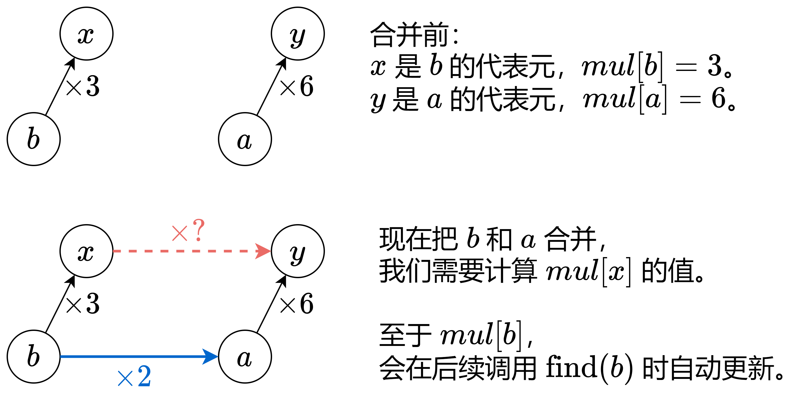

# 带权并查集（Python/Java/C++/Go/JS/Rust）

> **[399. 除法求值](https://leetcode.cn/problems/evaluate-division/solutions/3805496/dai-quan-bing-cha-ji-pythonjavacgojsrust-a4a1/) · Medium**

> **所属题单**
> - [常用数据结构 · 七、并查集](../../../刷题路径/灵神原版题单/常用数据结构/七、并查集.md) · §7.6 带权并查集（边权并查集）
> - [面试经典 150 题 · 图](../../../刷题路径/灵神原版题单/面试经典%20150%20题/图.md)

> **题目描述**
> 给你一个变量对数组 `equations` 和一个实数值数组 `values` 作为已知条件，其中 `equations[i] = [A_i, B_i]` 和 `values[i]` 共同表示等式 `A_i / B_i = values[i]` 。每个 `A_i` 或 `B_i` 是一个表示单个变量的字符串。
>
> 另有一些以数组 `queries` 表示的问题，其中 `queries[j] = [C_j, D_j]` 表示第 `j` 个问题，请你根据已知条件找出 `C_j / D_j = ?` 的结果作为答案。
>
> 返回 **所有问题的答案** 。如果存在某个无法确定的答案，则用 `-1.0` 替代这个答案。如果问题中出现了给定的已知条件中没有出现的字符串，也需要用 `-1.0` 替代这个答案。
>
> **注意：**输入总是有效的。你可以假设除法运算中不会出现除数为 0 的情况，且不存在任何矛盾的结果。
>
> **注意：**未在等式列表中出现的变量是未定义的，因此无法确定它们的答案。
>
> **示例 1：**
>
> ```
>
> 输入：equations = [["a","b"],["b","c"]], values = [2.0,3.0], queries = [["a","c"],["b","a"],["a","e"],["a","a"],["x","x"]]
> 输出：[6.00000,0.50000,-1.00000,1.00000,-1.00000]
> 解释：
> 条件：a / b = 2.0, b / c = 3.0
> 问题：a / c = ?, b / a = ?, a / e = ?, a / a = ?, x / x = ?
> 结果：[6.0, 0.5, -1.0, 1.0, -1.0 ]
> 注意：x 是未定义的 => -1.0
> ```
>
> **示例 2：**
>
> ```
>
> 输入：equations = [["a","b"],["b","c"],["bc","cd"]], values = [1.5,2.5,5.0], queries = [["a","c"],["c","b"],["bc","cd"],["cd","bc"]]
> 输出：[3.75000,0.40000,5.00000,0.20000]
> ```
>
> **示例 3：**
>
> ```
>
> 输入：equations = [["a","b"]], values = [0.5], queries = [["a","b"],["b","a"],["a","c"],["x","y"]]
> 输出：[0.50000,2.00000,-1.00000,-1.00000]
> ```
>
> **提示：**
>
> - `1 <= equations.length <= 20`
>
> - `equations[i].length == 2`
>
> - `1 <= A_i.length, B_i.length <= 5`
>
> - `values.length == equations.length`
>
> - `0.0 < values[i] <= 20.0`
>
> - `1 <= queries.length <= 20`
>
> - `queries[i].length == 2`
>
> - `1 <= C_j.length, D_j.length <= 5`
>
> - `A_i, B_i, C_j, D_j` 由小写英文字母与数字组成

> **题解**
> 已知条件是一些形如 $\dfrac{a}{b} = \textit{value}$ 的方程。
>
> 例如，已知 
>
> $$
> \dfrac{a}{b} = 3,\ \dfrac{b}{c} = 1,\ \dfrac{c}{d} = 4
> $$
>
> 这三个比值建立了 $a,b,c,d$ 的联系，我们可以算出其中任意两个量的比值，比如
>
> $$
> \dfrac{a}{d} = \dfrac{a}{b}\cdot \dfrac{b}{c}\cdot \dfrac{c}{d} = 3\times 1 \times 4 = 12
> $$
>
> 下面介绍并查集的方法，你需要先学会 [普通并查集](https://oi-wiki.org/ds/dsu/)。
>
> 定义 $\textit{mul}[x]$ 表示
>
> $$
> x \cdot \textit{mul}[x] = x\ 的代表元的值
> $$
>
> 如果 $c$ 和 $d$ 在同一个集合中，那么
>
> $$
> c\cdot \textit{mul}[c] = d\cdot \textit{mul}[d] = 代表元的值
> $$
>
> 得
>
> $$
> \dfrac{c}{d} = \dfrac{\textit{mul}[d]}{\textit{mul}[c]}
> $$
>
> 我们不需要知道代表元的值，也不需要知道每个元素的值，只需要知道每个元素与其代表元的**比值**，就能算出同一集合中任意两个元素的**比值**。比如昨天下了一个西湖的雨，今天下了两个西湖的雨，计算今天降水量与昨天降水量的比值，并不需要知道西湖有多少水。
>
> {:width=700px}
>
> 如上图，在已知 $\dfrac{x}{b} = 3$ 和 $\dfrac{y}{a} = 6$ 的情况下，新增信息 $\dfrac{a}{b} = 2$，我们需要计算 $x$ 到其代表元 $y$ 的 $\textit{mul}$ 值，即 $\dfrac{y}{x}$。
>
> 由于
>
> $$
> \dfrac{y}{b} = \dfrac{y}{x}\cdot \dfrac{x}{b} = \dfrac{y}{a}\cdot \dfrac{a}{b}
> $$
>
> 所以
>
> $$
> \textit{mul}[x] = \dfrac{y}{x} = \dfrac{\dfrac{y}{a}\cdot \dfrac{a}{b}}{\dfrac{x}{b}} = \dfrac{\textit{mul}[a]\cdot \textit{value}}{\textit{mul}[b]} = 4
> $$
>
> 计算 $x$ 到其代表元 $y$ 的 $\textit{mul}$ 值有什么用？
>
> 比如询问 $\dfrac{x}{a}$ 的值，就可以用前文得到的公式
>
> $$
> \dfrac{x}{a} = \dfrac{\textit{mul}[a]}{\textit{mul}[x]} = \dfrac{6}{4}
> $$
>
> 代码实现时，可以把字符串映射为从 $0$ 开始的编号，方便使用并查集。
>
> ```python
> class UnionFind:
>     def __init__(self, n: int):
>         # 一开始有 n 个集合 {0}, {1}, ..., {n-1}
>         # 集合 i 的代表元是自己，自己 * 1 = 自己
>         self.fa = list(range(n))  # 代表元
>         self.mul = [1.0] * n  # x 的值 * mul[x] = x 的代表元的值
>
>     # 返回 x 所在集合的代表元
>     # 同时做路径压缩，也就是把 x 所在集合中的所有元素的 fa 都改成代表元
>     def find(self, x: int) -> int:
>         fa = self.fa
>         if fa[x] != x:
>             root = self.find(fa[x])
>             self.mul[x] *= self.mul[fa[x]]  # 更新 x 到其代表元的 mul 值
>             fa[x] = root
>         return fa[x]
>
>     # 判断 x 和 y 是否在同一个集合
>     def same(self, x: int, y: int) -> bool:
>         # 如果 x 的代表元和 y 的代表元相同，那么 x 和 y 就在同一个集合
>         # 这就是代表元的作用：用来快速判断两个元素是否在同一个集合
>         return self.find(x) == self.find(y)
>
>     # 合并 from 和 to，新增信息 to / from = value
>     # 其中 to 和 from 表示未知量，下文的 x 和 y 也表示未知量
>     def merge(self, from_: int, to: int, value: float) -> None:
>         x, y = self.find(from_), self.find(to)
>         if x == y:  # from 和 to 在同一个集合，不做合并
>             return
>         #    x --------- y
>         #   /           /
>         # from ------- to
>         # 已知 x/from = mul[from] 和 y/to = mul[to]，现在合并 from 和 to，新增信息 to/from = value
>         # 由于 y/from = (y/x) * (x/from) = (y/to) * (to/from)
>         # 所以 y/x = (y/to) * (to/from) / (x/from) = mul[to] * value / mul[from]
>         self.mul[x] = self.mul[to] * value / self.mul[from_]
>         self.fa[x] = y
>
>
> class Solution:
>     def calcEquation(self, equations: List[List[str]], values: List[float], queries: List[List[str]]) -> List[float]:
>         # 把不同字符串映射为不同的数字，方便使用并查集
>         variable_to_id = {}
>         for equation in equations:
>             for s in equation:
>                 if s not in variable_to_id:
>                     variable_to_id[s] = len(variable_to_id)
>
>         # 初始化并查集
>         uf = UnionFind(len(variable_to_id))
>         for (a, b), value in zip(equations, values):
>             uf.merge(variable_to_id[b], variable_to_id[a], value)
>
>         # 回答询问
>         ans = []
>         for c, d in queries:
>             c = variable_to_id.get(c, -1)
>             d = variable_to_id.get(d, -1)
>             if c != -1 and d != -1 and uf.same(c, d):
>                 #    c * mul[c] = d * mul[d] = 代表元的值
>                 # => c / d = mul[d] / mul[c]
>                 ans.append(uf.mul[d] / uf.mul[c])
>             else:
>                 ans.append(-1.0)
>         return ans
> ```
>
>
> #### 复杂度分析
>
> - 时间复杂度：$\mathcal{O}(nL+qL + (n+q)\log n)$，其中 $n$ 是 $\textit{equations}$ 的长度，$q$ 是 $\textit{queries}$ 的长度，$L\le 5$ 是单个变量（字符串）的最大长度。这里为了实现方便，并查集只写了路径压缩，每次操作需要 $\mathcal{O}(\log n)$ 的时间。
> - 空间复杂度：$\mathcal{O}(nL)$。
>
> ## 专题训练
>
> 见下面数据结构题单的「**§7.6 带权并查集**」。
>
> ## 分类题单
>
> [如何科学刷题？](https://leetcode.cn/circle/discuss/RvFUtj/)
>
> 1. [滑动窗口与双指针（定长/不定长/单序列/双序列/三指针/分组循环）](https://leetcode.cn/circle/discuss/0viNMK/)
> 2. [二分算法（二分答案/最小化最大值/最大化最小值/第K小）](https://leetcode.cn/circle/discuss/SqopEo/)
> 3. [单调栈（基础/矩形面积/贡献法/最小字典序）](https://leetcode.cn/circle/discuss/9oZFK9/)
> 4. [网格图（DFS/BFS/综合应用）](https://leetcode.cn/circle/discuss/YiXPXW/)
> 5. [位运算（基础/性质/拆位/试填/恒等式/思维）](https://leetcode.cn/circle/discuss/dHn9Vk/)
> 6. [图论算法（DFS/BFS/拓扑排序/基环树/最短路/最小生成树/网络流）](https://leetcode.cn/circle/discuss/01LUak/)
> 7. [动态规划（入门/背包/划分/状态机/区间/状压/数位/数据结构优化/树形/博弈/概率期望）](https://leetcode.cn/circle/discuss/tXLS3i/)
> 8. [常用数据结构（前缀和/差分/栈/队列/堆/字典树/并查集/树状数组/线段树）](https://leetcode.cn/circle/discuss/mOr1u6/)
> 9. [数学算法（数论/组合/概率期望/博弈/计算几何/随机算法）](https://leetcode.cn/circle/discuss/IYT3ss/)
> 10. [贪心与思维（基本贪心策略/反悔/区间/字典序/数学/思维/脑筋急转弯/构造）](https://leetcode.cn/circle/discuss/g6KTKL/)
> 11. [链表、二叉树与回溯（前后指针/快慢指针/DFS/BFS/直径/LCA/一般树）](https://leetcode.cn/circle/discuss/K0n2gO/)
> 12. [字符串（KMP/Z函数/Manacher/字符串哈希/AC自动机/后缀数组/子序列自动机）](https://leetcode.cn/circle/discuss/SJFwQI/)
>
> [我的题解精选（已分类）](https://github.com/EndlessCheng/codeforces-go/blob/master/leetcode/SOLUTIONS.md)
>
> 欢迎关注 [B站@灵茶山艾府](https://space.bilibili.com/206214)
