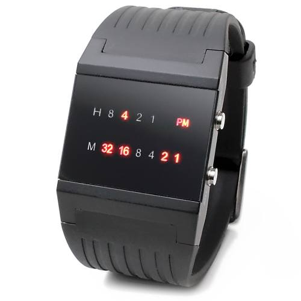

# 简单题，简单做（Python/Java/C++/Go）

> **[401. 二进制手表](https://leetcode.cn/problems/binary-watch/solutions/3903844/jian-dan-ti-jian-dan-zuo-pythonjavacgo-b-31zw/) · Easy**

> **题目描述**
> 二进制手表顶部有 4 个 LED 代表 **小时（0-11）**，底部的 6 个 LED 代表 **分钟（0-59）**。每个 LED 代表一个 0 或 1，最低位在右侧。
>
> - 例如，下面的二进制手表读取 `"4:51"` 。
>
> 
>
> 给你一个整数 `turnedOn` ，表示当前亮着的 LED 的数量，返回二进制手表可以表示的所有可能时间。你可以 **按任意顺序** 返回答案。
>
> 小时不会以零开头：
>
> - 例如，`"01:00"` 是无效的时间，正确的写法应该是 `"1:00"` 。
>
> 分钟必须由两位数组成，可能会以零开头：
>
> - 例如，`"10:2"` 是无效的时间，正确的写法应该是 `"10:02"` 。
>
> **示例 1：**
>
> ```
>
> 输入：turnedOn = 1
> 输出：["0:01","0:02","0:04","0:08","0:16","0:32","1:00","2:00","4:00","8:00"]
> ```
>
> **示例 2：**
>
> ```
>
> 输入：turnedOn = 9
> 输出：[]
> ```
>
> **提示：**
>
> - `0 <= turnedOn <= 10`

> **题解**
> 枚举小时 $h=0,1,2,\ldots,11$ 以及分钟 $m=0,1,2,\ldots,59$。如果 $h$ 二进制中的 $1$ 的个数加上 $m$ 二进制中的 $1$ 的个数恰好等于 $\textit{turnedOn}$，那么把 $h:m$ 添加到答案中。
>
> 注意如果 $m$ 是个位数，需要添加一个前导零。
>
> ```python
> class Solution:
>     def readBinaryWatch(self, turnedOn: int) -> List[str]:
>         ans = []
>         for h in range(12):
>             for m in range(60):
>                 if h.bit_count() + m.bit_count() == turnedOn:
>                     ans.append(f"{h}:{m:02d}")
>         return ans
> ```
>
>
> #### 复杂度分析
>
> - 时间复杂度：$\mathcal{O}(1)$。
> - 空间复杂度：$\mathcal{O}(1)$。
>
> ## 分类题单
>
> [如何科学刷题？](https://leetcode.cn/circle/discuss/RvFUtj/)
>
> 1. [滑动窗口与双指针（定长/不定长/单序列/双序列/三指针/分组循环）](https://leetcode.cn/circle/discuss/0viNMK/)
> 2. [二分算法（二分答案/最小化最大值/最大化最小值/第K小）](https://leetcode.cn/circle/discuss/SqopEo/)
> 3. [单调栈（基础/矩形面积/贡献法/最小字典序）](https://leetcode.cn/circle/discuss/9oZFK9/)
> 4. [网格图（DFS/BFS/综合应用）](https://leetcode.cn/circle/discuss/YiXPXW/)
> 5. [位运算（基础/性质/拆位/试填/恒等式/思维）](https://leetcode.cn/circle/discuss/dHn9Vk/)
> 6. [图论算法（DFS/BFS/拓扑排序/基环树/最短路/最小生成树/网络流）](https://leetcode.cn/circle/discuss/01LUak/)
> 7. [动态规划（入门/背包/划分/状态机/区间/状压/数位/数据结构优化/树形/博弈/概率期望）](https://leetcode.cn/circle/discuss/tXLS3i/)
> 8. [常用数据结构（前缀和/差分/栈/队列/堆/字典树/并查集/树状数组/线段树）](https://leetcode.cn/circle/discuss/mOr1u6/)
> 9. [数学算法（数论/组合/概率期望/博弈/计算几何/随机算法）](https://leetcode.cn/circle/discuss/IYT3ss/)
> 10. [贪心与思维（基本贪心策略/反悔/区间/字典序/数学/思维/脑筋急转弯/构造）](https://leetcode.cn/circle/discuss/g6KTKL/)
> 11. [链表、树与回溯（前后指针/快慢指针/DFS/BFS/直径/LCA）](https://leetcode.cn/circle/discuss/K0n2gO/)
> 12. [字符串（KMP/Z函数/Manacher/字符串哈希/AC自动机/后缀数组/子序列自动机）](https://leetcode.cn/circle/discuss/SJFwQI/)
>
> [我的题解精选（已分类）](https://github.com/EndlessCheng/codeforces-go/blob/master/leetcode/SOLUTIONS.md)
>
> 欢迎关注 [B站@灵茶山艾府](https://space.bilibili.com/206214)
