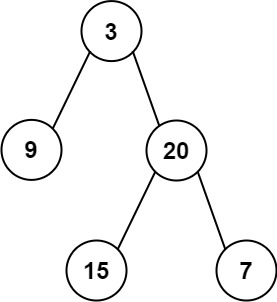

# 404. 左叶子之和

Easy · [力扣原题](https://leetcode.cn/problems/sum-of-left-leaves/)

所在刷题路径：灵神题单·链表树与回溯

| 作者 | 题解 | 动画讲解 |
|---|---|---|
| 灵茶山艾府 | [📄 题解](灵茶山艾府.md) | [▶︎ 0404 左叶子之和 · 灵茶山艾府.mp4](0404%20左叶子之和%20·%20灵茶山艾府.mp4) |
| yiduobo | [📄 题解](yiduobo.md) | [▶︎ 0404 左叶子之和 · yiduobo.mp4](0404%20左叶子之和%20·%20yiduobo.mp4) |

## 题目描述

给定二叉树的根节点 `root` ，返回所有左叶子之和。

**示例 1：**



```

输入: root = [3,9,20,null,null,15,7]
输出: 24
解释: 在这个二叉树中，有两个左叶子，分别是 9 和 15，所以返回 24
```

**示例 2:**

```

输入: root = [1]
输出: 0
```

**提示:**

- 节点数在 `[1, 1000]` 范围内

- `-1000 <= Node.val <= 1000`

---
[↑ 返回 0400-0499](../README.md) · [总索引](../../../索引.md) · [仓库首页](../../../README.md)
