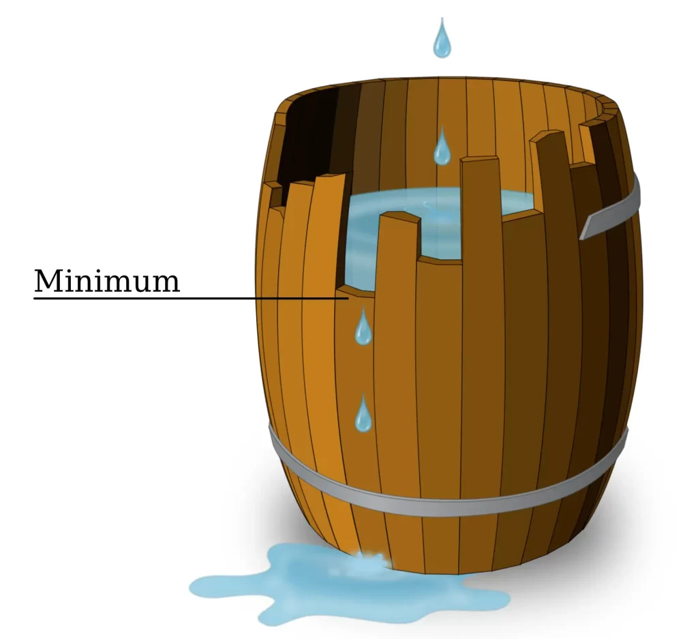

# 短板效应（Python/Java/C++/Go/JS/Rust）

> **[407. 接雨水 II](https://leetcode.cn/problems/trapping-rain-water-ii/solutions/2998212/duan-ban-xiao-ying-pythonjavacgojsrust-b-39mp/) · Hard**

> **所属题单**
> - [常用数据结构 · 五、堆（优先队列）](../../../刷题路径/灵神原版题单/常用数据结构/五、堆（优先队列）.md) · §5.2 进阶

> **题目描述**
> 给你一个 `m x n` 的矩阵，其中的值均为非负整数，代表二维高度图每个单元的高度，请计算图中形状最多能接多少体积的雨水。
>
> **示例 1:**
>
> 
>
> ```
>
> 输入: heightMap = [[1,4,3,1,3,2],[3,2,1,3,2,4],[2,3,3,2,3,1]]
> 输出: 4
> 解释: 下雨后，雨水将会被上图蓝色的方块中。总的接雨水量为1+2+1=4。
> ```
>
> **示例 2:**
>
> 
>
> ```
>
> 输入: heightMap = [[3,3,3,3,3],[3,2,2,2,3],[3,2,1,2,3],[3,2,2,2,3],[3,3,3,3,3]]
> 输出: 10
> ```
>
> **提示:**
>
> - `m == heightMap.length`
>
> - `n == heightMap[i].length`
>
> - `1 <= m, n <= 200`
>
> - `0 <= heightMap[i][j] <= 2 * 10⁴`

> **题解**
> **前置题目**：[42. 接雨水](https://leetcode.cn/problems/trapping-rain-water/)。建议先掌握那题的**双指针**写法，再来做本题。
>
> {:width=400}
>
> 哪个格子的接水量，在一开始就能确定？
>
> - 最外面一圈的格子是无法接水的。
> - 假设 $(0,1)$ 的高度是最外面一圈的格子中最小的，且高度等于 $5$，那么和它相邻的 $(1,1)$，我们能知道：
>     - $(1,1)$ 的水位不能超过 $5$，否则水会从 $(0,1)$ 流出去。
>     - $(1,1)$ 的水位一定可以等于 $5$，这是因为 $(0,1)$ 的高度是最外面一圈的格子中最小的，$(1,1)$ 的水不会从其他地方流出去。
>
> 我们从最外面一圈的格子开始。想象成一个木桶，最外面一圈格子的高度视作木板的高度。
>
> 接着上面的讨论：
>
> - 如果 $(1,1)$ 的高度 $\ge 5$，那么 $(0,1)$ 这块木板就没用了，我们去掉 $(0,1)$ 这块木板，改用 $(1,1)$ 这块木板。
> - 如果 $(1,1)$ 的高度 $< 5$，假设我们接的不是水，是**水泥**。那么把 $(1,1)$ 的高度填充为 $5$，仍然可以去掉 $(0,1)$ 这块木板，改用 $(1,1)$ 这块（填充水泥后）高为 $5$ 的~~木板~~水泥板。
>
> 继续，从当前木板中，找到一根最短的木板。假设 $(1,1)$ 是当前所有木板中最短的，那么其邻居 $(1,2)$ 和 $(2,1)$ 的水位就是 $(1,1)$ 的高度，因为超过 $(1,1)$ 高度的水会流出去。然后，去掉 $(1,1)$ 这块木板，改用 $(1,2)$ 和 $(2,1)$ 这两块木板。依此类推。
>
> 由于每次都要找最短的木板，所以用一个**最小堆**维护木板的高度。按照上述做法，不断循环，直到堆为空。
>
> > 为方便实现，代码在初始化堆的时候，直接遍历了整个矩阵。只遍历最外面一圈的写法可以参考 Python3 的写法二。
>
> ### 答疑
>
> **问**：这种思路和 [42. 接雨水](https://leetcode.cn/problems/trapping-rain-water/) 的双指针做法的联系是什么？
>
> **答**：42 那题只需要维护左右两个指针，本题相当于维护了“一圈”指针。42 那题每次取左右最小的指针，然后移动到相邻位置上；本题也是取最小的指针（出堆），往周围的邻居移动（入堆）。
>
> ```python
> class Solution:
>     def trapRainWater(self, heightMap: List[List[int]]) -> int:
>         m, n = len(heightMap), len(heightMap[0])
>         h = []
>         for i, row in enumerate(heightMap):
>             for j, height in enumerate(row):
>                 if i == 0 or i == m - 1 or j == 0 or j == n - 1:
>                     h.append((height, i, j))
>                     row[j] = -1  # 标记 (i,j) 访问过
>         heapify(h)
>
>         ans = 0
>         while h:
>             min_height, i, j = heappop(h)  # min_height 是木桶的短板
>             for x, y in (i, j - 1), (i, j + 1), (i - 1, j), (i + 1, j):
>                 if 0 <= x < m and 0 <= y < n and heightMap[x][y] >= 0:  # (x,y) 没有访问过
>                     # 如果 (x,y) 的高度小于 min_height，那么接水量为 min_height - heightMap[x][y]
>                     ans += max(min_height - heightMap[x][y], 0)
>                     # 给木桶新增一块高为 max(min_height, heightMap[x][y]) 的木板
>                     heappush(h, (max(min_height, heightMap[x][y]), x, y))
>                     heightMap[x][y] = -1  # 标记 (x,y) 访问过
>         return ans
> ```
>
> > [!example]- Python3 写法二
> > ```python
> > class Solution:
> >     def trapRainWater(self, heightMap: List[List[int]]) -> int:
> >         m, n = len(heightMap), len(heightMap[0])
> >         h = []
> >         for j in range(n):
> >             h.append((heightMap[0][j], 0, j))  # 上边
> >             h.append((heightMap[-1][j], m - 1, j))  # 下边
> >             heightMap[0][j] = heightMap[-1][j] = -1
> >         for i in range(1, m - 1):
> >             h.append((heightMap[i][0], i, 0))  # 左边
> >             h.append((heightMap[i][-1], i, n - 1))  # 右边
> >             heightMap[i][0] = heightMap[i][-1] = -1
> >         heapify(h)
> >
> >         ans = 0
> >         while h:
> >             min_height, i, j = heappop(h)  # min_height 是木桶的短板
> >             for x, y in (i, j - 1), (i, j + 1), (i - 1, j), (i + 1, j):
> >                 if 0 <= x < m and 0 <= y < n and heightMap[x][y] >= 0:  # (x,y) 没有访问过
> >                     # 如果 (x,y) 的高度小于 min_height，那么接水量为 min_height - heightMap[x][y]
> >                     ans += max(min_height - heightMap[x][y], 0)
> >                     # 给木桶新增一块高为 max(min_height, heightMap[x][y]) 的木板
> >                     heappush(h, (max(min_height, heightMap[x][y]), x, y))
> >                     heightMap[x][y] = -1  # 标记 (x,y) 访问过
> >         return ans
> > ```
>
>
> #### 复杂度分析
>
> - 时间复杂度：$\mathcal{O}(mn\log (mn))$，其中 $m$ 和 $n$ 分别为 $\textit{heightMap}$ 的行数和列数。每次出堆入堆需要 $\mathcal{O}(\log (mn))$ 的时间。
> - 空间复杂度：$\mathcal{O}(mn)$。
>
> ## 分类题单
>
> [如何科学刷题？](https://leetcode.cn/circle/discuss/RvFUtj/)
>
> 1. [滑动窗口与双指针（定长/不定长/单序列/双序列/三指针/分组循环）](https://leetcode.cn/circle/discuss/0viNMK/)
> 2. [二分算法（二分答案/最小化最大值/最大化最小值/第K小）](https://leetcode.cn/circle/discuss/SqopEo/)
> 3. [单调栈（基础/矩形面积/贡献法/最小字典序）](https://leetcode.cn/circle/discuss/9oZFK9/)
> 4. [网格图（DFS/BFS/综合应用）](https://leetcode.cn/circle/discuss/YiXPXW/)
> 5. [位运算（基础/性质/拆位/试填/恒等式/思维）](https://leetcode.cn/circle/discuss/dHn9Vk/)
> 6. [图论算法（DFS/BFS/拓扑排序/基环树/最短路/最小生成树/网络流）](https://leetcode.cn/circle/discuss/01LUak/)
> 7. [动态规划（入门/背包/划分/状态机/区间/状压/数位/数据结构优化/树形/博弈/概率期望）](https://leetcode.cn/circle/discuss/tXLS3i/)
> 8. [常用数据结构（前缀和/差分/栈/队列/堆/字典树/并查集/树状数组/线段树）](https://leetcode.cn/circle/discuss/mOr1u6/)
> 9. [数学算法（数论/组合/概率期望/博弈/计算几何/随机算法）](https://leetcode.cn/circle/discuss/IYT3ss/)
> 10. [贪心与思维（基本贪心策略/反悔/区间/字典序/数学/思维/脑筋急转弯/构造）](https://leetcode.cn/circle/discuss/g6KTKL/)
> 11. [链表、二叉树与回溯（前后指针/快慢指针/DFS/BFS/直径/LCA/一般树）](https://leetcode.cn/circle/discuss/K0n2gO/)
> 12. [字符串（KMP/Z函数/Manacher/字符串哈希/AC自动机/后缀数组/子序列自动机）](https://leetcode.cn/circle/discuss/SJFwQI/)
>
> [我的题解精选（已分类）](https://github.com/EndlessCheng/codeforces-go/blob/master/leetcode/SOLUTIONS.md)
>
> 欢迎关注 [B站@灵茶山艾府](https://space.bilibili.com/206214)
