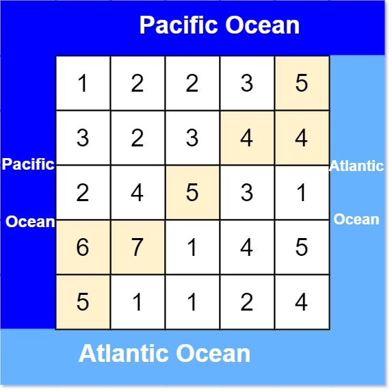

# 逆向思维（Python/Java/C++/C/Go/JS/Rust）

> **[417. 太平洋大西洋水流问题](https://leetcode.cn/problems/pacific-atlantic-water-flow/solutions/3798401/ni-xiang-si-wei-pythonjavaccgojsrust-by-zbz19/) · Medium · 难度分 1900**

> **所属题单**
> - [网格图 · 一、网格图 DFS](../../../刷题路径/灵神原版题单/网格图/一、网格图%20DFS.md)
> - [贪心算法 · 五、思维题](../../../刷题路径/灵神原版题单/贪心算法/五、思维题.md) · §5.4 逆向思维

> **题目描述**
> 有一个 `m × n` 的矩形岛屿，与 **太平洋** 和 **大西洋** 相邻。 **“太平洋”** 处于大陆的左边界和上边界，而 **“大西洋”** 处于大陆的右边界和下边界。
>
> 这个岛被分割成一个由若干方形单元格组成的网格。给定一个 `m x n` 的整数矩阵 `heights` ， `heights[r][c]` 表示坐标 `(r, c)` 上单元格 **高于海平面的高度** 。
>
> 岛上雨水较多，如果相邻单元格的高度 **小于或等于** 当前单元格的高度，雨水可以直接向北、南、东、西流向相邻单元格。水可以从海洋附近的任何单元格流入海洋。
>
> 返回网格坐标 `result` 的 **2D 列表** ，其中 `result[i] = [r_i, c_i]` 表示雨水从单元格 `(ri, ci)` 流动 **既可流向太平洋也可流向大西洋** 。
>
> **示例 1：**
>
> 
>
> ```
>
> 输入: heights = [[1,2,2,3,5],[3,2,3,4,4],[2,4,5,3,1],[6,7,1,4,5],[5,1,1,2,4]]
> 输出: [[0,4],[1,3],[1,4],[2,2],[3,0],[3,1],[4,0]]
> ```
>
> **示例 2：**
>
> ```
>
> 输入: heights = [[2,1],[1,2]]
> 输出: [[0,0],[0,1],[1,0],[1,1]]
> ```
>
> **提示：**
>
> - `m == heights.length`
>
> - `n == heights[r].length`
>
> - `1 <= m, n <= 200`
>
> - `0 <= heights[r][c] <= 10⁵`

> **题解**
> **核心想法**：本题起点（答案）不明确，但终点（边界）明确，所以从边界出发能方便地找到答案。
>
> {:width=400px}
>
> 什么是边界？$\textit{heights}$ 中的 $i=0$ 或者 $i=m-1$ 或者 $j=0$ 或者 $j=n-1$ 的格子。
>
> 什么是答案？既可流向太平洋也可流向大西洋的格子。
>
> 1. 对于可流向太平洋的格子，我们从上边界（$i=0$）和左边界（$j=0$）倒着**往高处走**，所有能访问到的格子，就是可以流向太平洋的格子。
> 2. 对于可流向大西洋的格子，我们从下边界（$i=m-1$）和右边界（$j=n-1$）倒着**往高处走**，所有能访问到的格子，就是可以流向大西洋的格子。
> 3. 计算这两类格子的**交集**，即为既可流向太平洋也可流向大西洋的格子。
>
> 关于网格图 DFS 的原理，见 [200. 岛屿数量](https://leetcode.cn/problems/number-of-islands/)，[我的题解](../../0200-0299/0200%20岛屿数量/灵茶山艾府.md)。
>
> ```python
> class Solution:
>     def pacificAtlantic(self, heights: List[List[int]]) -> List[List[int]]:
>         m, n = len(heights), len(heights[0])
>
>         def search(cells: List[Tuple[int, int]]) -> Set[Tuple[int, int]]:
>             def dfs(i: int, j: int) -> None:
>                 if (i, j) in vis:  # 避免重复访问，避免反复横跳无限递归
>                     return
>                 vis.add((i, j))  # 标记 (i,j) 已访问
>                 for x, y in (i, j - 1), (i, j + 1), (i - 1, j), (i + 1, j):  # 枚举相邻格子
>                     if 0 <= x < m and 0 <= y < n and heights[x][y] >= heights[i][j]:  # 往高处走
>                         dfs(x, y)
>
>             vis = set()
>             for i, j in cells:
>                 dfs(i, j)
>             return vis
>
>         pacific = [(0, j) for j in range(n)] + [(i, 0) for i in range(1, m)]
>         atlantic = [(m - 1, j) for j in range(n)] + [(i, n - 1) for i in range(m - 1)]
>         return list(search(pacific) & search(atlantic))  # 交集即为答案
> ```
>
>
> #### 复杂度分析
>
> - 时间复杂度：$\mathcal{O}(mn)$，其中 $m$ 和 $n$ 分别为 $\textit{heights}$ 的行数和列数。
> - 空间复杂度：$\mathcal{O}(mn)$。
>
> ## 专题训练
>
> 见下面网格图题单的「**一、网格图 DFS**」。
>
> ## 分类题单
>
> [如何科学刷题？](https://leetcode.cn/circle/discuss/RvFUtj/)
>
> 1. [滑动窗口与双指针（定长/不定长/单序列/双序列/三指针/分组循环）](https://leetcode.cn/circle/discuss/0viNMK/)
> 2. [二分算法（二分答案/最小化最大值/最大化最小值/第K小）](https://leetcode.cn/circle/discuss/SqopEo/)
> 3. [单调栈（基础/矩形面积/贡献法/最小字典序）](https://leetcode.cn/circle/discuss/9oZFK9/)
> 4. [网格图（DFS/BFS/综合应用）](https://leetcode.cn/circle/discuss/YiXPXW/)
> 5. [位运算（基础/性质/拆位/试填/恒等式/思维）](https://leetcode.cn/circle/discuss/dHn9Vk/)
> 6. [图论算法（DFS/BFS/拓扑排序/基环树/最短路/最小生成树/网络流）](https://leetcode.cn/circle/discuss/01LUak/)
> 7. [动态规划（入门/背包/划分/状态机/区间/状压/数位/数据结构优化/树形/博弈/概率期望）](https://leetcode.cn/circle/discuss/tXLS3i/)
> 8. [常用数据结构（前缀和/差分/栈/队列/堆/字典树/并查集/树状数组/线段树）](https://leetcode.cn/circle/discuss/mOr1u6/)
> 9. [数学算法（数论/组合/概率期望/博弈/计算几何/随机算法）](https://leetcode.cn/circle/discuss/IYT3ss/)
> 10. [贪心与思维（基本贪心策略/反悔/区间/字典序/数学/思维/脑筋急转弯/构造）](https://leetcode.cn/circle/discuss/g6KTKL/)
> 11. [链表、二叉树与回溯（前后指针/快慢指针/DFS/BFS/直径/LCA/一般树）](https://leetcode.cn/circle/discuss/K0n2gO/)
> 12. [字符串（KMP/Z函数/Manacher/字符串哈希/AC自动机/后缀数组/子序列自动机）](https://leetcode.cn/circle/discuss/SJFwQI/)
>
> [我的题解精选（已分类）](https://github.com/EndlessCheng/codeforces-go/blob/master/leetcode/SOLUTIONS.md)
>
> 欢迎关注 [B站@灵茶山艾府](https://space.bilibili.com/206214)
