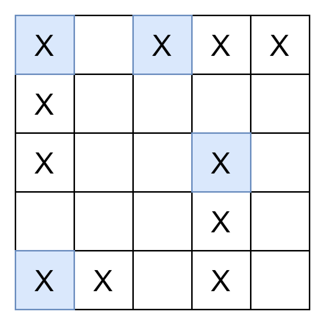

# 一次遍历，枚举战舰起点（Python/Java/C++/C/Go/JS/Rust）

> **[419. 棋盘上的战舰](https://leetcode.cn/problems/battleships-in-a-board/solutions/2807145/yi-ci-bian-li-mei-ju-zhan-jian-qi-dian-p-34o7/) · Medium**

> **题目描述**
> 给你一个大小为 `m x n` 的矩阵 `board` 表示棋盘，其中，每个单元格可以是一艘战舰 `'X'` 或者是一个空位 `'.'` ，返回在棋盘 `board` 上放置的 **舰队** 的数量。
>
> **舰队** 只能水平或者垂直放置在 `board` 上。换句话说，舰队只能按 `1 x k`（`1` 行，`k` 列）或 `k x 1`（`k` 行，`1` 列）的形状放置，其中 `k` 可以是任意大小。两个舰队之间至少有一个水平或垂直的空格分隔 （即没有相邻的舰队）。
>
> **示例 1：**
>
> 
>
> ```
>
> 输入：board = [["X",".",".","X"],[".",".",".","X"],[".",".",".","X"]]
> 输出：2
> ```
>
> **示例 2：**
>
> ```
>
> 输入：board = [["."]]
> 输出：0
> ```
>
> **提示：**
>
> - `m == board.length`
>
> - `n == board[i].length`
>
> - `1 <= m, n <= 200`
>
> - `board[i][j]` 是 `'.'` 或 `'X'`
>
> **进阶：**你可以实现一次扫描算法，并只使用 `O(1)` 额外空间，并且不修改 `board` 的值来解决这个问题吗？

> **题解**
> ## 题意
>
> 这题的标题应该是《棋盘上的战舰》，来源于 [海战棋](http://zh.battleship-game.org/)，把横着或竖着的**连续** X 看成一艘战舰，统计棋盘上有多少艘战舰。
>
> ## 思路
>
> 战舰的个数，等于战舰「头部」的个数。如下图，我们只需要统计蓝色 X 的个数，即为战舰的个数。
>
> 
>
> 具体来说，如果位于 $(i,j)$ 的格子是战舰的头部，那么左边和上边的相邻格子不能是 X，即：
>
> - 如果 $j>0$，那么 $(i,j-1)$ 不能是 X。
> - 如果 $i>0$，那么 $(i-1,j)$ 不能是 X。
>
> ```python
> class Solution:
>     def countBattleships(self, board: List[List[str]]) -> int:
>         ans = 0
>         for i, row in enumerate(board):
>             for j, c in enumerate(row):
>                 if c == 'X' and (j == 0 or row[j - 1] != 'X') and \
>                                 (i == 0 or board[i - 1][j] != 'X'):
>                     ans += 1
>         return ans
> ```
>
>
> #### 复杂度分析
>
> - 时间复杂度：$\mathcal{O}(mn)$，其中 $m$ 和 $n$ 分别为 $\textit{board}$ 的行数和列数。
> - 空间复杂度：$\mathcal{O}(1)$。
>
> ## 分类题单
>
> [如何科学刷题？](https://leetcode.cn/circle/discuss/RvFUtj/)
>
> 1. [滑动窗口（定长/不定长/多指针）](https://leetcode.cn/circle/discuss/0viNMK/)
> 2. [二分算法（二分答案/最小化最大值/最大化最小值/第K小）](https://leetcode.cn/circle/discuss/SqopEo/)
> 3. [单调栈（基础/矩形面积/贡献法/最小字典序）](https://leetcode.cn/circle/discuss/9oZFK9/)
> 4. [网格图（DFS/BFS/综合应用）](https://leetcode.cn/circle/discuss/YiXPXW/)
> 5. [位运算（基础/性质/拆位/试填/恒等式/思维）](https://leetcode.cn/circle/discuss/dHn9Vk/)
> 6. [图论算法（DFS/BFS/拓扑排序/最短路/最小生成树/二分图/基环树/欧拉路径）](https://leetcode.cn/circle/discuss/01LUak/)
> 7. [动态规划（入门/背包/状态机/划分/区间/状压/数位/数据结构优化/树形/博弈/概率期望）](https://leetcode.cn/circle/discuss/tXLS3i/)
> 8. [常用数据结构（前缀和/差分/栈/队列/堆/字典树/并查集/树状数组/线段树）](https://leetcode.cn/circle/discuss/mOr1u6/)
> 9. [数学算法（数论/组合/概率期望/博弈/计算几何/随机算法）](https://leetcode.cn/circle/discuss/IYT3ss/)
> 10. [贪心算法（基本贪心策略/反悔/区间/字典序/数学/思维/脑筋急转弯/构造）](https://leetcode.cn/circle/discuss/g6KTKL/)
>
> [我的题解精选（已分类）](https://github.com/EndlessCheng/codeforces-go/blob/master/leetcode/SOLUTIONS.md)
>
> 欢迎关注 [B站@灵茶山艾府](https://space.bilibili.com/206214)
