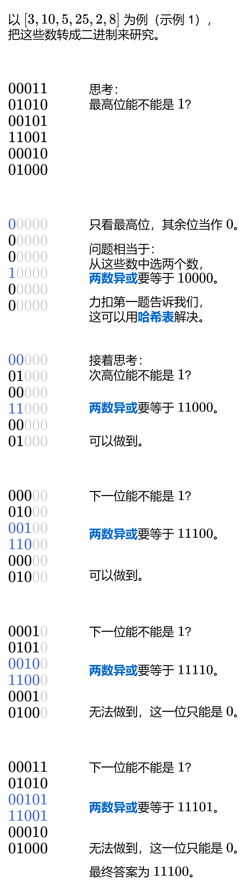

# 【图解】简洁高效，一图秒懂！（Python/Java/C++/Go/JS/Rust）

> **[421. 数组中两个数的最大异或值](https://leetcode.cn/problems/maximum-xor-of-two-numbers-in-an-array/solutions/2511644/tu-jie-jian-ji-gao-xiao-yi-tu-miao-dong-1427d/) · Medium · 难度分 2000**

> **所属题单**
> - [常用数据结构 · 六、字典树（trie）](../../../刷题路径/灵神原版题单/常用数据结构/六、字典树（trie）.md) · §6.4 0-1 字典树（异或字典树）
> - [位运算 · 五、试填法](../../../刷题路径/灵神原版题单/位运算/五、试填法.md)

> **题目描述**
> 给你一个整数数组 `nums` ，返回 `nums[i] XOR nums[j]` 的最大运算结果，其中 `0 ≤ i ≤ j < n` 。
>
> **示例 1：**
>
> ```
>
> 输入：nums = [3,10,5,25,2,8]
> 输出：28
> 解释：最大运算结果是 5 XOR 25 = 28.
> ```
>
> **示例 2：**
>
> ```
>
> 输入：nums = [14,70,53,83,49,91,36,80,92,51,66,70]
> 输出：127
> ```
>
> **提示：**
>
> - `1 <= nums.length <= 2 * 10⁵`
>
> - `0 <= nums[i] <= 2³¹ - 1`

> **题解**
> 
>
> ## 算法
>
> 1. 初始化答案 $\textit{ans}=0$。
> 2. 从最高位开始枚举 $i$，也就是 $\max(\textit{nums})$ 的二进制长度减一。
> 3. 设 $\textit{newAns} = \textit{ans} + 2^i$，看能否从 $\textit{nums}$ 中选两个数（低于 $i$ 的比特位当作 $0$），满足这两个数的异或和等于 $\textit{newAns}$。如果可以，则更新 $\textit{ans}$ 为 $\textit{newAns}$，否则 $\textit{ans}$ 保持不变。 
> 4. 判断【两数异或】的做法和力扣第一题【两数之和】是一样的，请看 [我的题解](../../0000-0099/0001%20两数之和/灵茶山艾府.md)。用 $\oplus$ 表示异或，如果 $a\oplus b = \textit{newAns}$，那么两边同时异或 $b$，由于 $b\oplus b = 0$，所以得到 $a = \textit{newAns} \oplus b$（相当于把两数之和代码中的减法改成异或）。这样就可以一边枚举 $b$，一边在哈希表中查找 $\textit{newAns} \oplus b$ 了。
>
> 请注意，$\textit{ans}$ **继承**了上一位算出的内容，后面比特位的计算不是只看当前位，之前算过的高位也得满足。
>
> ## 答疑
>
> **问**：如何理解代码中这些位运算的含义？
>
> **答**：关于位运算的技巧整理，请看 [从集合论到位运算，常见位运算技巧分类总结！](https://leetcode.cn/circle/discuss/CaOJ45/)
>
> **问**：为什么不能从二进制的最低位开始思考？
>
> **答**：如果从最低位开始枚举，可能高位的异或就只能是 $0$ 了，无法满足题目「最大」的要求。
>
> ```python
> class Solution:
>     def findMaximumXOR(self, nums: List[int]) -> int:
>         ans = mask = 0
>         high_bit = max(nums).bit_length() - 1
>         for i in range(high_bit, -1, -1):  # 从最高位开始枚举
>             mask |= 1 << i
>             new_ans = ans | (1 << i)  # 这个比特位可以是 1 吗？
>             seen = set()
>             for x in nums:
>                 x &= mask  # 低于 i 的比特位置为 0
>                 if new_ans ^ x in seen:
>                     ans = new_ans  # 这个比特位可以是 1
>                     break
>                 seen.add(x)
>         return ans
> ```
>
>
> #### 复杂度分析
>
> - 时间复杂度：$\mathcal{O}(n\log U)$，其中 $n$ 为 $\textit{nums}$ 的长度，$U=\max(\textit{nums})$。外层循环需要循环 $\mathcal{O}(\log U)$ 次。
> - 空间复杂度：$\mathcal{O}(n)$。哈希表中至多有 $n$ 个数。
>
> ## 分类题单
>
> [如何科学刷题？](https://leetcode.cn/circle/discuss/RvFUtj/)
>
> 1. [滑动窗口（定长/不定长/多指针）](https://leetcode.cn/circle/discuss/0viNMK/)
> 2. [二分算法（二分答案/最小化最大值/最大化最小值/第K小）](https://leetcode.cn/circle/discuss/SqopEo/)
> 3. [单调栈（基础/矩形面积/贡献法/最小字典序）](https://leetcode.cn/circle/discuss/9oZFK9/)
> 4. [网格图（DFS/BFS/综合应用）](https://leetcode.cn/circle/discuss/YiXPXW/)
> 5. [位运算（基础/性质/拆位/试填/恒等式/思维）](https://leetcode.cn/circle/discuss/dHn9Vk/)
> 6. [图论算法（DFS/BFS/拓扑排序/最短路/最小生成树/二分图/基环树/欧拉路径）](https://leetcode.cn/circle/discuss/01LUak/)
> 7. [动态规划（入门/背包/状态机/划分/区间/状压/数位/数据结构优化/树形/博弈/概率期望）](https://leetcode.cn/circle/discuss/tXLS3i/)
> 8. [常用数据结构（前缀和/差分/栈/队列/堆/字典树/并查集/树状数组/线段树）](https://leetcode.cn/circle/discuss/mOr1u6/)
> 9. [数学算法（数论/组合/概率期望/博弈/计算几何/随机算法）](https://leetcode.cn/circle/discuss/IYT3ss/)
> 10. [贪心算法（基本贪心策略/反悔/区间/字典序/数学/思维/脑筋急转弯/构造）](https://leetcode.cn/circle/discuss/g6KTKL/)
> 11. [链表、二叉树与一般树（前后指针/快慢指针/DFS/BFS/直径/LCA）](https://leetcode.cn/circle/discuss/K0n2gO/)
>
> [我的题解精选（已分类）](https://github.com/EndlessCheng/codeforces-go/blob/master/leetcode/SOLUTIONS.md)
>
> 欢迎关注 [B站@灵茶山艾府](https://space.bilibili.com/206214)
