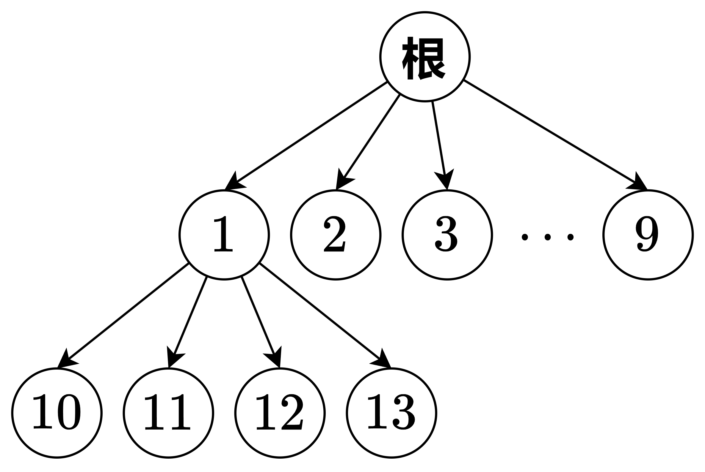

# 在十叉树上找第 k 小，O(log n) 数学优化（Python/Java/C++/C/Go/JS/Rust）

> **[440. 字典序的第K小数字](https://leetcode.cn/problems/k-th-smallest-in-lexicographical-order/solutions/3696254/zai-shi-cha-shu-shang-zhao-di-k-xiao-olo-vzkl/) · Hard**

> **所属题单**
> - [常用数据结构 · 六、字典树（trie）](../../../刷题路径/灵神原版题单/常用数据结构/六、字典树（trie）.md) · §6.2 进阶

> **题目描述**
> 给定整数 `n` 和 `k`，返回  `[1, n]` 中字典序第 `k` 小的数字。
>
> **示例 1:**
>
> ```
>
> 输入: n = 13, k = 2
> 输出: 10
> 解释: 字典序的排列是 [1, 10, 11, 12, 13, 2, 3, 4, 5, 6, 7, 8, 9]，所以第二小的数字是 10。
> ```
>
> **示例 2:**
>
> ```
>
> 输入: n = 1, k = 1
> 输出: 1
> ```
>
> **提示:**
>
> - `1 <= k <= n <= 10⁹`

> **题解**
> 理解 [字典树](../../0200-0299/0208%20实现%20Trie%20%28前缀树%29/灵茶山艾府.md) 的思想对本题有帮助。
>
> 本题可以看成一棵**十叉树**，示例 1 如下图：
>
> {:width=430}
>
> > **注**：根节点至多有 $9$ 个儿子，非根节点至多有 $10$ 个儿子。所以是十叉树。
>
> ## 核心思路
>
> 先序遍历这棵树，等价于从左到右遍历字典序列表。所以先序遍历访问到的第 $k$ 个节点就是答案。
>
> 每访问一个节点，就把 $k$ 减一。当 $k=0$ 时，当前节点就是答案。
>
> 从根节点的第一个儿子 $1$ 开始。由于该节点被我们访问了，先把 $k$ 减一。
>
> 设子树 $1$ 的大小（节点个数）为 $\textit{size}$。分类讨论：
>
> - 如果 $\textit{size}\le k$，那么答案不在子树 $1$ 中。然后考虑下一个儿子 $2$，依此类推。访问到下一个儿子时，要把 $k$ 减去 $(\textit{size}-1)+1 = \textit{size}$，这里 $\textit{size}-1$ 是因为节点 $1$ 已经访问过了。
> - 否则，答案在子树 $1$ 中。首先访问 $1$ 的儿子 $10$，把 $k$ 减一。依次考虑 $1$ 的儿子 $10,11,12,\ldots,19$，计算子树大小，比较子树大小与 $k$ 的大小关系，依此类推。
>
> **问**：为什么判断条件是 $\textit{size}\le k$ 而不是 $\textit{size}<k$？
>
> **答**：因为当我们访问到子树根节点时，就把 $k$ 减一了。这时再算子树大小，就把根节点重复统计了，所以是 $\textit{size}-1<k$，即 $\textit{size}\le k$。
>
> ## 如何计算子树大小
>
> 子树每层的节点个数是有规律的，可以**逐层统计**。
>
> 比如 $n=1234$，计算子树 $1$ 的大小：
>
> 1. 第一层，只有 $1$ 一个节点。
> 2. 第二层，最小是 $10$，最大是 $19$，有 $10$ 个节点。
> 3. 第三层，最小是 $100$，最大是 $199$，有 $100$ 个节点。
> 4. 第四层，最小是 $1000$，最大是 $n=1234$，有 $n-1000+1=235$ 个节点。
>
> 所以一共有 $1+10+100+235=346$ 个节点。
>
> 上述过程如何用代码实现？
>
> 每一层的最小值是好算的：$1\to 10\to 100\to 1000$。
>
> 最大值呢？看上去不太好算。
>
> 不妨改为 $2\to 20\to 200\to \min(2000,n+1)$，这个过程中的每个数减一，就是每一层的最大值。
>
> ## 优化前
>
> ```python
> class Solution:
>     def findKthNumber(self, n: int, k: int) -> int:
>         # 逐层统计 node 子树大小
>         def count_subtree_size(node: int) -> int:
>             size = 0
>             left, right = node, node + 1
>             while left <= n:
>                 # 这一层的最小值是 left，最大值是 min(right, n + 1) - 1
>                 size += min(right, n + 1) - left
>                 left *= 10  # 继续，计算下一层
>                 right *= 10
>             return size
>
>         node = 1
>         k -= 1  # 访问节点 node
>         while k > 0:
>             size = count_subtree_size(node)
>             if size <= k:  # 向右，跳过 node 子树
>                 node += 1  # 访问 node 右侧兄弟节点
>                 k -= size  # 访问子树中的每个节点，以及新的 node 节点
>             else:  # 向下，深入 node 子树
>                 node *= 10  # 访问 node 的第一个儿子
>                 k -= 1  # 访问新的 node 节点
>         return node
> ```
>
>
> #### 复杂度分析
>
> - 时间复杂度：$\mathcal{O}(D\log^2 n)$，其中 $D=10$。整棵树有 $\mathcal{O}(\log n)$ 层，每层会遍历至多 $D$ 个节点，每个节点需要 $\mathcal{O}(\log n)$ 的时间计算子树大小。
> - 空间复杂度：$\mathcal{O}(1)$。
>
> ## 优化
>
> 对于统计子树大小的算法，我举了一个 $n=1234$ 的例子，最终算出子树大小为 $1+10+100+235=346$。
>
> 这里面的 $1+10+100$ 是个等比数列之和，结果为 $11\cdots 1 = \dfrac{10^m-1}{9}$。其中 $m$ 为 $n$ 的十进制长度减去当前节点的深度（根节点的深度为 $0$）。注意我们一开始访问的是节点 $1$，不是根节点。
>
> 我们可以在访问节点的过程中，维护 $10^m$，这样只需要计算最后一层的节点个数。
>
> ```python
> class Solution:
>     def findKthNumber(self, n: int, k: int) -> int:
>         pow10 = 1  # 直接跳到子树 1 最后一层，left 和 right 需要乘以 pow10
>         x = n // 10
>         while x > 0:
>             pow10 = pow10 * 10
>             x //= 10
>
>         # 统计 node 子树大小，O(1)
>         def count_subtree_size(node: int) -> int:
>             size = (pow10 - 1) // 9  # 1+10+100+...
>             left, right = node * pow10, (node + 1) * pow10
>             if left <= n:
>                 size += min(right, n + 1) - left  # 余项
>             return size
>
>         node = 1
>         k -= 1  # 访问节点 node
>         while k > 0:
>             size = count_subtree_size(node)
>             if size <= k:  # 向右，跳过 node 子树
>                 node += 1  # 访问 node 右侧兄弟节点
>                 k -= size  # 访问子树中的每个节点，以及新的 node 节点
>             else:  # 向下，深入 node 子树
>                 pow10 //= 10  # 子树层数减一
>                 node *= 10  # 访问 node 的第一个儿子
>                 k -= 1  # 访问新的 node 节点
>         return node
> ```
>
>
> #### 复杂度分析
>
> - 时间复杂度：$\mathcal{O}(D\log n)$，其中 $D=10$。
> - 空间复杂度：$\mathcal{O}(1)$。
>
> ## 还能优化？
>
> 1. 可以在每一层二分，计算要从第几个儿子往下。时间复杂度 $\mathcal{O}(\log D \log n)$。
> 2. 解不等式，直接求出要从第几个儿子往下。时间复杂度 $\mathcal{O}(\log n)$。
>
> 留给感兴趣的读者思考。
>
> ## 分类题单
>
> [如何科学刷题？](https://leetcode.cn/circle/discuss/RvFUtj/)
>
> 1. [滑动窗口与双指针（定长/不定长/单序列/双序列/三指针/分组循环）](https://leetcode.cn/circle/discuss/0viNMK/)
> 2. [二分算法（二分答案/最小化最大值/最大化最小值/第K小）](https://leetcode.cn/circle/discuss/SqopEo/)
> 3. [单调栈（基础/矩形面积/贡献法/最小字典序）](https://leetcode.cn/circle/discuss/9oZFK9/)
> 4. [网格图（DFS/BFS/综合应用）](https://leetcode.cn/circle/discuss/YiXPXW/)
> 5. [位运算（基础/性质/拆位/试填/恒等式/思维）](https://leetcode.cn/circle/discuss/dHn9Vk/)
> 6. [图论算法（DFS/BFS/拓扑排序/基环树/最短路/最小生成树/网络流）](https://leetcode.cn/circle/discuss/01LUak/)
> 7. [动态规划（入门/背包/划分/状态机/区间/状压/数位/数据结构优化/树形/博弈/概率期望）](https://leetcode.cn/circle/discuss/tXLS3i/)
> 8. [常用数据结构（前缀和/差分/栈/队列/堆/字典树/并查集/树状数组/线段树）](https://leetcode.cn/circle/discuss/mOr1u6/)
> 9. [数学算法（数论/组合/概率期望/博弈/计算几何/随机算法）](https://leetcode.cn/circle/discuss/IYT3ss/)
> 10. [贪心与思维（基本贪心策略/反悔/区间/字典序/数学/思维/脑筋急转弯/构造）](https://leetcode.cn/circle/discuss/g6KTKL/)
> 11. [链表、二叉树与回溯（前后指针/快慢指针/DFS/BFS/直径/LCA/一般树）](https://leetcode.cn/circle/discuss/K0n2gO/)
> 12. [字符串（KMP/Z函数/Manacher/字符串哈希/AC自动机/后缀数组/子序列自动机）](https://leetcode.cn/circle/discuss/SJFwQI/)
>
> [我的题解精选（已分类）](https://github.com/EndlessCheng/codeforces-go/blob/master/leetcode/SOLUTIONS.md)
>
> 欢迎关注 [B站@灵茶山艾府](https://space.bilibili.com/206214)
