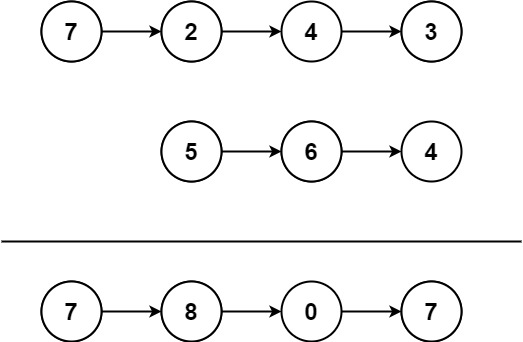

# 445. 两数相加 II

Medium · [力扣原题](https://leetcode.cn/problems/add-two-numbers-ii/)

所在刷题路径：labuladong、灵神题单·链表树与回溯

| 作者 | 题解 | 动画讲解 |
|---|---|---|
| 灵茶山艾府 | [📄 题解](灵茶山艾府.md) | [▶︎ 0445 两数相加 II · 灵茶山艾府.mp4](0445%20两数相加%20II%20·%20灵茶山艾府.mp4) |
| yiduobo | [📄 题解](yiduobo.md) | [▶︎ 0445 两数相加 II · yiduobo.mp4](0445%20两数相加%20II%20·%20yiduobo.mp4) |

## 题目描述

给你两个 **非空** 链表来代表两个非负整数。数字最高位位于链表开始位置。它们的每个节点只存储一位数字。将这两数相加会返回一个新的链表。

你可以假设除了数字 0 之外，这两个数字都不会以零开头。

**示例1：**



```

输入：l1 = [7,2,4,3], l2 = [5,6,4]
输出：[7,8,0,7]
```

**示例2：**

```

输入：l1 = [2,4,3], l2 = [5,6,4]
输出：[8,0,7]
```

**示例3：**

```

输入：l1 = [0], l2 = [0]
输出：[0]
```

**提示：**

- 链表的长度范围为` [1, 100]`

- `0 <= node.val <= 9`

- 输入数据保证链表代表的数字无前导 0

**进阶：**如果输入链表不能翻转该如何解决？

---
[↑ 返回 0400-0499](../README.md) · [总索引](../../../索引.md) · [仓库首页](../../../README.md)
