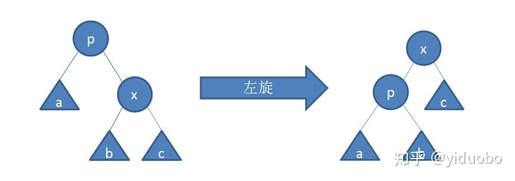
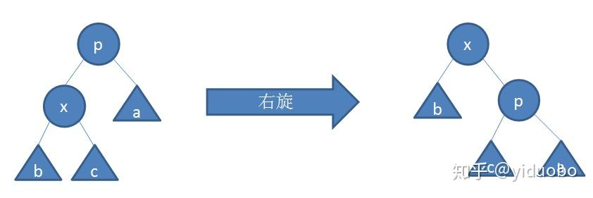

# 450. 删除二叉搜索树中的节点

> **[yiduobo的每日leetcode 450.删除二叉搜索树中的节点](https://zhuanlan.zhihu.com/p/211311857) · 知乎 · 2020-09-01 · 赞同 1**
> 力扣：[450. 删除二叉搜索树中的节点](https://leetcode.cn/problems/delete-node-in-a-bst/)

祖传的手艺不想丢了，所以按顺序写一个leetcode的题解。计划每日两题，争取不卡题吧

450.删除二叉搜索树中的节点<https://leetcode-cn.com/problems/delete-node-in-a-bst/>

对于二叉搜索树以及二叉平衡树而言，有一类的操作称之为左旋和右旋，如下图所示：





可以发现，上面两种旋转操作可以在不改变二叉搜索树节点大小顺序性质的同时，将圆形节点的父子关系调换。

那么现在对于题目删除节点的需求，可以将待删除节点与该节点的左孩子或者右孩子通过旋转操作进行调换，直到待删除节点变为一个叶子节点，最后直接将该节点删除。

最后附上python代码：

```python
# Definition for a binary tree node.
# class TreeNode(object):
#     def __init__(self, x):
#         self.val = x
#         self.left = None
#         self.right = None

class Solution(object):
    def deleteNode(self, root, key):
        """
        :type root: TreeNode
        :type key: int
        :rtype: TreeNode
        """

        p_head = TreeNode
        p_head.left = root

        now = root
        fa = p_head
        while now and now.val != key:
            fa = now
            if now.val > key:
                now = now.left
            else:
                now = now.right

        if not now:
            return p_head.left

        while now.left or now.right:
            if now.left:
                fa = self.rightRotate(now, fa)
            else:
                fa = self.leftRotate(now, fa)
        
        if fa.left == now:
            fa.left = None
        else:
            fa.right = None

        return p_head.left

    def leftRotate(self, now, fa):
        tmp = now.right
        if now == fa.left:
            fa.left = tmp
        else:
            fa.right = tmp

        now.right = tmp.left
        tmp.left = now
        return tmp

    def rightRotate(self, now, fa):
        tmp = now.left
        if now == fa.left:
            fa.left = tmp
        else:
            fa.right = tmp

        now.left = tmp.right
        tmp.right = now
        return tmp
```
