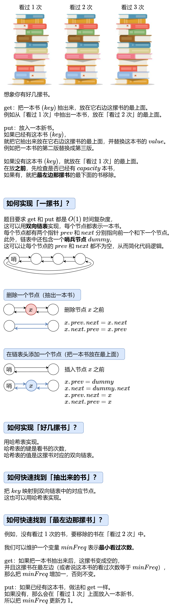

# 【图解】一张图秒懂 LFU！（Python/Java/C++/Go/JS/Rust）

> **[460. LFU 缓存](https://leetcode.cn/problems/lfu-cache/solutions/2457716/tu-jie-yi-zhang-tu-miao-dong-lfupythonja-f56h/) · Hard**

> **所属题单**
> - [常用数据结构 · 编程能力强化训练](../../../刷题路径/灵神原版题单/常用数据结构/编程能力强化训练.md) · Part B
> - [链表、二叉树与回溯 · 一、链表](../../../刷题路径/灵神原版题单/链表、二叉树与回溯/一、链表.md) · §1.10 综合应用

> **题目描述**
> 请你为 [最不经常使用（LFU）](https://baike.baidu.com/item/%E7%BC%93%E5%AD%98%E7%AE%97%E6%B3%95)缓存算法设计并实现数据结构。
>
> 实现 `LFUCache` 类：
>
> - `LFUCache(int capacity)` - 用数据结构的容量 `capacity` 初始化对象
>
> - `int get(int key)` - 如果键 `key` 存在于缓存中，则获取键的值，否则返回 `-1` 。
>
> - `void put(int key, int value)` - 如果键 `key` 已存在，则变更其值；如果键不存在，请插入键值对。当缓存达到其容量 `capacity` 时，则应该在插入新项之前，移除最不经常使用的项。在此问题中，当存在平局（即两个或更多个键具有相同使用频率）时，应该去除 **最久未使用** 的键。
>
> 为了确定最不常使用的键，可以为缓存中的每个键维护一个 **使用计数器** 。使用计数最小的键是最久未使用的键。
>
> 当一个键首次插入到缓存中时，它的使用计数器被设置为 `1` (由于 put 操作)。对缓存中的键执行 `get` 或 `put` 操作，使用计数器的值将会递增。
>
> 函数 `get` 和 `put` 必须以 `O(1)` 的平均时间复杂度运行。
>
> **示例：**
>
> ```
>
> 输入：
> ["LFUCache", "put", "put", "get", "put", "get", "get", "put", "get", "get", "get"]
> [[2], [1, 1], [2, 2], [1], [3, 3], [2], [3], [4, 4], [1], [3], [4]]
> 输出：
> [null, null, null, 1, null, -1, 3, null, -1, 3, 4]
>
> 解释：
> // cnt(x) = 键 x 的使用计数
> // cache=[] 将显示最后一次使用的顺序（最左边的元素是最近的）
> LFUCache lfu = new LFUCache(2);
> lfu.put(1, 1);   // cache=[1,_], cnt(1)=1
> lfu.put(2, 2);   // cache=[2,1], cnt(2)=1, cnt(1)=1
> lfu.get(1);      // 返回 1
>                  // cache=[1,2], cnt(2)=1, cnt(1)=2
> lfu.put(3, 3);   // 去除键 2 ，因为 cnt(2)=1 ，使用计数最小
>                  // cache=[3,1], cnt(3)=1, cnt(1)=2
> lfu.get(2);      // 返回 -1（未找到）
> lfu.get(3);      // 返回 3
>                  // cache=[3,1], cnt(3)=2, cnt(1)=2
> lfu.put(4, 4);   // 去除键 1 ，1 和 3 的 cnt 相同，但 1 最久未使用
>                  // cache=[4,3], cnt(4)=1, cnt(3)=2
> lfu.get(1);      // 返回 -1（未找到）
> lfu.get(3);      // 返回 3
>                  // cache=[3,4], cnt(4)=1, cnt(3)=3
> lfu.get(4);      // 返回 4
>                  // cache=[3,4], cnt(4)=2, cnt(3)=3
> ```
>
> **提示：**
>
> - `1 <= capacity <= 10⁴`
>
> - `0 <= key <= 10⁵`
>
> - `0 <= value <= 10⁹`
>
> - 最多调用 `2 * 10⁵` 次 `get` 和 `put` 方法

> **题解**
> 做本题前，推荐先完成 [146. LRU 缓存](https://leetcode.cn/problems/lru-cache/)，相当于本题的简单版本。[我的题解](../../0100-0199/0146%20LRU%20缓存/灵茶山艾府.md)。
>
> {:width=700px}
>
> #### 答疑
>
> **问**：一个双向链表需要几个哨兵节点？
>
> **答**：一个就够了。一开始哨兵节点 $\textit{dummy}$ 的 $\textit{prev}$ 和 $\textit{next}$ 都指向 $\textit{dummy}$。随着节点的插入，$\textit{dummy}$ 的 $\textit{next}$ 指向链表的第一个节点（最上面的书），$\textit{prev}$ 指向链表的最后一个节点（最下面的书）。
>
> **问**：为什么 $\textit{minFreq}$ 一定对应着最左边的非空的那摞书？
>
> **答**：在添加一本新书的情况下，这本新书一定是放在 $\textit{freq}=1$ 的那摞书上，此时我们把 $\textit{minFreq}$ 置为 $1$。在「抽出一本书且这摞书变成空」的情况下，我们会把这本书放到它右边这摞书的最上面。如果变成空的那摞书是最左边的，我们还会把 $\textit{minFreq}$ 加一。所以无论如何，$\textit{minFreq}$ 都会对应着最左边的非空的那摞书。
>
> **阅读建议**：先看写法二，理解核心思路；再看写法一，理解链表细节。
>
> ## 写法一：手写双向链表
>
> ```python
> class Node:
>     # 提高访问属性的速度，并节省内存
>     __slots__ = 'prev', 'next', 'key', 'value', 'freq'
>
>     def __init__(self, key=0, val=0):
>         self.key = key
>         self.value = val
>         self.freq = 1  #  新书只读了一次
>
> class LFUCache:
>     def __init__(self, capacity: int):
>         self.capacity = capacity
>         self.key_to_node = {}
>         def new_list() -> Node:
>             dummy = Node()  # 哨兵节点
>             dummy.prev = dummy
>             dummy.next = dummy
>             return dummy
>         self.freq_to_dummy = defaultdict(new_list)
>
>     def get_node(self, key: int) -> Optional[Node]:
>         if key not in self.key_to_node:  # 没有这本书
>             return None
>         node = self.key_to_node[key]  # 有这本书
>         self.remove(node)  # 把这本书抽出来
>         dummy = self.freq_to_dummy[node.freq]
>         if dummy.prev == dummy:  # 抽出来后，这摞书是空的
>             del self.freq_to_dummy[node.freq]  # 移除空链表
>             if self.min_freq == node.freq:  # 这摞书是最左边的
>                 self.min_freq += 1
>         node.freq += 1  # 看书次数 +1
>         self.push_front(self.freq_to_dummy[node.freq], node)  # 放在右边这摞书的最上面
>         return node
>
>     def get(self, key: int) -> int:
>         node = self.get_node(key)
>         return node.value if node else -1
>
>     def put(self, key: int, value: int) -> None:
>         node = self.get_node(key)
>         if node:  # 有这本书
>             node.value = value  # 更新 value
>             return
>         if len(self.key_to_node) == self.capacity:  # 书太多了
>             dummy = self.freq_to_dummy[self.min_freq]
>             back_node = dummy.prev  # 最左边那摞书的最下面的书
>             del self.key_to_node[back_node.key]
>             self.remove(back_node)  # 移除
>             if dummy.prev == dummy:  # 这摞书是空的
>                 del self.freq_to_dummy[self.min_freq]  # 移除空链表
>         self.key_to_node[key] = node = Node(key, value)  # 新书
>         self.push_front(self.freq_to_dummy[1], node)  # 放在「看过 1 次」的最上面
>         self.min_freq = 1
>
>     # 删除一个节点（抽出一本书）
>     def remove(self, x: Node) -> None:
>         x.prev.next = x.next
>         x.next.prev = x.prev
>
>     # 在链表头添加一个节点（把一本书放到最上面）
>     def push_front(self, dummy: Node, x: Node) -> None:
>         x.prev = dummy
>         x.next = dummy.next
>         x.prev.next = x
>         x.next.prev = x
> ```
>
>
> ## 写法二：标准库
>
> ```python
> # 为方便读者理解核心逻辑，该写法没有删除空字典，删除空字典的写法见【Python 写法二】
> class LFUCache:
>     def __init__(self, capacity: int):
>         self.capacity = capacity
>         self.key_to_value_and_freq = {}  # key -> [value, freq]
>         # from collections import OrderedDict
>         # OrderedDict = dict + 双向链表
>         self.freq_to_dict = defaultdict(OrderedDict)  # freq -> OrderedDict（只保存 key）
>
>     def get_list(self, key: int) -> Optional[List[int]]:
>         lst = self.key_to_value_and_freq.get(key, None)
>         if not lst:  # 没有这本书
>             return None
>         freq = lst[1]  # 获取这本书在第几摞
>         del self.freq_to_dict[freq][key]  # 把这本书抽出来
>         if not self.freq_to_dict[self.min_freq]:  # 最左边那摞书是空的
>             self.min_freq += 1
>         lst[1] += 1  # 看书次数 +1
>         self.freq_to_dict[freq + 1][key] = None
>         self.freq_to_dict[freq + 1].move_to_end(key, last=False)  # 放在右边这摞书的最上面
>         return lst
>
>     def get(self, key: int) -> int:
>         lst = self.get_list(key)
>         return lst[0] if lst else -1
>
>     def put(self, key: int, value: int) -> None:
>         lst = self.get_list(key)
>         if lst:  # 有这本书
>             lst[0] = value  # 更新 value
>             return
>         if len(self.key_to_value_and_freq) == self.capacity:  # 书太多了
>             # 移除最左边那摞书的最下面的书
>             k, _ = self.freq_to_dict[self.min_freq].popitem()
>             del self.key_to_value_and_freq[k]
>         self.key_to_value_and_freq[key] = [value, 1]  # 新书
>         self.freq_to_dict[1][key] = None
>         self.freq_to_dict[1].move_to_end(key, last=False)  # 放在「看过 1 次」的最上面
>         self.min_freq = 1
> ```
>
> > [!example]- Python3 写法二
> > ```python
> > class LFUCache:
> >     def __init__(self, capacity: int):
> >         self.capacity = capacity
> >         self.key_to_value_and_freq = {}  # key -> [value, freq]
> >         # from collections import OrderedDict
> >         # OrderedDict = dict + 双向链表
> >         self.freq_to_dict = defaultdict(OrderedDict)  # freq -> OrderedDict（只保存 key）
> >
> >     def get_list(self, key: int) -> Optional[List[int]]:
> >         lst = self.key_to_value_and_freq.get(key, None)
> >         if not lst:  # 没有这本书
> >             return None
> >         freq = lst[1]  # 获取这本书在第几摞
> >         del self.freq_to_dict[freq][key]  # 把这本书抽出来
> >         if not self.freq_to_dict[freq]:  # 抽出来后，这摞书是空的
> >             del self.freq_to_dict[freq]  # 移除空字典
> >             if self.min_freq == freq:  # 这摞书是最左边的
> >                 self.min_freq += 1
> >         lst[1] += 1  # 看书次数 +1
> >         self.freq_to_dict[freq + 1][key] = None
> >         self.freq_to_dict[freq + 1].move_to_end(key, last=False)  # 放在右边这摞书的最上面
> >         return lst
> >
> >     def get(self, key: int) -> int:
> >         lst = self.get_list(key)
> >         return lst[0] if lst else -1
> >
> >     def put(self, key: int, value: int) -> None:
> >         lst = self.get_list(key)
> >         if lst:  # 有这本书
> >             lst[0] = value  # 更新 value
> >             return
> >         if len(self.key_to_value_and_freq) == self.capacity:  # 书太多了
> >             # 移除最左边那摞书的最下面的书
> >             k, _ = self.freq_to_dict[self.min_freq].popitem()
> >             del self.key_to_value_and_freq[k]
> >             if not self.freq_to_dict[self.min_freq]:  # 移除后，这摞书是空的
> >                 del self.freq_to_dict[self.min_freq]  # 移除空字典
> >         self.key_to_value_and_freq[key] = [value, 1]  # 新书
> >         self.freq_to_dict[1][key] = None
> >         self.freq_to_dict[1].move_to_end(key, last=False)  # 放在「看过 1 次」的最上面
> >         self.min_freq = 1
> > ```
>
>
> #### 复杂度分析
>
> - 时间复杂度：所有操作均为 $\mathcal{O}(1)$。
> - 空间复杂度：$\mathcal{O}(\min(p, \textit{capacity}))$，其中 $p$ 为 $\text{put}$ 的调用次数。
>
> ## 相似题目
>
> 本题代码量大，如果您在做本题时遇到一些困难，可以先完成下面这些题目，再回过头来做本题。
>
> - [146. LRU 缓存](https://leetcode.cn/problems/lru-cache/)，[我的题解](../../0100-0199/0146%20LRU%20缓存/灵茶山艾府.md)
> - [895. 最大频率栈](https://leetcode.cn/problems/maximum-frequency-stack/)，[我的题解](../../0800-0899/0895%20最大频率栈/灵茶山艾府.md)
> - [1172. 餐盘栈](https://leetcode.cn/problems/dinner-plate-stacks/)，[我的题解](../../1100-1199/1172%20餐盘栈/灵茶山艾府.md)
>
> ## 分类题单
>
> [如何科学刷题？](https://leetcode.cn/discuss/post/3141566/ru-he-ke-xue-shua-ti-by-endlesscheng-q3yd/)
>
> 1. [滑动窗口与双指针（定长/不定长/单序列/双序列/三指针/分组循环）](https://leetcode.cn/discuss/post/3578981/ti-dan-hua-dong-chuang-kou-ding-chang-bu-rzz7/)
> 2. [二分算法（二分答案/最小化最大值/最大化最小值/第K小）](https://leetcode.cn/discuss/post/3579164/ti-dan-er-fen-suan-fa-er-fen-da-an-zui-x-3rqn/)
> 3. [单调栈（基础/矩形面积/贡献法/最小字典序）](https://leetcode.cn/discuss/post/3579480/ti-dan-dan-diao-zhan-ju-xing-xi-lie-zi-d-u4hk/)
> 4. [网格图（DFS/BFS/综合应用）](https://leetcode.cn/discuss/post/3580195/fen-xiang-gun-ti-dan-wang-ge-tu-dfsbfszo-l3pa/)
> 5. [位运算（基础/性质/拆位/试填/恒等式/思维）](https://leetcode.cn/discuss/post/3580371/fen-xiang-gun-ti-dan-wei-yun-suan-ji-chu-nth4/)
> 6. [图论算法（DFS/BFS/拓扑排序/基环树/最短路/最小生成树/网络流）](https://leetcode.cn/discuss/post/3581143/fen-xiang-gun-ti-dan-tu-lun-suan-fa-dfsb-qyux/)
> 7. [动态规划（入门/背包/划分/状态机/区间/状压/数位/数据结构优化/树形/博弈/概率期望）](https://leetcode.cn/discuss/post/3581838/fen-xiang-gun-ti-dan-dong-tai-gui-hua-ru-007o/)
> 8. [常用数据结构（前缀和/差分/栈/队列/堆/字典树/并查集/树状数组/线段树）](https://leetcode.cn/discuss/post/3583665/fen-xiang-gun-ti-dan-chang-yong-shu-ju-j-bvmv/)
> 9. [数学算法（数论/组合/概率期望/博弈/计算几何/随机算法）](https://leetcode.cn/discuss/post/3584388/fen-xiang-gun-ti-dan-shu-xue-suan-fa-shu-gcai/)
> 10. [贪心与思维（基本贪心策略/反悔/区间/字典序/数学/思维/脑筋急转弯/构造）](https://leetcode.cn/discuss/post/3091107/fen-xiang-gun-ti-dan-tan-xin-ji-ben-tan-k58yb/)
> 11. [链表、树与回溯（前后指针/快慢指针/DFS/BFS/直径/LCA）](https://leetcode.cn/discuss/post/3142882/fen-xiang-gun-ti-dan-lian-biao-er-cha-sh-6srp/)
> 12. [字符串（KMP/Z函数/Manacher/字符串哈希/AC自动机/后缀数组/子序列自动机）](https://leetcode.cn/discuss/post/3144832/fen-xiang-gun-ti-dan-zi-fu-chuan-kmpzhan-ugt4/)
>
> [我的题解精选（已分类）](https://github.com/EndlessCheng/codeforces-go/blob/master/leetcode/SOLUTIONS.md)
>
> 欢迎关注 [B站@灵茶山艾府](https://space.bilibili.com/206214)
