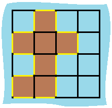

# 脑筋急转弯（Python/Java/C++/C/Go/JS/Rust）

> **[463. 岛屿的周长](https://leetcode.cn/problems/island-perimeter/solutions/3756201/nao-jin-ji-zhuan-wan-pythonjavaccgojsrus-met3/) · Easy**

> **所属题单**
> - [网格图 · 一、网格图 DFS](../../../刷题路径/灵神原版题单/网格图/一、网格图%20DFS.md)
> - [贪心算法 · 五、思维题](../../../刷题路径/灵神原版题单/贪心算法/五、思维题.md) · §5.2 脑筋急转弯

> **题目描述**
> 给定一个 `row x col` 的二维网格地图 `grid` ，其中：`grid[i][j] = 1` 表示陆地， `grid[i][j] = 0` 表示水域。
>
> 网格中的格子 **水平和垂直** 方向相连（对角线方向不相连）。整个网格被水完全包围，但其中恰好有一个岛屿（或者说，一个或多个表示陆地的格子相连组成的岛屿）。
>
> 岛屿中没有“湖”（“湖” 指水域在岛屿内部且不和岛屿周围的水相连）。格子是边长为 1 的正方形。网格为长方形，且宽度和高度均不超过 100 。计算这个岛屿的周长。
>
> **示例 1：**
>
> 
>
> ```
>
> 输入：grid = [[0,1,0,0],[1,1,1,0],[0,1,0,0],[1,1,0,0]]
> 输出：16
> 解释：它的周长是上面图片中的 16 个黄色的边
> ```
>
> **示例 2：**
>
> ```
>
> 输入：grid = [[1]]
> 输出：4
> ```
>
> **示例 3：**
>
> ```
>
> 输入：grid = [[1,0]]
> 输出：4
> ```
>
> **提示：**
>
> - `row == grid.length`
>
> - `col == grid[i].length`
>
> - `1 <= row, col <= 100`
>
> - `grid[i][j]` 为 `0` 或 `1`

> **题解**
> 做过 [200. 岛屿数量](https://leetcode.cn/problems/number-of-islands/) 的同学，可能看到题目会去思考 DFS 岛屿，统计周长的方法。
>
> 但实际上不需要这么麻烦。
>
> 
>
> 周长是什么？陆地边缘（上图黄线）的长度。
>
> 陆地是什么？$\textit{grid}[i][j]=1$ 的格子。
>
> 边缘怎么判定？看图，黄色的边的两侧，一边是陆地，另一边出界或者是水。我们可以枚举陆地格子上下左右四个方向的相邻格子，如果出界或者是水，那么就找到了一条黄色的边。
>
> > 注意题目保证没有内陆湖，我们统计的一定是岛屿的边缘。
>
> ```python
> class Solution:
>     def islandPerimeter(self, grid: List[List[int]]) -> int:
>         m, n = len(grid), len(grid[0])
>         ans = 0
>         for i, row in enumerate(grid):
>             for j, x in enumerate(row):
>                 if x == 0:
>                     continue
>                 if i == 0 or grid[i - 1][j] == 0:  # 上：出界或者是水
>                     ans += 1
>                 if i == m - 1 or grid[i + 1][j] == 0:  # 下：出界或者是水
>                     ans += 1
>                 if j == 0 or row[j - 1] == 0:  # 左：出界或者是水
>                     ans += 1
>                 if j == n - 1 or row[j + 1] == 0:  # 右：出界或者是水
>                     ans += 1
>         return ans
> ```
>
>
> #### 复杂度分析
>
> - 时间复杂度：$\mathcal{O}(mn)$，其中 $m$ 和 $n$ 分别为 $\textit{grid}$ 的行数和列数。
> - 空间复杂度：$\mathcal{O}(1)$。
>
> ## 分类题单
>
> [如何科学刷题？](https://leetcode.cn/circle/discuss/RvFUtj/)
>
> 1. [滑动窗口与双指针（定长/不定长/单序列/双序列/三指针/分组循环）](https://leetcode.cn/circle/discuss/0viNMK/)
> 2. [二分算法（二分答案/最小化最大值/最大化最小值/第K小）](https://leetcode.cn/circle/discuss/SqopEo/)
> 3. [单调栈（基础/矩形面积/贡献法/最小字典序）](https://leetcode.cn/circle/discuss/9oZFK9/)
> 4. [网格图（DFS/BFS/综合应用）](https://leetcode.cn/circle/discuss/YiXPXW/)
> 5. [位运算（基础/性质/拆位/试填/恒等式/思维）](https://leetcode.cn/circle/discuss/dHn9Vk/)
> 6. [图论算法（DFS/BFS/拓扑排序/基环树/最短路/最小生成树/网络流）](https://leetcode.cn/circle/discuss/01LUak/)
> 7. [动态规划（入门/背包/划分/状态机/区间/状压/数位/数据结构优化/树形/博弈/概率期望）](https://leetcode.cn/circle/discuss/tXLS3i/)
> 8. [常用数据结构（前缀和/差分/栈/队列/堆/字典树/并查集/树状数组/线段树）](https://leetcode.cn/circle/discuss/mOr1u6/)
> 9. [数学算法（数论/组合/概率期望/博弈/计算几何/随机算法）](https://leetcode.cn/circle/discuss/IYT3ss/)
> 10. [贪心与思维（基本贪心策略/反悔/区间/字典序/数学/思维/脑筋急转弯/构造）](https://leetcode.cn/circle/discuss/g6KTKL/)
> 11. [链表、二叉树与回溯（前后指针/快慢指针/DFS/BFS/直径/LCA/一般树）](https://leetcode.cn/circle/discuss/K0n2gO/)
> 12. [字符串（KMP/Z函数/Manacher/字符串哈希/AC自动机/后缀数组/子序列自动机）](https://leetcode.cn/circle/discuss/SJFwQI/)
>
> [我的题解精选（已分类）](https://github.com/EndlessCheng/codeforces-go/blob/master/leetcode/SOLUTIONS.md)
>
> 欢迎关注 [B站@灵茶山艾府](https://space.bilibili.com/206214)
