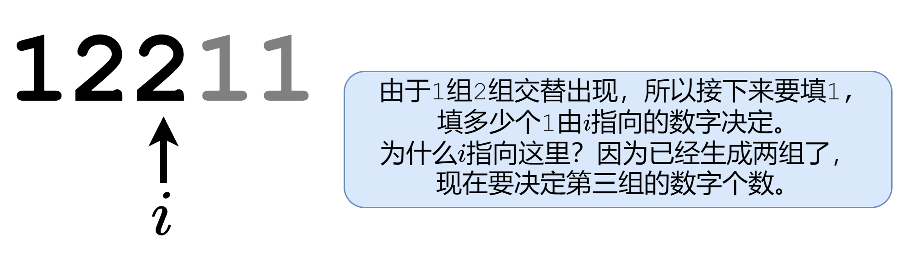
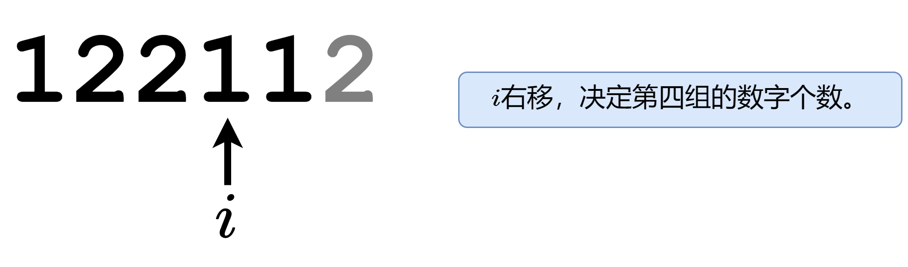
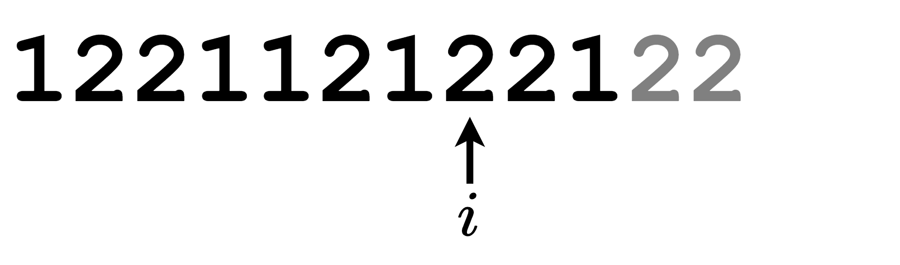
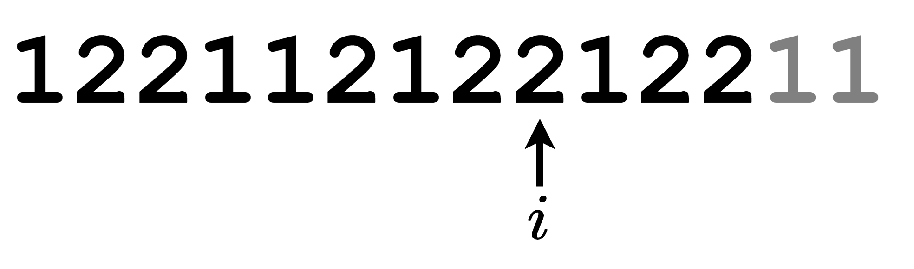

# 一个动画秒懂本题+简洁写法（Python/Java/C++/Go）

> **[481. 神奇字符串](https://leetcode.cn/problems/magical-string/solutions/1938214/by-endlesscheng-z8o1/) · Medium**

> **题目描述**
> 神奇字符串 `s` 仅由 `'1'` 和 `'2'` 组成，并需要遵守下面的规则：
>
> - 将连续相同字符组 `'1'` 和 `'2'` 长度的序列连接起来会生成字符串 `s` 本身。
>
> `s` 的前几个元素是 `s = "1221121221221121122……"` 。如果将 `s` 中连续的若干 `1` 和 `2` 进行分组，可以得到 `"1 22 11 2 1 22 1 22 11 2 11 22 ......"` 。每组中 `1` 或者 `2` 的出现次数分别是 `"1 2 2 1 1 2 1 2 2 1 2 2 ......"` 。上面的出现次数正是 `s` 自身。
>
> 给你一个整数 `n` ，返回在神奇字符串 `s` 的前 `n` 个数字中 `1` 的数目。
>
> **示例 1：**
>
> ```
>
> 输入：n = 6
> 输出：3
> 解释：神奇字符串 s 的前 6 个元素是 “122112”，它包含三个 1，因此返回 3 。
> ```
>
> **示例 2：**
>
> ```
>
> 输入：n = 1
> 输出：1
> ```
>
> **提示：**
>
> - `1 <= n <= 10⁵`

> **题解**
> 根据题意，我们可以把 $s$ 看成是由「$1$ 组」和「$2$ 组」交替组成的，重点在于每组内的数字是一个还是两个，这可以从 $s$ 自身上知道。
>
> 下面的 PPT 动画演示了从 $s$ 的前三位 $122$ 开始，构造 $s$ 的过程：
>
> <,,,,,,>
>
> 构造到 $s$ 的长度达到 $n$ 时停止。
>
> 注意最后一次构造可能会填入两个数，导致 $s$ 的长度为 $n+1$，因此最后统计 $1$ 的个数时，应统计 $s$ 的前 $n$ 个数，而不是整个 $s$。
>
> ```python
> class Solution:
>     def magicalString(self, n: int) -> int:
>         s = [1, 2, 2]
>         i = 2
>         while len(s) < n:
>             s += [s[-1] ^ 3] * s[i]  # 1^3=2, 2^3=1，这样就能在 1 和 2 之间转换
>             i += 1
>         return s[:n].count(1)
> ```
>
>
> 还可以直接构造出一个长度至少为 $10^5$ 的 $s$，并求出每个前缀中 $1$ 的个数，存到 $\textit{acc}$ 数组中，这样就不用每次都生成并统计了，直接返回 $\textit{acc}[n]$。
>
> ```python
> s = [1, 2, 2]
> i = 2
> while len(s) < 100000:
>     s += [s[-1] ^ 3] * s[i]  # 1^3=2, 2^3=1，这样就能在 1 和 2 之间转换
>     i += 1
> acc = list(accumulate((2 - c for c in s), initial=0))  # 2-1=1，2-2=0，这样就只统计了 1
>
> class Solution:
>     def magicalString(self, n: int) -> int:
>         return acc[n]
> ```
>
>
> #### 复杂度分析
>
> - 时间复杂度：$O(n)$。如果提前构造好 $\textit{acc}$ 数组，则时间复杂度为 $O(1)$。
> - 空间复杂度：$O(n)$。
>
> ---
>
> 欢迎关注我的B站频道：[灵茶山艾府](https://space.bilibili.com/206214)，每周更新算法讲解视频哦~
