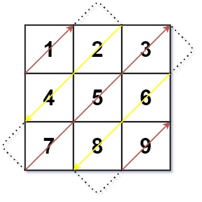

# 【模板】遍历对角线（Python/Java/C++/C/Go/JS/Rust）

> **[498. 对角线遍历](https://leetcode.cn/problems/diagonal-traverse/solutions/3762798/mo-ban-bian-li-dui-jiao-xian-pythonjavac-jnky/) · Medium**

> **所属题单**
> - [常用数据结构 · 零、常用枚举技巧](../../../刷题路径/灵神原版题单/常用数据结构/零、常用枚举技巧.md) · §0.3 遍历对角线

> **题目描述**
> 给你一个大小为 `m x n` 的矩阵 `mat` ，请以对角线遍历的顺序，用一个数组返回这个矩阵中的所有元素。
>
> **示例 1：**
>
> 
>
> ```
>
> 输入：mat = [[1,2,3],[4,5,6],[7,8,9]]
> 输出：[1,2,4,7,5,3,6,8,9]
> ```
>
> **示例 2：**
>
> ```
>
> 输入：mat = [[1,2],[3,4]]
> 输出：[1,2,3,4]
> ```
>
> **提示：**
>
> - `m == mat.length`
>
> - `n == mat[i].length`
>
> - `1 <= m, n <= 10⁴`
>
> - `1 <= m * n <= 10⁴`
>
> - `-10⁵ <= mat[i][j] <= 10⁵`

> **题解**
> 
>
> 对于每条对角线，行号 $i$ 加列号 $j$ 是一个定值。示例 1 正中间对角线的 $i+j$ 恒为 $2$。（可以回想一下 [51. N 皇后](https://leetcode.cn/problems/n-queens/) 的写法）
>
> 设 $k=i+j$，那么左上角那条对角线的 $k=0$，右下角那条对角线的 $k= (m-1)+(n-1) = m+n-2$。
>
> 枚举 $k=0,1,2,\dots,m+n-2$，就相当于在从左上到右下，**一条一条地枚举对角线**。
>
> 由于 $i+j=k$，知道 $j$ 就知道 $i$，所以我们只需要计算出每条对角线的 $j$ 的**最小值**和**最大值**，就可以开始遍历对角线了。
>
> - 由于 $j=k-i$，当 $i=m-1$ 时 $j$ 取到最小值 $k-m+1$，但这个数不能是负数，所以最小的 $j$ 是 $\max(k-m+1,0)$。
> - 由于 $j=k-i$，当 $i=0$ 时 $j$ 取到最大值 $k$，但这个数不能超过 $n-1$，所以最大的 $j$ 是 $\min(k, n - 1)$。
>
> 然后就可以**模拟**了：
>
> 1. 枚举 $k=0,1,2,\dots,m+n-2$。
> 2. 如果 $k$ 是偶数，我们从小到大枚举 $j$，否则从大到小枚举 $j$。其中 $j$ 的范围是 $[\max(k-m+1,0),\min(k, n - 1)]$。
> 3. 把 $\textit{mat}[k-j][j]$ 加入答案。
>
> ```python
> class Solution:
>     def findDiagonalOrder(self, mat: List[List[int]]) -> List[int]:
>         m, n = len(mat), len(mat[0])
>         ans = []
>         for k in range(m + n - 1):
>             min_j = max(k - m + 1, 0)
>             max_j = min(k, n - 1)
>             if k % 2 == 0:  # 偶数从左到右
>                 for j in range(min_j, max_j + 1):
>                     ans.append(mat[k - j][j])
>             else:  # 奇数从右到左
>                 for j in range(max_j, min_j - 1, -1):
>                     ans.append(mat[k - j][j])
>         return ans
> ```
>
>
> #### 复杂度分析
>
> - 时间复杂度：$\mathcal{O}(mn)$，其中 $m$ 和 $n$ 分别为 $\textit{grid}$ 的行数和列数。
> - 空间复杂度：$\mathcal{O}(1)$。返回值不计入。
>
> ## 相似题目
>
> - [3446. 按对角线进行矩阵排序](https://leetcode.cn/problems/sort-matrix-by-diagonals/) 1373
> - [2711. 对角线上不同值的数量差](https://leetcode.cn/problems/difference-of-number-of-distinct-values-on-diagonals/) 1429
> - [1329. 将矩阵按对角线排序](https://leetcode.cn/problems/sort-the-matrix-diagonally/) 1548
> - [562. 矩阵中最长的连续1线段](https://leetcode.cn/problems/longest-line-of-consecutive-one-in-matrix/)（会员题）
>
> ## 分类题单
>
> [如何科学刷题？](https://leetcode.cn/circle/discuss/RvFUtj/)
>
> 1. [滑动窗口与双指针（定长/不定长/单序列/双序列/三指针/分组循环）](https://leetcode.cn/circle/discuss/0viNMK/)
> 2. [二分算法（二分答案/最小化最大值/最大化最小值/第K小）](https://leetcode.cn/circle/discuss/SqopEo/)
> 3. [单调栈（基础/矩形面积/贡献法/最小字典序）](https://leetcode.cn/circle/discuss/9oZFK9/)
> 4. [网格图（DFS/BFS/综合应用）](https://leetcode.cn/circle/discuss/YiXPXW/)
> 5. [位运算（基础/性质/拆位/试填/恒等式/思维）](https://leetcode.cn/circle/discuss/dHn9Vk/)
> 6. [图论算法（DFS/BFS/拓扑排序/基环树/最短路/最小生成树/网络流）](https://leetcode.cn/circle/discuss/01LUak/)
> 7. [动态规划（入门/背包/划分/状态机/区间/状压/数位/数据结构优化/树形/博弈/概率期望）](https://leetcode.cn/circle/discuss/tXLS3i/)
> 8. [常用数据结构（前缀和/差分/栈/队列/堆/字典树/并查集/树状数组/线段树）](https://leetcode.cn/circle/discuss/mOr1u6/)
> 9. [数学算法（数论/组合/概率期望/博弈/计算几何/随机算法）](https://leetcode.cn/circle/discuss/IYT3ss/)
> 10. [贪心与思维（基本贪心策略/反悔/区间/字典序/数学/思维/脑筋急转弯/构造）](https://leetcode.cn/circle/discuss/g6KTKL/)
> 11. [链表、二叉树与回溯（前后指针/快慢指针/DFS/BFS/直径/LCA/一般树）](https://leetcode.cn/circle/discuss/K0n2gO/)
> 12. [字符串（KMP/Z函数/Manacher/字符串哈希/AC自动机/后缀数组/子序列自动机）](https://leetcode.cn/circle/discuss/SJFwQI/)
>
> [我的题解精选（已分类）](https://github.com/EndlessCheng/codeforces-go/blob/master/leetcode/SOLUTIONS.md)
>
> 欢迎关注 [B站@灵茶山艾府](https://space.bilibili.com/206214)
