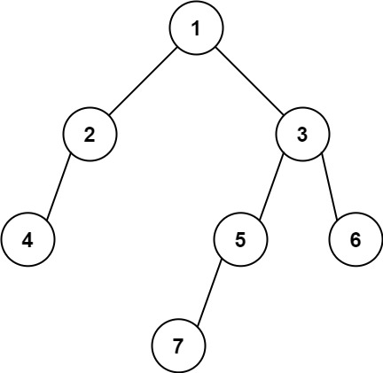

# 513. 找树左下角的值

Medium · [力扣原题](https://leetcode.cn/problems/find-bottom-left-tree-value/)

所在刷题路径：灵神题单·链表树与回溯

| 作者 | 题解 | 动画讲解 |
|---|---|---|
| 灵茶山艾府 | [📄 题解](灵茶山艾府.md) | [▶︎ 0513 找树左下角的值 · 灵茶山艾府.mp4](0513%20找树左下角的值%20·%20灵茶山艾府.mp4) |
| yiduobo | [📄 题解](yiduobo.md) | [▶︎ 0513 找树左下角的值 · yiduobo.mp4](0513%20找树左下角的值%20·%20yiduobo.mp4) |

## 题目描述

给定一个二叉树的 **根节点** `root`。

请找出该二叉树的 **最底层 最左边** 节点的值。

**示例 1:**


```

输入：root = [2,1,3]
输出：1
解释：最后一行是 [1, 3]，因此最左边的值是 1。
```

**示例 2:**



```

输入：[1,2,3,4,null,5,6,null,null,7]
输出：7
解释：最后一层只有节点 7。
```

**提示:**

- 二叉树的节点个数的范围是 `[1, 10⁴]`

- `-2³¹ <= Node.val <= 2³¹ - 1`

---
[↑ 返回 0500-0599](../README.md) · [总索引](../../../索引.md) · [仓库首页](../../../README.md)
