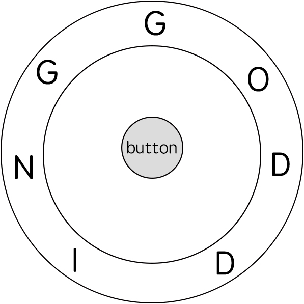

# 两种 O(nm) 做法：DP / BFS（Python/Java/C++/Go）

> **[514. 自由之路](https://leetcode.cn/problems/freedom-trail/solutions/2623534/onm-zuo-fa-cong-ji-yi-hua-sou-suo-dao-di-dnec/) · Hard · 难度分 2400**

> **所属题单**
> - [动态规划 · 七、其他线性 DP](../../../刷题路径/灵神原版题单/动态规划/七、其他线性%20DP.md) · §7.6 多维 DP
> - [图论算法 · 一、图的遍历](../../../刷题路径/灵神原版题单/图论算法/一、图的遍历.md) · §1.3 图论建模 + BFS 最短路
> - [字符串 · 九、子序列自动机](../../../刷题路径/灵神原版题单/字符串/九、子序列自动机.md)

> **题目描述**
> 电子游戏“辐射4”中，任务 **“通向自由”** 要求玩家到达名为 “**Freedom Trail Ring”** 的金属表盘，并使用表盘拼写特定关键词才能开门。
>
> 给定一个字符串 `ring` ，表示刻在外环上的编码；给定另一个字符串 `key` ，表示需要拼写的关键词。您需要算出能够拼写关键词中所有字符的**最少**步数。
>
> 最初，**ring** 的第一个字符与 `12:00` 方向对齐。您需要顺时针或逆时针旋转 `ring` 以使 **key** 的一个字符在 `12:00` 方向对齐，然后按下中心按钮，以此逐个拼写完 **`key`** 中的所有字符。
>
> 旋转 `ring` 拼出 key 字符 `key[i]` 的阶段中：
>
> 1. 您可以将 **ring** 顺时针或逆时针旋转 **一个位置** ，计为1步。旋转的最终目的是将字符串 **`ring`** 的一个字符与 `12:00` 方向对齐，并且这个字符必须等于字符 **`key[i]` 。**
>
> 2. 如果字符 **`key[i]`** 已经对齐到12:00方向，您需要按下中心按钮进行拼写，这也将算作 **1 步**。按完之后，您可以开始拼写 **key** 的下一个字符（下一阶段）, 直至完成所有拼写。
>
> **示例 1：**
>
> 
>
> ```
>
> 输入: ring = "godding", key = "gd"
> 输出: 4
> 解释:
>  对于 key 的第一个字符 'g'，已经在正确的位置, 我们只需要1步来拼写这个字符。
>  对于 key 的第二个字符 'd'，我们需要逆时针旋转 ring "godding" 2步使它变成 "ddinggo"。
>  当然, 我们还需要1步进行拼写。
>  因此最终的输出是 4。
> ```
>
> **示例 2:**
>
> ```
>
> 输入: ring = "godding", key = "godding"
> 输出: 13
> ```
>
> **提示：**
>
> - `1 <= ring.length, key.length <= 100`
>
> - `ring` 和 `key` 只包含小写英文字母
>
> - **保证** 字符串 `key` 一定可以由字符串  `ring` 旋转拼出

> **题解**
> ## 前置知识
>
> 请看视频讲解 [动态规划入门：从记忆化搜索到递推](https://www.bilibili.com/video/BV1Xj411K7oF/)，其中包含如何把记忆化搜索 1:1 翻译成递推的技巧。
>
> ## 一、启发思考：寻找子问题
>
> 为方便描述，下文把 $\textit{ring}$ 记作 $s$，把 $\textit{key}$ 记作 $t$。设 $s$ 的长度为 $n$，$t$ 的长度为 $m$。
>
> 我们可以只计算最小旋转次数，最后加上 $m$，即为答案。
>
> 举例说明，假设 $s=\texttt{goddid},\ t=\texttt{gdi}$。
>
> 一开始 12:00 方向为 $s[0]$，由于 $s[0]=t[0]$，无需旋转，问题变成 $s=\texttt{goddid},\ t=\texttt{di}$ 且 12:00 方向为 $s[0]$ 状态下的最小旋转次数。
>
> 现在要旋转到 $s[i]=\texttt{d}$ 上，分类讨论：
>
> - 旋转到 $s[0]=\texttt{g}$ **右边最近**的 $s[2]=\texttt{d}$ 上，需要旋转 $2$ 次。现在问题变成 $s=\texttt{goddid},\ t=\texttt{i}$ 且 12:00 方向为 $s[2]$ 状态下的最小旋转次数。
> - 旋转到 $s[0]=\texttt{g}$ **左边最近**的 $s[5]=\texttt{d}$ 上，需要旋转 $1$ 次。注意 $s$ 是环形的，$s[0]$ 左边是 $s[n-1]$。现在问题变成 $s=\texttt{goddid},\ t=\texttt{i}$ 且 12:00 方向为 $s[5]$ 状态下的最小旋转次数。
>
> 我们把要解决的问题，变成了**和原问题相似的、规模更小的子问题**，所以可以用**递归**解决。
>
> > 注：动态规划有「选或不选」和「枚举选哪个」两种基本思考方式。在做题时，可根据题目要求，选择适合题目的一种来思考。本题用到的是「枚举选哪个」。
>
> ## 二、递归怎么写：状态定义与状态转移方程
>
> 要解决的问题都形如「给定 $s$ 和 $t'$，此时 12:00 方向为 $s[i]$，计算拼写出 $t'$ 的最小旋转次数」，其中 $t'$ 是 $t$ 的一个后缀。据此定义 $\textit{dfs}(j,i)$ 表示拼写后缀 $t[j]$ 到 $t[m-1]$，此时 12:00 方向为 $s[i]$ 时的最小旋转次数。
>
> 把 $t[j]$ 记作 $c$。
>
> 如果 $s[i] = c$，那么无需旋转，即
>
> $$
> \textit{dfs}(j,i) = \textit{dfs}(j+1, i)
> $$
>
> 如果 $s[i] \ne c$，分类讨论：
>
> - 旋转到 $s[i]$ **左边最近**的 $c$ 上，设其下标为 $l$，如果 $l > i$ 那么需要旋转 $n-(l-i)$ 次，否则需要旋转 $i-l$ 次，设旋转次数为 $\textit{kl}$。
> - 旋转到 $s[i]$ **右边最近**的 $c$ 上，设其下标为 $r$，如果 $r < i$ 那么需要旋转 $n-(i-r)$ 次，否则需要旋转 $r-i$ 次，设旋转次数为 $\textit{kr}$。
>
> 这两种情况取最小值，就得到了 $\textit{dfs}(j,i)$，即
>
> $$
> \textit{dfs}(j,i) = \min(\textit{dfs}(j+1,l) + \textit{kl}, \textit{dfs}(j+1,r) + \textit{kr})
> $$
>
> 其中 $l$ 和 $r$ 可以在递归之前预处理出来，具体请看代码。
>
> 递归边界：$\textit{dfs}(m,i)=0$。拼写完毕。
>
> 递归入口：$\textit{dfs}(0,0)$，加上 $m$ 即为答案。
>
> 注意下面的递归代码尚未优化（记忆化），会超时。
>
> ```python
> # 会超时的递归代码
> class Solution:
>     def findRotateSteps(self, s: str, t: str) -> int:
>         s = [ord(c) - ord('a') for c in s]
>         t = [ord(c) - ord('a') for c in t]
>         n = len(s)
>
>         # 先算出每个字母的最后一次出现的下标
>         # 由于 s 是环形的，循环结束后的 pos 就刚好是 left[0]
>         pos = [0] * 26  # 初始值不重要
>         for i, c in enumerate(s):
>             pos[c] = i
>         # 计算每个 s[i] 左边 a-z 的最近下标（左边没有就从 n-1 往左找）
>         left = [None] * n
>         for i, c in enumerate(s):
>             left[i] = pos[:]
>             pos[c] = i  # 更新下标
>
>         # 先算出每个字母的首次出现的下标
>         # 由于 s 是环形的，循环结束后的 pos 就刚好是 right[n-1]
>         for i in range(n - 1, -1, -1):
>             pos[s[i]] = i
>         # 计算每个 s[i] 右边 a-z 的最近下标（左边没有就从 0 往右找）
>         right = [None] * n
>         for i in range(n - 1, -1, -1):
>             right[i] = pos[:]
>             pos[s[i]] = i  # 更新下标
>
>         def dfs(j: int, i: int) -> int:
>             if j == len(t):
>                 return 0
>             c = t[j]
>             if s[i] == c:  # 无需旋转
>                 return dfs(j + 1, i)
>             # 左边最近 or 右边最近，取最小值
>             l, r = left[i][c], right[i][c]
>             return min(dfs(j + 1, l) + (n - l + i if l > i else i - l),
>                        dfs(j + 1, r) + (n - i + r if r < i else r - i))
>
>         return dfs(0, 0) + len(t)
> ```
>
>
> ## 三、递归 + 记录返回值 = 记忆化搜索
>
> 上面的做法太慢了，怎么优化呢？
>
> 在整个递归过程中，其实有大量重复的递归调用。例如先往左再往右，和先往右再往左，到达的 $i$ 可能是一样的，这会导致递归入参相同。由于递归函数没有副作用，同样的入参无论计算多少次，算出来的结果都是一样的，因此可以用**记忆化搜索**来优化：
>
> - 如果一个状态（递归入参）是第一次遇到，那么可以在返回前，把状态及其结果记到一个 $\textit{memo}$ 数组中。
> - 如果一个状态不是第一次遇到（$\textit{memo}$ 中保存的结果不等于 $\textit{memo}$ 的初始值），那么可以直接返回 $\textit{memo}$ 中保存的结果。
>
> **注意**：$\textit{memo}$ 数组的**初始值**一定不能等于要记忆化的值！例如初始值设置为 $0$，并且要记忆化的 $\textit{dfs}(j,i)$ 也等于 $0$，那就没法判断 $0$ 到底表示第一次遇到这个状态，还是表示之前遇到过了，从而导致记忆化失效。一般把初始值设置为 $-1$。
>
> > Python 用户可以无视上面这段，直接用 `@cache` 装饰器。
>
> ```python
> class Solution:
>     def findRotateSteps(self, s: str, t: str) -> int:
>         s = [ord(c) - ord('a') for c in s]
>         t = [ord(c) - ord('a') for c in t]
>         n = len(s)
>
>         # 先算出每个字母的最后一次出现的下标
>         # 由于 s 是环形的，循环结束后的 pos 就刚好是 left[0]
>         pos = [0] * 26  # 初始值不重要
>         for i, c in enumerate(s):
>             pos[c] = i
>         # 计算每个 s[i] 左边 a-z 的最近下标（左边没有就从 n-1 往左找）
>         left = [None] * n
>         for i, c in enumerate(s):
>             left[i] = pos[:]
>             pos[c] = i  # 更新下标
>
>         # 先算出每个字母的首次出现的下标
>         # 由于 s 是环形的，循环结束后的 pos 就刚好是 right[n-1]
>         for i in range(n - 1, -1, -1):
>             pos[s[i]] = i
>         # 计算每个 s[i] 右边 a-z 的最近下标（左边没有就从 0 往右找）
>         right = [None] * n
>         for i in range(n - 1, -1, -1):
>             right[i] = pos[:]
>             pos[s[i]] = i  # 更新下标
>
>         @cache  # 缓存装饰器，避免重复计算 dfs 的结果
>         def dfs(j: int, i: int) -> int:
>             if j == len(t):
>                 return 0
>             c = t[j]
>             if s[i] == c:  # 无需旋转
>                 return dfs(j + 1, i)
>             # 左边最近 or 右边最近，取最小值
>             l, r = left[i][c], right[i][c]
>             return min(dfs(j + 1, l) + (n - l + i if l > i else i - l),
>                        dfs(j + 1, r) + (n - i + r if r < i else r - i))
>
>         return dfs(0, 0) + len(t)
> ```
>
>
> #### 复杂度分析
>
> - 时间复杂度：$\mathcal{O}(n(|\Sigma|+m))$，其中 $n$ 为 $s$ 的长度，$m$ 为 $t$ 的长度，$|\Sigma|$ 为字符集合的大小，本题中字符均为小写字母，所以 $|\Sigma|=26$。预处理 $\textit{left}$ 和 $\textit{right}$ 需要 $\mathcal{O}(n|\Sigma|)$ 的时间。由于每个状态只会计算一次，动态规划的时间复杂度 $=$ 状态个数 $\times$ 单个状态的计算时间。本题状态个数等于 $\mathcal{O}(nm)$，单个状态的计算时间为 $\mathcal{O}(1)$，所以动态规划的时间复杂度为 $\mathcal{O}(nm)$。
> - 空间复杂度：$\mathcal{O}(n(|\Sigma|+m))$。
>
> ## 四、1:1 翻译成递推
>
> 我们可以去掉递归中的「递」，只保留「归」的部分，即自底向上计算。
>
> 具体来说，$f[j][i]$ 的定义和 $\textit{dfs}(j,i)$ 的定义是一样的，都表示拼写后缀 $t[j]$ 到 $t[m-1]$，此时 12:00 方向为 $s[i]$ 时的最小旋转次数。
>
> 相应的递推式（状态转移方程）也和 $\textit{dfs}$ 一样：
>
> $$
> f[j][i] = \min(f[j+1][l] + \textit{kl}, f[j+1][r] + \textit{kr})
> $$
>
> > 相当于之前是用递归去计算每个状态，现在是**枚举**并计算每个状态。
>
> 初始值 $f[m][i]=0$，翻译自递归边界 $\textit{dfs}(m,i)=0$。
>
> 答案为 $f[0][0]+m$，翻译自递归入口 $\textit{dfs}(0,0)$ 再加上 $t$ 的长度。
>
> #### 答疑
>
> **问**：如何思考循环顺序？什么时候要正序枚举，什么时候要倒序枚举？
>
> **答**：这里有一个通用的做法：盯着状态转移方程，想一想，要计算 $f[j][i]$，必须先把 $f[j+1][\cdot]$ 算出来，那么只有 $j$ 从大到小枚举才能做到。
>
> **问**：为什么递推的效率不如记忆化搜索？
>
> **答**：注意到我们其实计算了很多「无效状态」，比如在 $s$ 中但不在 $t$ 中的字母我们也枚举了。记忆化搜索不会递归到这样的状态，计算的状态数更少。
>
> ```python
> class Solution:
>     def findRotateSteps(self, s: str, t: str) -> int:
>         s = [ord(c) - ord('a') for c in s]
>         t = [ord(c) - ord('a') for c in t]
>         n, m = len(s), len(t)
>
>         # 先算出每个字母的最后一次出现的下标
>         # 由于 s 是环形的，循环结束后的 pos 就刚好是 left[0]
>         pos = [0] * 26  # 初始值不重要
>         for i, c in enumerate(s):
>             pos[c] = i
>         # 计算每个 s[i] 左边 a-z 的最近下标（左边没有就从 n-1 往左找）
>         left = [None] * n
>         for i, c in enumerate(s):
>             left[i] = pos[:]
>             pos[c] = i  # 更新下标
>
>         # 先算出每个字母的首次出现的下标
>         # 由于 s 是环形的，循环结束后的 pos 就刚好是 right[n-1]
>         for i in range(n - 1, -1, -1):
>             pos[s[i]] = i
>         # 计算每个 s[i] 右边 a-z 的最近下标（左边没有就从 0 往右找）
>         right = [None] * n
>         for i in range(n - 1, -1, -1):
>             right[i] = pos[:]
>             pos[s[i]] = i  # 更新下标
>
>         f = [[0] * n for _ in range(m + 1)]
>         for j in range(m - 1, -1, -1):
>             c = t[j]
>             for i, x in enumerate(s):
>                 if x == c:  # 无需旋转
>                     f[j][i] = f[j + 1][i]
>                 else:  # 左边最近 or 右边最近，取最小值
>                     l, r = left[i][c], right[i][c]
>                     f[j][i] = min(f[j + 1][l] + (n - l + i if l > i else i - l),
>                                   f[j + 1][r] + (n - i + r if r < i else r - i))
>         return f[0][0] + m
> ```
>
>
> #### 复杂度分析
>
> - 时间复杂度：$\mathcal{O}(n(|\Sigma|+m))$，其中 $n$ 为 $s$ 的长度，$m$ 为 $t$ 的长度，$|\Sigma|$ 为字符集合的大小，本题中字符均为小写字母，所以 $|\Sigma|=26$。预处理 $\textit{left}$ 和 $\textit{right}$ 需要 $\mathcal{O}(n|\Sigma|)$ 的时间。动态规划需要 $\mathcal{O}(nm)$ 的时间。
> - 空间复杂度：$\mathcal{O}(n(|\Sigma|+m))$。利用滚动数组可以优化至 $\mathcal{O}(n|\Sigma|)$，具体请看基础算法精讲中的背包那期视频。
>
> ## 另一种解法：BFS
>
> 定义状态 $(i,j)$ 表示 12:00 方向为 $s[i]$，当前需要拼写 $t[j]$。
>
> - 如果 $s[i]=t[j]$，拼写 $t[j]$，移动到状态 $(i,j+1)$。
> - 否则向左移动到状态 $(i-1+n)\bmod n, j)$，或者向右移动到状态 $(i+1)\bmod n, j)$。
>
> 答案就是从 $(0,0)$ 到 $(i,m)$ 的最短路长度，由于每次移动都是 $1$ 步，可以用 BFS 解决。
>
> ```python
> class Solution:
>     def findRotateSteps(self, s: str, t: str) -> int:
>         n, m = len(s), len(t)
>         vis = [[False] * (m + 1) for _ in range(n)]
>         vis[0][0] = True
>         q = [(0, 0)]
>         for step in count(0):  # 枚举 step=0,1,2,...
>             tmp = q
>             q = []
>             for i, j in tmp:
>                 if j == m:
>                     return step
>                 if s[i] == t[j]:
>                     if not vis[i][j + 1]:
>                         vis[i][j + 1] = True
>                         q.append((i, j + 1))
>                     continue
>                 for i2 in (i - 1) % n, (i + 1) % n:
>                     if not vis[i2][j]:
>                         vis[i2][j] = True
>                         q.append((i2, j))
> ```
>
>
> #### 复杂度分析
>
> - 时间复杂度：$\mathcal{O}(nm)$，其中 $n$ 为 $s$ 的长度，$m$ 为 $t$ 的长度。有 $\mathcal{O}(nm)$ 个状态，每个状态至多访问一次。
> - 空间复杂度：$\mathcal{O}(nm)$。
>
> ## 分类题单
>
> [如何科学刷题？](https://leetcode.cn/circle/discuss/RvFUtj/)
>
> 1. [滑动窗口与双指针（定长/不定长/单序列/双序列/三指针/分组循环）](https://leetcode.cn/circle/discuss/0viNMK/)
> 2. [二分算法（二分答案/最小化最大值/最大化最小值/第K小）](https://leetcode.cn/circle/discuss/SqopEo/)
> 3. [单调栈（基础/矩形面积/贡献法/最小字典序）](https://leetcode.cn/circle/discuss/9oZFK9/)
> 4. [网格图（DFS/BFS/综合应用）](https://leetcode.cn/circle/discuss/YiXPXW/)
> 5. [位运算（基础/性质/拆位/试填/恒等式/思维）](https://leetcode.cn/circle/discuss/dHn9Vk/)
> 6. [图论算法（DFS/BFS/拓扑排序/基环树/最短路/最小生成树/网络流）](https://leetcode.cn/circle/discuss/01LUak/)
> 7. [动态规划（入门/背包/划分/状态机/区间/状压/数位/数据结构优化/树形/博弈/概率期望）](https://leetcode.cn/circle/discuss/tXLS3i/)
> 8. [常用数据结构（前缀和/差分/栈/队列/堆/字典树/并查集/树状数组/线段树）](https://leetcode.cn/circle/discuss/mOr1u6/)
> 9. [数学算法（数论/组合/概率期望/博弈/计算几何/随机算法）](https://leetcode.cn/circle/discuss/IYT3ss/)
> 10. [贪心与思维（基本贪心策略/反悔/区间/字典序/数学/思维/脑筋急转弯/构造）](https://leetcode.cn/circle/discuss/g6KTKL/)
> 11. [链表、二叉树与回溯（前后指针/快慢指针/DFS/BFS/直径/LCA/一般树）](https://leetcode.cn/circle/discuss/K0n2gO/)
> 12. [字符串（KMP/Z函数/Manacher/字符串哈希/AC自动机/后缀数组/子序列自动机）](https://leetcode.cn/circle/discuss/SJFwQI/)
>
> [我的题解精选（已分类）](https://github.com/EndlessCheng/codeforces-go/blob/master/leetcode/SOLUTIONS.md)
>
> 欢迎关注 [B站@灵茶山艾府](https://space.bilibili.com/206214)
