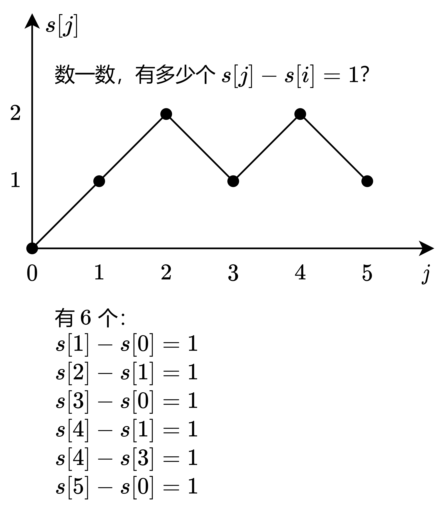

# 前缀和+哈希表：从两次遍历到一次遍历，附变形题（Python/Java/C++/Go/JS/Rust）

> **[560. 和为 K 的子数组](https://leetcode.cn/problems/subarray-sum-equals-k/solutions/2781031/qian-zhui-he-ha-xi-biao-cong-liang-ci-bi-4mwr/) · Medium**

> **所属题单**
> - [常用数据结构 · 一、前缀和](../../../刷题路径/灵神原版题单/常用数据结构/一、前缀和.md) · §1.2 前缀和与哈希表
> - [LeetCode 热题 100 · 子串](../../../刷题路径/灵神原版题单/LeetCode%20热题%20100/子串.md)

> **题目描述**
> 给你一个整数数组 `nums` 和一个整数 `k` ，请你统计并返回 <em>该数组中和为 `k` 的子数组的个数</em> 。
>
> 子数组是数组中元素的连续非空序列。
>
> **示例 1：**
>
> ```
>
> 输入：nums = [1,1,1], k = 2
> 输出：2
> ```
>
> **示例 2：**
>
> ```
>
> 输入：nums = [1,2,3], k = 3
> 输出：2
> ```
>
> **提示：**
>
> - `1 <= nums.length <= 2 * 10⁴`
>
> - `-1000 <= nums[i] <= 1000`
>
> - `-10⁷ <= k <= 10⁷`

> **题解**
> ## 前置题目
>
> 本题是连续子数组和问题，可以用**前缀和**处理。
>
> 请先完成前缀和**模板题** [303. 区域和检索 - 数组不可变](https://leetcode.cn/problems/range-sum-query-immutable/)，并阅读 [我的题解](../../0300-0399/0303%20区域和检索%20-%20数组不可变/灵茶山艾府.md)。
>
> ## 转化
>
> 回顾 303 题的前缀和的定义：$s[0]=0,\ s[i] = \textit{nums}[0] + \textit{nums}[1] + \cdots + \textit{nums}[i-1]$。
>
> > 注意 $s$ 是一个长为 $n+1$ 的数组，第一个数是 $0$。
>
> 设 $i<j$，如果 $\textit{nums}[i]$ 到 $\textit{nums}[j-1]$ 的元素和等于 $k$，用前缀和表示，就是
>
> $$
> s[j] - s[i] = k
> $$
>
> 问题转化为：
>
> - $s$ 中有多少对下标 $(i,j)$ 满足 $0\le i<j\le n$ 且 $s[j] - s[i] = k$？
>
> 写成 $s[j] + (-s[i]) = k$ 就能看得更明白，这是梦开始的地方——[1. 两数之和](https://leetcode.cn/problems/two-sum/)。不过那题只需找到一对下标，而本题需要计算所有满足条件的下标对的个数。
>
> ## 枚举右，维护左
>
> 以 $\textit{nums}=[1,1,-1,1,-1]$，$k=1$ 为例，其前缀和数组为 $s=[0,1,2,1,2,1]$。画出前缀和数组的折线图，如下：
>
> {:width=500}
>
> 如果用二重循环暴力枚举有多少个 $s[j] - s[i] = k$，时间复杂度是 $\mathcal{O}(n^2)$，太慢了。如何加速？
>
> [从两数之和中，我们可以学到什么？](../../0000-0099/0001%20两数之和/灵茶山艾府.md)我们可以把 $s[j] - s[i] = k$ 移项，得 
>
> $$
> s[i] = s[j] - k
> $$
>
> 枚举当前的前缀和 $s[j]$，看看曾经有多少个前缀和等于 $s[j] - k$（配对）。每当我们在左边找到一个值等于 $s[j] - k$ 的前缀和，就找到了一个和为 $k$ 的子数组（因为 $s[j] - (s[j] - k) = k$）。
>
> 比如 $s[j]=2$，那么 $s[i]=s[j]-k=2-1=1$，我们要找的是 $j$ 左边有多少个 $s[i]=1$。在上面的例子中，遍历到 $s[4]=2$ 时，我们知道左边有 $2$ 个 $s[i]=1$，所以新找到了 $2$ 个和为 $1$ 的子数组。
>
> 用这个视角，再来算算上图中的那 $6$ 个和为 $1$ 的子数组。
>
> |  $j$ | $s[j]$  | $s[j]-k$  | $s[j]-k$ 的个数 | 解释 |
> |:---:|:---:|:---:|:---:|---|
> | $0$  | $0$  | $-1$  |  $0$ | 无 |
> | $1$  | $1$  | $0$  |  $1$  | $s[0]=0$ |
> | $2$  | $2$  | $1$  |  $1$ | $s[1]=1$ |
> | $3$  | $1$  | $0$  |  $1$ | $s[0]=0$ |
> | $4$  | $2$  | $1$  |  $2$ | $s[1]=s[3]=1$ |
> | $5$  | $1$  | $0$  |  $1$ | $s[0]=0$ |
>
> 一共有 $0+1+1+1+2+1=6$ 个和为 $k=1$ 的子数组。
>
> 具体来说，在遍历 $s[j]$ 的同时，用一个哈希表 $\textit{cnt}$ 统计 $s[j]$ 的个数。哈希表的 key 是 $s[j]$，value 是值为 $s[j]$ 的前缀和的个数。遍历到 $s[j]$ 时，从哈希表中就可以找到有 $\textit{cnt}[s[j] - k]$ 个 $s[i]$，加入答案。请读者动手算算上面的例子，加深理解。
>
> ## 答疑
>
> **问**：为什么这样做可以不重不漏地计算？
>
> **答**：暴力做法是，外层循环枚举 $j$，内层循环枚举 $i$，如果 $s[j]-s[i]=k$，那么答案加一。我们保留了「外层循环枚举 $j$」这个过程，把内层循环用哈希表优化成了 $\mathcal{O}(1)$，所以本质是对暴力算法的哈希表优化。既然暴力算法是不重不漏地计算，那么优化做法也是不重不漏地计算。
>
> **问**：为什么要把 $s[0]=0$ 也加到哈希表中？
>
> **答**：举个最简单的例子，$\textit{nums}=[1],\ k=1$。如果不把 $s[0]=0$ 加到哈希表中，按照我们的算法，没法算出这里有 $1$ 个符合要求的子数组。也可以这样理解，要想把任意子数组都表示成两个前缀和的差，必须添加 $s[0]=0$，否则当子数组是前缀时，没法减去一个数，具体见 [前缀和及其扩展](../../0300-0399/0303%20区域和检索%20-%20数组不可变/灵茶山艾府.md) 中的讲解。
>
> **问**：为什么代码中要先更新 $\textit{ans}$，再更新 $\textit{cnt}$？这两行代码能否交换？
>
> **答**：不行，这会在 $k=0$ 的时候算错。例如 $\textit{nums}=[2],\ k=0$，正确答案应该是 $0$，但如果先把 $\textit{cnt}[2]$ 加一，再把 $\textit{cnt}[2]$ 加到 $\textit{ans}$ 中，最后返回的 $\textit{ans}$ 就不是 $0$ 了。
>
> **问**：为什么这题不适合用**滑动窗口**做？
>
> **答**：滑动窗口需要满足**单调性**，当右端点元素进入窗口时，窗口元素和是不能减少的。本题 $\textit{nums}$ 包含**负数**，当负数进入窗口时，窗口左端点该往哪个方向移动？无法确定。如果没有负数的话，则可以用滑动窗口（恰好型滑动窗口），见 [930. 和相同的二元子数组](https://leetcode.cn/problems/binary-subarrays-with-sum/)。
>
> ## 写法一：两次遍历
>
> ```python
> class Solution:
>     def subarraySum(self, nums: List[int], k: int) -> int:
>         s = [0] * (len(nums) + 1)
>         for i, x in enumerate(nums):
>             s[i + 1] = s[i] + x
>
>         cnt = defaultdict(int)
>         ans = 0
>         for sj in s:
>             ans += cnt[sj - k]
>             cnt[sj] += 1
>         return ans
> ```
>
>
> #### 复杂度分析
>
> - 时间复杂度：$\mathcal{O}(n)$，其中 $n$ 为 $\textit{nums}$ 的长度。
> - 空间复杂度：$\mathcal{O}(n)$。
>
> ## 写法二：一次遍历 · 其一
>
> 我们可以一边计算前缀和，一边遍历前缀和。
>
> 在遍历 $\textit{nums}$ 之前，我们需要先统计 $s[0]=0$，即空前缀的元素和等于 $0$。往 $\textit{cnt}$ 中添加 $\textit{cnt}[0]=1$。
>
> 对比一下，两次遍历的代码循环了 $n+1$ 次，下面的代码循环了 $n$ 次，少的那一次是什么？就是对 $s[0]=0$ 的统计。
>
> ```python
> class Solution:
>     def subarraySum(self, nums: List[int], k: int) -> int:
>         cnt = defaultdict(int)
>         cnt[0] = 1  # s[0]=0 单独统计
>         ans = s = 0
>         for x in nums:
>             s += x
>             ans += cnt[s - k]
>             cnt[s] += 1
>         return ans
> ```
>
>
> ## 写法三：一次遍历 · 其二
>
> 在同一轮循环中，先把 $s[i-1]$ 加入哈希表，再根据 $s[i]$ 更新答案。
>
> 这样写无需初始化 $\textit{cnt}[0]=1$。
>
> ```python
> class Solution:
>     def subarraySum(self, nums: List[int], k: int) -> int:
>         cnt = defaultdict(int)
>         ans = s = 0
>         for x in nums:
>             cnt[s] += 1
>             s += x
>             ans += cnt[s - k]
>         return ans
> ```
>
>
> #### 复杂度分析
>
> - 时间复杂度：$\mathcal{O}(n)$，其中 $n$ 为 $\textit{nums}$ 的长度。
> - 空间复杂度：$\mathcal{O}(m)$，其中 $m$ 为不同前缀和的个数。如果设置了哈希表的容量，则空间复杂度为 $\mathcal{O}(n)$。
>
> ### 变形题
>
> 1. 改成计算元素和等于 $k$ 的**最短**子数组，要怎么做？
> 2. 改成计算元素和等于 $k$ 的**最长**子数组，要怎么做？
> 3. 改成计算元素和等于 $k$ 的**所有子数组的长度之和**，要怎么做？
> 4. 改成元素和**至多**为 $k$，要怎么做？见 [363. 矩形区域不超过 K 的最大数值和](https://leetcode.cn/problems/max-sum-of-rectangle-no-larger-than-k/)。
> 5. 改成计算元素和为**奇数**的子数组个数，要怎么做？
>
> 欢迎在评论区分享你的思路/代码。
>
> > 提示：思考题 4 可以枚举上下边界，转成一维数组。
>
> ## 分类题单
>
> [如何科学刷题？](https://leetcode.cn/circle/discuss/RvFUtj/)
>
> 1. [滑动窗口与双指针（定长/不定长/单序列/双序列/三指针/分组循环）](https://leetcode.cn/circle/discuss/0viNMK/)
> 2. [二分算法（二分答案/最小化最大值/最大化最小值/第K小）](https://leetcode.cn/circle/discuss/SqopEo/)
> 3. [单调栈（基础/矩形面积/贡献法/最小字典序）](https://leetcode.cn/circle/discuss/9oZFK9/)
> 4. [网格图（DFS/BFS/综合应用）](https://leetcode.cn/circle/discuss/YiXPXW/)
> 5. [位运算（基础/性质/拆位/试填/恒等式/思维）](https://leetcode.cn/circle/discuss/dHn9Vk/)
> 6. [图论算法（DFS/BFS/拓扑排序/基环树/最短路/最小生成树/网络流）](https://leetcode.cn/circle/discuss/01LUak/)
> 7. [动态规划（入门/背包/划分/状态机/区间/状压/数位/数据结构优化/树形/博弈/概率期望）](https://leetcode.cn/circle/discuss/tXLS3i/)
> 8. [常用数据结构（前缀和/差分/栈/队列/堆/字典树/并查集/树状数组/线段树）](https://leetcode.cn/circle/discuss/mOr1u6/)
> 9. [数学算法（数论/组合/概率期望/博弈/计算几何/随机算法）](https://leetcode.cn/circle/discuss/IYT3ss/)
> 10. [贪心与思维（基本贪心策略/反悔/区间/字典序/数学/思维/脑筋急转弯/构造）](https://leetcode.cn/circle/discuss/g6KTKL/)
> 11. [链表、二叉树与回溯（前后指针/快慢指针/DFS/BFS/直径/LCA/一般树）](https://leetcode.cn/circle/discuss/K0n2gO/)
> 12. [字符串（KMP/Z函数/Manacher/字符串哈希/AC自动机/后缀数组/子序列自动机）](https://leetcode.cn/circle/discuss/SJFwQI/)
>
> [我的题解精选（已分类）](https://github.com/EndlessCheng/codeforces-go/blob/master/leetcode/SOLUTIONS.md)
>
> 欢迎关注 [B站@灵茶山艾府](https://space.bilibili.com/206214)
