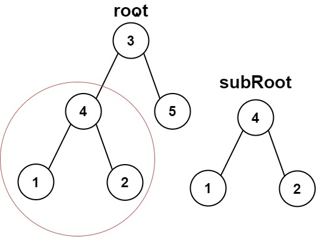
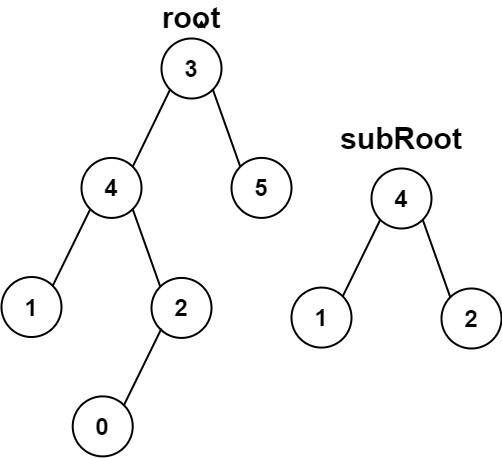

# 572. 另一棵树的子树

Easy · [力扣原题](https://leetcode.cn/problems/subtree-of-another-tree/)

所在刷题路径：灵神核心路线、灵神题单·链表树与回溯

| 作者 | 题解 | 动画讲解 |
|---|---|---|
| 灵茶山艾府 | [📄 题解](灵茶山艾府.md) | [▶︎ 动画（GIF）](0572%20另一棵树的子树%20·%20灵茶山艾府.gif) · [mp4 文件](0572%20另一棵树的子树%20·%20灵茶山艾府.mp4) |
| yiduobo | [📄 题解](yiduobo.md) | [▶︎ 动画（GIF）](0572%20另一棵树的子树%20·%20yiduobo.gif) · [mp4 文件](0572%20另一棵树的子树%20·%20yiduobo.mp4) |

## 动画讲解

> 动图会循环播放；想暂停、拖进度条请下载上面表格里的 mp4 文件。

### 灵茶山艾府


### yiduobo


## 题目描述

给你两棵二叉树 `root` 和 `subRoot` 。检验 `root` 中是否包含和 `subRoot` 具有相同结构和节点值的子树。如果存在，返回 `true` ；否则，返回 `false` 。

二叉树 `tree` 的一棵子树包括 `tree` 的某个节点和这个节点的所有后代节点。`tree` 也可以看做它自身的一棵子树。

**示例 1：**



```

输入：root = [3,4,5,1,2], subRoot = [4,1,2]
输出：true
```

**示例 2：**



```

输入：root = [3,4,5,1,2,null,null,null,null,0], subRoot = [4,1,2]
输出：false
```

**提示：**

- `root` 树上的节点数量范围是 `[1, 2000]`

- `subRoot` 树上的节点数量范围是 `[1, 1000]`

- `-10⁴ <= root.val <= 10⁴`

- `-10⁴ <= subRoot.val <= 10⁴`

---
[↑ 返回 0500-0599](../README.md) · [总索引](../../../索引.md) · [仓库首页](../../../README.md)
