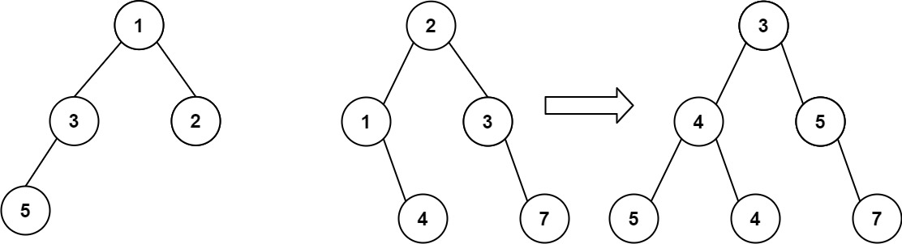

# 【视频】看到递归就晕？带你理解递归的本质！附题单（Python/Java/C++/C/Go/JS/Rust）

> **[617. 合并二叉树](https://leetcode.cn/problems/merge-two-binary-trees/solutions/2387255/kan-dao-di-gui-jiu-yun-dai-ni-li-jie-di-leixm/) · Easy**

> **所属题单**
> - [链表、二叉树与回溯 · 二、二叉树](../../../刷题路径/灵神原版题单/链表、二叉树与回溯/二、二叉树.md) · §2.3 自底向上 DFS（后序遍历）

> **题目描述**
> 给你两棵二叉树： `root1` 和 `root2` 。
>
> 想象一下，当你将其中一棵覆盖到另一棵之上时，两棵树上的一些节点将会重叠（而另一些不会）。你需要将这两棵树合并成一棵新二叉树。合并的规则是：如果两个节点重叠，那么将这两个节点的值相加作为合并后节点的新值；否则，**不为** null 的节点将直接作为新二叉树的节点。
>
> 返回合并后的二叉树。
>
> **注意:** 合并过程必须从两个树的根节点开始。
>
> **示例 1：**
>
> 
>
> ```
>
> 输入：root1 = [1,3,2,5], root2 = [2,1,3,null,4,null,7]
> 输出：[3,4,5,5,4,null,7]
> ```
>
> **示例 2：**
>
> ```
>
> 输入：root1 = [1], root2 = [1,2]
> 输出：[2,2]
> ```
>
> **提示：**
>
> - 两棵树中的节点数目在范围 `[0, 2000]` 内
>
> - `-10⁴ <= Node.val <= 10⁴`

> **题解**
> 晕递归的同学，请看视频：[深入理解递归【基础算法精讲 09】](https://www.bilibili.com/video/BV1UD4y1Y769/)
>
> 分类讨论：
>
> - 如果 $\textit{root}_1$ 是空的，无需合并，直接返回 $\textit{root}_2$。
> - 如果 $\textit{root}_2$ 是空的，无需合并，直接返回 $\textit{root}_1$。
> - 如果都不为空，那么将这两个节点的值相加，作为合并后节点的新值。然后递归合并 $\textit{root}_1.\textit{left}$ 与 $\textit{root}_2.\textit{left}$，得到合并后的左子树；递归合并 $\textit{root}_1.\textit{right}$ 与 $\textit{root}_2.\textit{right}$，得到合并后的右子树。最后返回合并后的节点。
>
> ## 写法一
>
> ```python
> class Solution:
>     def mergeTrees(self, root1: Optional[TreeNode], root2: Optional[TreeNode]) -> Optional[TreeNode]:
>         if root1 is None: return root2
>         if root2 is None: return root1
>         return TreeNode(root1.val + root2.val,
>             self.mergeTrees(root1.left, root2.left),    # 合并左子树
>             self.mergeTrees(root1.right, root2.right))  # 合并右子树
> ```
>
>
> #### 复杂度分析
>
> - 时间复杂度：$\mathcal{O}(\min(n,m))$，其中 $n,m$ 分别为两棵二叉树的节点数。
> - 空间复杂度：$\mathcal{O}(\min(n,m))$。
>
> ## 写法二
>
> 也可以在两个节点都不为空时，把新节点的 $\textit{val}$，$\textit{left}$ 和 $\textit{right}$ 直接保存到 $\textit{root}_1$ 中。
>
> ```python
> class Solution:
>     def mergeTrees(self, root1: Optional[TreeNode], root2: Optional[TreeNode]) -> Optional[TreeNode]:
>         if root1 is None: return root2
>         if root2 is None: return root1
>         root1.val += root2.val
>         root1.left = self.mergeTrees(root1.left, root2.left)     # 合并左子树
>         root1.right = self.mergeTrees(root1.right, root2.right)  # 合并右子树
>         return root1
> ```
>
>
> #### 复杂度分析
>
> - 时间复杂度：$\mathcal{O}(\min(n,m))$，其中 $n,m$ 分别为两棵二叉树的节点数。
> - 空间复杂度：$\mathcal{O}(\min(n,m))$。递归需要 $\mathcal{O}(\min(n,m))$ 的栈空间。
>
> ## 分类题单
>
> [如何科学刷题？](https://leetcode.cn/circle/discuss/RvFUtj/)
>
> 1. [滑动窗口与双指针（定长/不定长/单序列/双序列/三指针）](https://leetcode.cn/circle/discuss/0viNMK/)
> 2. [二分算法（二分答案/最小化最大值/最大化最小值/第K小）](https://leetcode.cn/circle/discuss/SqopEo/)
> 3. [单调栈（基础/矩形面积/贡献法/最小字典序）](https://leetcode.cn/circle/discuss/9oZFK9/)
> 4. [网格图（DFS/BFS/综合应用）](https://leetcode.cn/circle/discuss/YiXPXW/)
> 5. [位运算（基础/性质/拆位/试填/恒等式/思维）](https://leetcode.cn/circle/discuss/dHn9Vk/)
> 6. [图论算法（DFS/BFS/拓扑排序/最短路/最小生成树/二分图/基环树/欧拉路径）](https://leetcode.cn/circle/discuss/01LUak/)
> 7. [动态规划（入门/背包/状态机/划分/区间/状压/数位/数据结构优化/树形/博弈/概率期望）](https://leetcode.cn/circle/discuss/tXLS3i/)
> 8. [常用数据结构（前缀和/差分/栈/队列/堆/字典树/并查集/树状数组/线段树）](https://leetcode.cn/circle/discuss/mOr1u6/)
> 9. [数学算法（数论/组合/概率期望/博弈/计算几何/随机算法）](https://leetcode.cn/circle/discuss/IYT3ss/)
> 10. [贪心与思维（基本贪心策略/反悔/区间/字典序/数学/思维/脑筋急转弯/构造）](https://leetcode.cn/circle/discuss/g6KTKL/)
> 11. [链表、二叉树与一般树（前后指针/快慢指针/DFS/BFS/直径/LCA）](https://leetcode.cn/circle/discuss/K0n2gO/)
> 12. [字符串（KMP/Z函数/Manacher/字符串哈希/AC自动机/后缀数组/子序列自动机）](https://leetcode.cn/circle/discuss/SJFwQI/)
>
> [我的题解精选（已分类）](https://github.com/EndlessCheng/codeforces-go/blob/master/leetcode/SOLUTIONS.md)
>
> 欢迎关注 [B站@灵茶山艾府](https://space.bilibili.com/206214)
