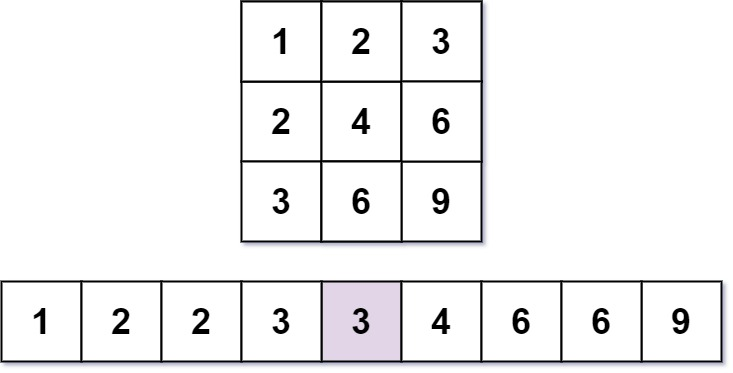
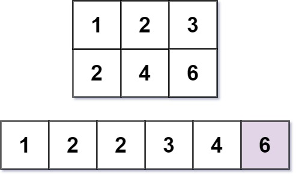

# 668. 乘法表中第k小的数

Hard · [力扣原题](https://leetcode.cn/problems/kth-smallest-number-in-multiplication-table/)

所在刷题路径：灵神题单·二分算法

| 作者 | 题解 | 动画讲解 |
|---|---|---|
| 灵茶山艾府 | [📄 题解](灵茶山艾府.md) | [▶︎ 动画（GIF）](0668%20乘法表中第k小的数%20·%20灵茶山艾府.gif) · [mp4 文件](0668%20乘法表中第k小的数%20·%20灵茶山艾府.mp4) |
| yiduobo | [📄 题解](yiduobo.md) | [▶︎ 动画（GIF）](0668%20乘法表中第k小的数%20·%20yiduobo.gif) · [mp4 文件](0668%20乘法表中第k小的数%20·%20yiduobo.mp4) |

## 动画讲解

> 动图会循环播放；想暂停、拖进度条请下载上面表格里的 mp4 文件。

### 灵茶山艾府


### yiduobo


## 题目描述

几乎每一个人都用 [乘法表](https://baike.baidu.com/item/%E4%B9%98%E6%B3%95%E8%A1%A8)。但是你能在乘法表中快速找到第 `k` 小的数字吗？

乘法表是大小为 `m x n` 的一个整数矩阵，其中 `mat[i][j] == i * j`（下标从 **1** 开始）。

给你三个整数 `m`、`n` 和 `k`，请你在大小为 `m x n` 的乘法表中，找出并返回第 `k` 小的数字。

**示例 1：**



```

输入：m = 3, n = 3, k = 5
输出：3
解释：第 5 小的数字是 3 。
```

**示例 2：**



```

输入：m = 2, n = 3, k = 6
输出：6
解释：第 6 小的数字是 6 。
```

**提示：**

- `1 <= m, n <= 3 * 10⁴`

- `1 <= k <= m * n`

---
[↑ 返回 0600-0699](../README.md) · [总索引](../../../索引.md) · [仓库首页](../../../README.md)
