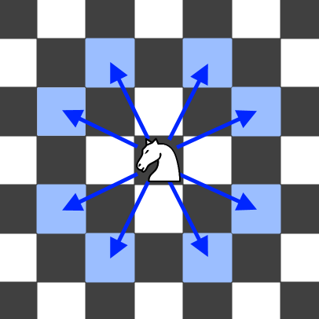

# 教你一步步思考 DP：从记忆化搜索到递推（Python/Java/C++/Go）

> **[688. 骑士在棋盘上的概率](https://leetcode.cn/problems/knight-probability-in-chessboard/solutions/2997395/jiao-ni-yi-bu-bu-si-kao-dpcong-ji-yi-hua-dgt6/) · Medium**

> **所属题单**
> - [动态规划 · 十五、概率 DP、期望 DP](../../../刷题路径/灵神原版题单/动态规划/十五、概率%20DP、期望%20DP.md)
> - [数学算法 · 三、概率期望](../../../刷题路径/灵神原版题单/数学算法/三、概率期望.md)

> **题目描述**
> 在一个 `n x n` 的国际象棋棋盘上，一个骑士从单元格 `(row, column)` 开始，并尝试进行 `k` 次移动。行和列是 **从 0 开始** 的，所以左上单元格是 `(0,0)` ，右下单元格是 `(n - 1, n - 1)` 。
>
> 象棋骑士有8种可能的走法，如下图所示。每次移动在基本方向上是两个单元格，然后在正交方向上是一个单元格。
>
> 
>
> 每次骑士要移动时，它都会随机从8种可能的移动中选择一种(即使棋子会离开棋盘)，然后移动到那里。
>
> 骑士继续移动，直到它走了 `k` 步或离开了棋盘。
>
> 返回 <em>骑士在棋盘停止移动后仍留在棋盘上的概率</em> 。
>
> **示例 1：**
>
> ```
>
> 输入: n = 3, k = 2, row = 0, column = 0
> 输出: 0.0625
> 解释: 有两步(到(1,2)，(2,1))可以让骑士留在棋盘上。
> 在每一个位置上，也有两种移动可以让骑士留在棋盘上。
> 骑士留在棋盘上的总概率是0.0625。
> ```
>
> **示例 2：**
>
> ```
>
> 输入: n = 1, k = 0, row = 0, column = 0
> 输出: 1.00000
> ```
>
> **提示:**
>
> - `1 <= n <= 25`
>
> - `0 <= k <= 100`
>
> - `0 <= row, column <= n - 1`

> **题解**
> ## 一、寻找子问题
>
> 在示例 1 中，我们要解决的问题（原问题）是：
>
> - 马从 $(0,0)$ 出发，走 $k=2$ 步后仍然在棋盘上的概率。
>
> 枚举马走的八个方向，假设走到了 $(1,2)$，问题变成：
>
> - 马从 $(1,2)$ 出发，走 $k-1=1$ 步后仍然在棋盘上的概率。
>
> 这是**和原问题相似的、规模更小的子问题**，可以用**递归**解决。
>
> ## 二、状态定义与状态转移方程
>
> 根据上面的讨论，我们需要在递归过程中跟踪以下信息：
>
> - $k$：还剩下 $k$ 步要走。
> - $(i,j)$：马的位置。
>
> 因此，定义状态为 $\textit{dfs}(k,i,j)$，表示马从 $(i,j)$ 出发，走 $k$ 步后仍然在棋盘上的概率。
>
> 枚举马走的八个方向，其中有 $\dfrac{1}{8}$ 概率走到了 $(x,y)$，问题变成：
>
> - 马从 $(x,y)$ 出发，走 $k-1$ 步后仍然在棋盘上的概率，即 $\textit{dfs}(k-1,x,y)$。
>
> 八种情况累加，得
>
> $$
> \textit{dfs}(k,i,j) = \dfrac{1}{8}\sum_{(x,y)} \textit{dfs}(k-1,x,y)
> $$
>
> **递归边界**：如果马出界，那么在棋盘上的概率为 $0$，即 $\textit{dfs}(k,i,j)=0$。如果 $k=0$ 时马仍然在棋盘上，那么概率为 $1$，即 $\textit{dfs}(0,i,j)=1$。
>
> **递归入口**：$\textit{dfs}(k,\textit{row},\textit{column})$，也就是答案。
>
> ## 三、递归搜索 + 保存递归返回值 = 记忆化搜索
>
> 考虑到整个递归过程中有大量重复递归调用（递归入参相同）。由于递归函数没有副作用，同样的入参无论计算多少次，算出来的结果都是一样的，因此可以用**记忆化搜索**来优化：
>
> - 如果一个状态（递归入参）是第一次遇到，那么可以在返回前，把状态及其结果记到一个 $\textit{memo}$ 数组中。
> - 如果一个状态不是第一次遇到（$\textit{memo}$ 中保存的结果不等于 $\textit{memo}$ 的初始值），那么可以直接返回 $\textit{memo}$ 中保存的结果。
>
> **注意**：$\textit{memo}$ 数组的**初始值**一定不能等于要记忆化的值！例如初始值设置为 $0$，并且要记忆化的 $\textit{dfs}(k,i,j)$ 也等于 $0$，那就没法判断 $0$ 到底表示第一次遇到这个状态，还是表示之前遇到过了，从而导致记忆化失效。一般把初始值设置为 $-1$。本题可以初始化成 $0$。
>
> > Python 用户可以无视上面这段，直接用 `@cache` 装饰器。
>
> 具体请看视频讲解 [动态规划入门：从记忆化搜索到递推](https://www.bilibili.com/video/BV1Xj411K7oF/)，其中包含把记忆化搜索 1:1 翻译成递推的技巧。
>
> ```python
> DIRS = (2, 1), (1, 2), (-1, 2), (-2, 1), (-2, -1), (-1, -2), (1, -2), (2, -1)
>
> class Solution:
>     def knightProbability(self, n: int, k: int, row: int, column: int) -> float:
>         @cache  # 缓存装饰器，避免重复计算 dfs 的结果（记忆化）
>         def dfs(k: int, i: int, j: int) -> float:
>             if not (0 <= i < n and 0 <= j < n):  # 出界
>                 return 0
>             if k == 0:  # 走完了，仍然在棋盘上
>                 return 1
>             return sum(dfs(k - 1, i + dx, j + dy) for dx, dy in DIRS) / 8
>         return dfs(k, row, column)
> ```
>
>
> #### 复杂度分析
>
> - 时间复杂度：$\mathcal{O}(kn^2)$。由于每个状态只会计算一次，动态规划的时间复杂度 $=$ 状态个数 $\times$ 单个状态的计算时间。本题状态个数等于 $\mathcal{O}(kn^2)$，单个状态的计算时间为 $\mathcal{O}(1)$，所以总的时间复杂度为 $\mathcal{O}(kn^2)$。
> - 空间复杂度：$\mathcal{O}(kn^2)$。保存多少状态，就需要多少空间。
>
> ## 四、1:1 翻译成递推
>
> 我们可以去掉递归中的「递」，只保留「归」的部分，即自底向上计算。
>
> 为避免下标出现负数，把棋盘的边界从 $[0,n-1]$ 调整为 $[2,n+1]$。
>
> 具体来说，$f[k][i][j]$ 的定义和 $\textit{dfs}(k,i,j)$ 的定义是一样的，都表示马从 $(i,j)$ 出发，走 $k$ 步后仍然在棋盘上的概率。
>
> 相应的递推式（状态转移方程）也和 $\textit{dfs}$ 一样：
>
> $$
> f[k][i][j] = \dfrac{1}{8}\sum_{(x,y)} f[k-1][x][y]
> $$
>
> 初始值：如果马出界，那么在棋盘上的概率为 $0$，即 $f[k][i][j]=0$。如果 $k=0$ 时马仍然在棋盘上，那么概率为 $1$，即 $f[0][i][j]=1$。
>
> 答案为 $f[k][\textit{row}+2][\textit{column}+2]$，翻译自递归入口 $\textit{dfs}(k,\textit{row},\textit{column})$。这里 $+2$ 是因为我们调整了棋盘的边界，所以起点也一同调整。
>
> ```python
> DIRS = (2, 1), (1, 2), (-1, 2), (-2, 1), (-2, -1), (-1, -2), (1, -2), (2, -1)
>
> class Solution:
>     def knightProbability(self, n: int, k: int, row: int, column: int) -> float:
>         f = [[[0] * (n + 4) for _ in range(n + 4)] for _ in range(k + 1)]
>         for i in range(2, n + 2):
>             f[0][i][2: n + 2] = [1] * n
>         for step in range(1, k + 1):
>             for i in range(2, n + 2):
>                 for j in range(2, n + 2):
>                     f[step][i][j] = sum(f[step - 1][i + dx][j + dy] for dx, dy in DIRS) / 8
>         return f[k][row + 2][column + 2]
> ```
>
>
> #### 复杂度分析
>
> - 时间复杂度：$\mathcal{O}(kn^2)$。
> - 空间复杂度：$\mathcal{O}(kn^2)$。若用滚动数组，空间可以优化至 $\mathcal{O}(n^2)$。
>
> 更多相似题目，见 [动态规划题单](https://leetcode.cn/circle/discuss/tXLS3i/) 中的「**§7.5 多维 DP**」。
>
> ## 分类题单
>
> [如何科学刷题？](https://leetcode.cn/circle/discuss/RvFUtj/)
>
> 1. [滑动窗口与双指针（定长/不定长/单序列/双序列/三指针）](https://leetcode.cn/circle/discuss/0viNMK/)
> 2. [二分算法（二分答案/最小化最大值/最大化最小值/第K小）](https://leetcode.cn/circle/discuss/SqopEo/)
> 3. [单调栈（基础/矩形面积/贡献法/最小字典序）](https://leetcode.cn/circle/discuss/9oZFK9/)
> 4. [网格图（DFS/BFS/综合应用）](https://leetcode.cn/circle/discuss/YiXPXW/)
> 5. [位运算（基础/性质/拆位/试填/恒等式/思维）](https://leetcode.cn/circle/discuss/dHn9Vk/)
> 6. [图论算法（DFS/BFS/拓扑排序/最短路/最小生成树/二分图/基环树/欧拉路径）](https://leetcode.cn/circle/discuss/01LUak/)
> 7. 【本题相关】[动态规划（入门/背包/状态机/划分/区间/状压/数位/数据结构优化/树形/博弈/概率期望）](https://leetcode.cn/circle/discuss/tXLS3i/)
> 8. [常用数据结构（前缀和/差分/栈/队列/堆/字典树/并查集/树状数组/线段树）](https://leetcode.cn/circle/discuss/mOr1u6/)
> 9. [数学算法（数论/组合/概率期望/博弈/计算几何/随机算法）](https://leetcode.cn/circle/discuss/IYT3ss/)
> 10. [贪心与思维（基本贪心策略/反悔/区间/字典序/数学/思维/脑筋急转弯/构造）](https://leetcode.cn/circle/discuss/g6KTKL/)
> 11. [链表、二叉树与一般树（前后指针/快慢指针/DFS/BFS/直径/LCA）](https://leetcode.cn/circle/discuss/K0n2gO/)
> 12. [字符串（KMP/Z函数/Manacher/字符串哈希/AC自动机/后缀数组/子序列自动机）](https://leetcode.cn/circle/discuss/SJFwQI/)
>
> [我的题解精选（已分类）](https://github.com/EndlessCheng/codeforces-go/blob/master/leetcode/SOLUTIONS.md)
>
> 欢迎关注 [B站@灵茶山艾府](https://space.bilibili.com/206214)
