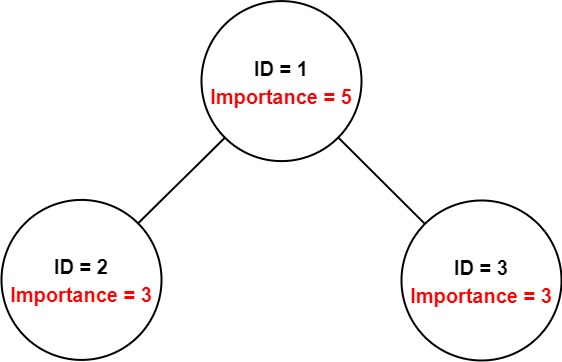
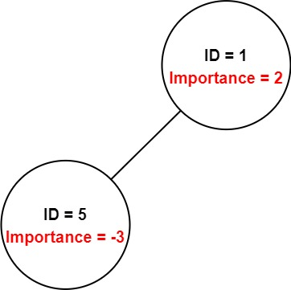

# 哈希表+DFS（Python/Java/C++/Go/JS）

> **[690. 员工的重要性](https://leetcode.cn/problems/employee-importance/solutions/2892882/ha-xi-biao-dfspythonjavacgojs-by-endless-rbx0/) · Medium**

> **所属题单**
> - [链表、二叉树与回溯 · 三、一般树](../../../刷题路径/灵神原版题单/链表、二叉树与回溯/三、一般树.md) · §3.3 自底向上 DFS

> **题目描述**
> 你有一个保存员工信息的数据结构，它包含了员工唯一的 id ，重要度和直系下属的 id 。
>
> 给定一个员工数组 `employees`，其中：
>
> - `employees[i].id` 是第 `i` 个员工的 ID。
>
> - `employees[i].importance` 是第 `i` 个员工的重要度。
>
> - `employees[i].subordinates` 是第 `i` 名员工的直接下属的 ID 列表。
>
> 给定一个整数 `id` 表示一个员工的 ID，返回这个员工和他所有下属的重要度的 **总和**。
>
> **示例 1：**
>
> 
>
> ```
>
> 输入：employees = [[1,5,[2,3]],[2,3,[]],[3,3,[]]], id = 1
> 输出：11
> 解释：
> 员工 1 自身的重要度是 5 ，他有两个直系下属 2 和 3 ，而且 2 和 3 的重要度均为 3 。因此员工 1 的总重要度是 5 + 3 + 3 = 11 。
> ```
>
> **示例 2：**
>
> 
>
> ```
>
> 输入：employees = [[1,2,[5]],[5,-3,[]]], id = 5
> 输出：-3
> 解释：员工 5 的重要度为 -3 并且没有直接下属。
> 因此，员工 5 的总重要度为 -3。
> ```
>
> **提示：**
>
> - `1 <= employees.length <= 2000`
>
> - `1 <= employees[i].id <= 2000`
>
> - 所有的 `employees[i].id` **互不相同**。
>
> - `-100 <= employees[i].importance <= 100`
>
> - 一名员工最多有一名直接领导，并可能有多名下属。
>
> - `employees[i].subordinates` 中的 ID 都有效。

> **题解**
> 首先，创建一个哈希表，把第 $i$ 个员工的 ID 映射到 $\textit{employees}[i]$ 对象上。
>
> 然后从 $\textit{id}$ 开始 DFS（题目保证员工组成了树形结构）：
>
> 1. 根据 $\textit{id}$ 从哈希表中获取到对应的员工对象 $e$。
> 2. 把 $e.\textit{importance}$ 加到返回值中。
> 3. 遍历 $e.\textit{subordinates}$，继续 DFS 下属的 ID，把 $\textit{dfs}(\textit{subId})$ 加到返回值中。
>
> ```python
> class Solution:
>     def getImportance(self, employees: List['Employee'], id: int) -> int:
>         employees = {e.id: e for e in employees}
>         def dfs(id: int) -> int:
>             e = employees[id]
>             return e.importance + sum(dfs(sub) for sub in e.subordinates)
>         return dfs(id)
> ```
>
>
> #### 复杂度分析
>
> - 时间复杂度：$\mathcal{O}(n)$，其中 $n$ 是 $\textit{employees}$ 的长度。由于员工组成了树形结构，每个员工至多访问一次。
> - 空间复杂度：$\mathcal{O}(n)$。
>
> 更多相似题目，见下面树题单中的「**一般树**」。
>
> ## 分类题单
>
> [如何科学刷题？](https://leetcode.cn/circle/discuss/RvFUtj/)
>
> 1. [滑动窗口（定长/不定长/多指针）](https://leetcode.cn/circle/discuss/0viNMK/)
> 2. [二分算法（二分答案/最小化最大值/最大化最小值/第K小）](https://leetcode.cn/circle/discuss/SqopEo/)
> 3. [单调栈（基础/矩形面积/贡献法/最小字典序）](https://leetcode.cn/circle/discuss/9oZFK9/)
> 4. [网格图（DFS/BFS/综合应用）](https://leetcode.cn/circle/discuss/YiXPXW/)
> 5. [位运算（基础/性质/拆位/试填/恒等式/思维）](https://leetcode.cn/circle/discuss/dHn9Vk/)
> 6. [图论算法（DFS/BFS/拓扑排序/最短路/最小生成树/二分图/基环树/欧拉路径）](https://leetcode.cn/circle/discuss/01LUak/)
> 7. [动态规划（入门/背包/状态机/划分/区间/状压/数位/数据结构优化/树形/博弈/概率期望）](https://leetcode.cn/circle/discuss/tXLS3i/)
> 8. [常用数据结构（前缀和/差分/栈/队列/堆/字典树/并查集/树状数组/线段树）](https://leetcode.cn/circle/discuss/mOr1u6/)
> 9. [数学算法（数论/组合/概率期望/博弈/计算几何/随机算法）](https://leetcode.cn/circle/discuss/IYT3ss/)
> 10. [贪心算法（基本贪心策略/反悔/区间/字典序/数学/思维/脑筋急转弯/构造）](https://leetcode.cn/circle/discuss/g6KTKL/)
> 11. [链表、二叉树与一般树（前后指针/快慢指针/DFS/BFS/直径/LCA）](https://leetcode.cn/circle/discuss/K0n2gO/)
>
> [我的题解精选（已分类）](https://github.com/EndlessCheng/codeforces-go/blob/master/leetcode/SOLUTIONS.md)
>
> 欢迎关注 [B站@灵茶山艾府](https://space.bilibili.com/206214)
