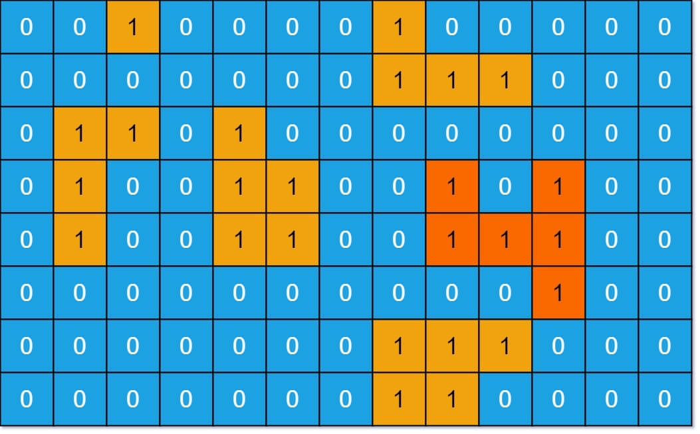

# 网格图 DFS（Python/Java/C++/C/Go/JS/Rust）

> **[695. 岛屿的最大面积](https://leetcode.cn/problems/max-area-of-island/solutions/3756169/wang-ge-tu-dfspythonjavaccgojsrust-by-en-2hsc/) · Medium**

> **所属题单**
> - [网格图 · 一、网格图 DFS](../../../刷题路径/灵神原版题单/网格图/一、网格图%20DFS.md)

> **题目描述**
> 给你一个大小为 `m x n` 的二进制矩阵 `grid` 。
>
> **岛屿** 是由一些相邻的 `1` (代表土地) 构成的组合，这里的「相邻」要求两个 `1` 必须在 **水平或者竖直的四个方向上** 相邻。你可以假设 `grid` 的四个边缘都被 `0`（代表水）包围着。
>
> 岛屿的面积是岛上值为 `1` 的单元格的数目。
>
> 计算并返回 `grid` 中最大的岛屿面积。如果没有岛屿，则返回面积为 `0` 。
>
> **示例 1：**
>
> 
>
> ```
>
> 输入：grid = [[0,0,1,0,0,0,0,1,0,0,0,0,0],[0,0,0,0,0,0,0,1,1,1,0,0,0],[0,1,1,0,1,0,0,0,0,0,0,0,0],[0,1,0,0,1,1,0,0,1,0,1,0,0],[0,1,0,0,1,1,0,0,1,1,1,0,0],[0,0,0,0,0,0,0,0,0,0,1,0,0],[0,0,0,0,0,0,0,1,1,1,0,0,0],[0,0,0,0,0,0,0,1,1,0,0,0,0]]
> 输出：6
> 解释：答案不应该是 11 ，因为岛屿只能包含水平或垂直这四个方向上的 1 。
> ```
>
> **示例 2：**
>
> ```
>
> 输入：grid = [[0,0,0,0,0,0,0,0]]
> 输出：0
> ```
>
> **提示：**
>
> - `m == grid.length`
>
> - `n == grid[i].length`
>
> - `1 <= m, n <= 50`
>
> - `grid[i][j]` 为 `0` 或 `1`

> **题解**
> 做法同 [200. 岛屿数量](https://leetcode.cn/problems/number-of-islands/)，请看 [我的题解](../../0200-0299/0200%20岛屿数量/灵茶山艾府.md)，在 DFS 岛屿的同时统计岛屿格子的个数。
>
> **问**：如何理解这个递归？
>
> **答**：递归的思想是，假设你是一家公司的老板，你不需要万事亲力亲为，而是拆解问题，交给下属去做。我们从岛屿的某个位置 $(i,j)$ 登陆，然后一分为四，把统计岛屿面积的任务交给其他人去处理，自己只需累加其他人统计出来的岛屿面积，再加上 $1$，即 $(i,j)$ 这个格子。
>
> ```python
> class Solution:
>     def maxAreaOfIsland(self, grid: List[List[int]]) -> int:
>         m, n = len(grid), len(grid[0])
>
>         def dfs(i: int, j: int) -> int:
>             area = 1  # (i,j) 这个格子
>             grid[i][j] = 0  # 标记 (i,j) 访问过
>             for x, y in (i, j - 1), (i, j + 1), (i - 1, j), (i + 1, j):  # 左右上下
>                 if 0 <= x < m and 0 <= y < n and grid[x][y]:
>                     # 把统计岛屿面积的任务交给其他人去处理，自己只需累加其他人统计出来的岛屿面积
>                     area += dfs(x, y)
>             return area
>
>         ans = 0
>         for i, row in enumerate(grid):
>             for j, x in enumerate(row):
>                 if x:  # 是陆地，且之前没有访问过
>                     ans = max(ans, dfs(i, j))
>         return ans
> ```
>
>
> #### 复杂度分析
>
> - 时间复杂度：$\mathcal{O}(mn)$，其中 $m$ 和 $n$ 分别为 $\textit{grid}$ 的行数和列数。
> - 空间复杂度：$\mathcal{O}(mn)$。最坏情况下，对于之字形（蛇形）岛屿，递归深度为 $\mathcal{O}(mn)$，需要 $\mathcal{O}(mn)$ 的栈空间。
>
> ## 专题训练
>
> 见下面网格图题单的「**一、网格图 DFS**」。
>
> ## 分类题单
>
> [如何科学刷题？](https://leetcode.cn/circle/discuss/RvFUtj/)
>
> 1. [滑动窗口与双指针（定长/不定长/单序列/双序列/三指针/分组循环）](https://leetcode.cn/circle/discuss/0viNMK/)
> 2. [二分算法（二分答案/最小化最大值/最大化最小值/第K小）](https://leetcode.cn/circle/discuss/SqopEo/)
> 3. [单调栈（基础/矩形面积/贡献法/最小字典序）](https://leetcode.cn/circle/discuss/9oZFK9/)
> 4. [网格图（DFS/BFS/综合应用）](https://leetcode.cn/circle/discuss/YiXPXW/)
> 5. [位运算（基础/性质/拆位/试填/恒等式/思维）](https://leetcode.cn/circle/discuss/dHn9Vk/)
> 6. [图论算法（DFS/BFS/拓扑排序/基环树/最短路/最小生成树/网络流）](https://leetcode.cn/circle/discuss/01LUak/)
> 7. [动态规划（入门/背包/划分/状态机/区间/状压/数位/数据结构优化/树形/博弈/概率期望）](https://leetcode.cn/circle/discuss/tXLS3i/)
> 8. [常用数据结构（前缀和/差分/栈/队列/堆/字典树/并查集/树状数组/线段树）](https://leetcode.cn/circle/discuss/mOr1u6/)
> 9. [数学算法（数论/组合/概率期望/博弈/计算几何/随机算法）](https://leetcode.cn/circle/discuss/IYT3ss/)
> 10. [贪心与思维（基本贪心策略/反悔/区间/字典序/数学/思维/脑筋急转弯/构造）](https://leetcode.cn/circle/discuss/g6KTKL/)
> 11. [链表、二叉树与回溯（前后指针/快慢指针/DFS/BFS/直径/LCA/一般树）](https://leetcode.cn/circle/discuss/K0n2gO/)
> 12. [字符串（KMP/Z函数/Manacher/字符串哈希/AC自动机/后缀数组/子序列自动机）](https://leetcode.cn/circle/discuss/SJFwQI/)
>
> [我的题解精选（已分类）](https://github.com/EndlessCheng/codeforces-go/blob/master/leetcode/SOLUTIONS.md)
>
> 欢迎关注 [B站@灵茶山艾府](https://space.bilibili.com/206214)
