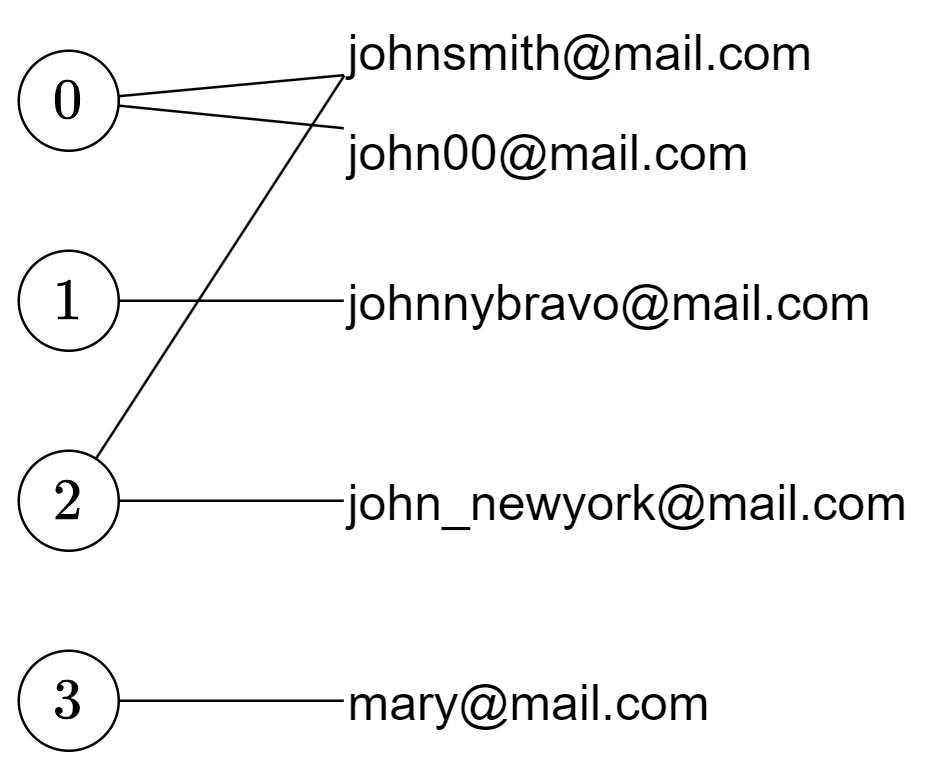

# 哈希表 + DFS（Python/Java/C++/Go/JS/Rust）

> **[721. 账户合并](https://leetcode.cn/problems/accounts-merge/solutions/2844186/ha-xi-biao-dfspythonjavacgojsrust-by-end-z9nh/) · Medium**

> **所属题单**
> - [常用数据结构 · 七、并查集](../../../刷题路径/灵神原版题单/常用数据结构/七、并查集.md) · §7.1 基础
> - [图论算法 · 一、图的遍历](../../../刷题路径/灵神原版题单/图论算法/一、图的遍历.md) · §1.1 深度优先搜索（DFS）

> **题目描述**
> 给定一个列表 `accounts`，每个元素 `accounts[i]` 是一个字符串列表，其中第一个元素 `accounts[i][0]` 是 <em>名称 (name)</em>，其余元素是 <em>**emails**</em> 表示该账户的邮箱地址。
>
> 现在，我们想合并这些账户。如果两个账户都有一些共同的邮箱地址，则两个账户必定属于同一个人。请注意，即使两个账户具有相同的名称，它们也可能属于不同的人，因为人们可能具有相同的名称。一个人最初可以拥有任意数量的账户，但其所有账户都具有相同的名称。
>
> 合并账户后，按以下格式返回账户：每个账户的第一个元素是名称，其余元素是 **按字符 ASCII 顺序排列** 的邮箱地址。账户本身可以以 **任意顺序** 返回。
>
> **示例 1：**
>
> ```
>
> 输入：accounts = [["John", "johnsmith@mail.com", "john00@mail.com"], ["John", "johnnybravo@mail.com"], ["John", "johnsmith@mail.com", "john_newyork@mail.com"], ["Mary", "mary@mail.com"]]
> 输出：[["John", 'john00@mail.com', 'john_newyork@mail.com', 'johnsmith@mail.com'],  ["John", "johnnybravo@mail.com"], ["Mary", "mary@mail.com"]]
> 解释：
> 第一个和第三个 John 是同一个人，因为他们有共同的邮箱地址 "johnsmith@mail.com"。
> 第二个 John 和 Mary 是不同的人，因为他们的邮箱地址没有被其他帐户使用。
> 可以以任何顺序返回这些列表，例如答案 [['Mary'，'mary@mail.com']，['John'，'johnnybravo@mail.com']，
> ['John'，'john00@mail.com'，'john_newyork@mail.com'，'johnsmith@mail.com']] 也是正确的。
> ```
>
> **示例 2：**
>
> ```
>
> 输入：accounts = [["Gabe","Gabe0@m.co","Gabe3@m.co","Gabe1@m.co"],["Kevin","Kevin3@m.co","Kevin5@m.co","Kevin0@m.co"],["Ethan","Ethan5@m.co","Ethan4@m.co","Ethan0@m.co"],["Hanzo","Hanzo3@m.co","Hanzo1@m.co","Hanzo0@m.co"],["Fern","Fern5@m.co","Fern1@m.co","Fern0@m.co"]]
> 输出：[["Ethan","Ethan0@m.co","Ethan4@m.co","Ethan5@m.co"],["Gabe","Gabe0@m.co","Gabe1@m.co","Gabe3@m.co"],["Hanzo","Hanzo0@m.co","Hanzo1@m.co","Hanzo3@m.co"],["Kevin","Kevin0@m.co","Kevin3@m.co","Kevin5@m.co"],["Fern","Fern0@m.co","Fern1@m.co","Fern5@m.co"]]
> ```
>
> **提示：**
>
> - `1 <= accounts.length <= 1000`
>
> - `2 <= accounts[i].length <= 10`
>
> - `1 <= accounts[i][j].length <= 30`
>
> - `accounts[i][0]` 由英文字母组成
>
> - `accounts[i][j] (for j > 0)` 是有效的邮箱地址

> **题解**
> 
>
> 看示例 1，把每个账户用其在 $\textit{accounts}$ 中的下标表示，即节点 $0$ 到 $3$。
>
> 同时，把每个账户的邮箱地址，也视作节点。我们在**账户下标**与其**邮箱地址**之间连边，得到一个**无向图**（二分图）。
>
> 题目相当于求出这个图的每个**连通块**，这可以用 **DFS** 解决。
>
> ### 算法
>
> 1. 把 $\textit{accounts}$ 中的信息提取到哈希表 $\textit{emailToIdx}$ 中，key 为邮箱地址，value 为这个邮箱对应的账户下标列表。
> 2. 初始化一个长为 $n$ 的全为 $\texttt{false}$ 的布尔数组 $\textit{vis}$，用来标记访问过的账户下标。
> 3. 遍历 $\textit{vis}$，如果 $i$ 没有访问过，即 $\textit{vis}[i]=\texttt{false}$，则从 $i$ 开始 DFS。
>      1. DFS 之前，创建一个哈希集合 $\textit{emails}$，用来保存 DFS 中访问到的邮箱地址。
>      2. 开始 DFS。首先标记 $\textit{vis}[i]=\texttt{true}$。
>      3. 遍历 $\textit{accounts}[i]$ 的邮箱地址 $\textit{email}$。
>      4. 如果 $\textit{email}$ 在哈希集合 $\textit{emails}$ 中，则跳过；否则把 $\textit{email}$ 加入哈希集合 $\textit{emails}$。
>      5. 遍历 $\textit{emailToIdx}[\textit{email}]$，也就是所有包含该邮箱地址的账户下标 $j$，如果 $j$ 没有访问过，即 $\textit{vis}[j]=\texttt{false}$，则继续 DFS $j$。
> 4. DFS 结束后，把 $\textit{emails}$ 中的元素按照字典序从小到大排序，然后和 $\textit{accounts}[i][0]$ 一起加入答案。
> 5. 返回答案。
>
> ```python
> class Solution:
>     def accountsMerge(self, accounts: List[List[str]]) -> List[List[str]]:
>         email_to_idx = defaultdict(list)
>         for i, account in enumerate(accounts):
>             for email in account[1:]:
>                 email_to_idx[email].append(i)
>
>         def dfs(i: int) -> None:
>             vis[i] = True
>             for email in accounts[i][1:]:  # 遍历 i 的所有邮箱地址
>                 if email in email_set:
>                     continue
>                 email_set.add(email)
>                 for j in email_to_idx[email]:  # 遍历所有包含该邮箱地址的账户下标 j
>                     if not vis[j]:  # j 没有访问过
>                         dfs(j)
>
>         ans = []
>         vis = [False] * len(accounts)
>         for i, b in enumerate(vis):
>             if not b:  # i 没有访问过
>                 email_set = set()  # 用于收集 DFS 中访问到的邮箱地址
>                 dfs(i)
>                 ans.append([accounts[i][0]] + sorted(email_set))
>         return ans
> ```
>
>
> #### 复杂度分析
>
> - 时间复杂度：$\mathcal{O}(L\log M)$，其中 $L$ 是 $accounts$ 中所有字符串的长度之和，$M$ 是 $accounts$ 中的字符串个数。瓶颈在排序上，把 $\mathcal{O}(M)$ 个总长度为 $\mathcal{O}(L)$ 的字符串排序的时间复杂度为 $\mathcal{O}(L\log M)$。
> - 空间复杂度：$\mathcal{O}(L)$。
>
> ## 分类题单
>
> [如何科学刷题？](https://leetcode.cn/circle/discuss/RvFUtj/)
>
> 1. [滑动窗口（定长/不定长/多指针）](https://leetcode.cn/circle/discuss/0viNMK/)
> 2. [二分算法（二分答案/最小化最大值/最大化最小值/第K小）](https://leetcode.cn/circle/discuss/SqopEo/)
> 3. [单调栈（基础/矩形面积/贡献法/最小字典序）](https://leetcode.cn/circle/discuss/9oZFK9/)
> 4. [网格图（DFS/BFS/综合应用）](https://leetcode.cn/circle/discuss/YiXPXW/)
> 5. [位运算（基础/性质/拆位/试填/恒等式/思维）](https://leetcode.cn/circle/discuss/dHn9Vk/)
> 6. [图论算法（DFS/BFS/拓扑排序/最短路/最小生成树/二分图/基环树/欧拉路径）](https://leetcode.cn/circle/discuss/01LUak/)
> 7. [动态规划（入门/背包/状态机/划分/区间/状压/数位/数据结构优化/树形/博弈/概率期望）](https://leetcode.cn/circle/discuss/tXLS3i/)
> 8. [常用数据结构（前缀和/差分/栈/队列/堆/字典树/并查集/树状数组/线段树）](https://leetcode.cn/circle/discuss/mOr1u6/)
> 9. [数学算法（数论/组合/概率期望/博弈/计算几何/随机算法）](https://leetcode.cn/circle/discuss/IYT3ss/)
> 10. [贪心算法（基本贪心策略/反悔/区间/字典序/数学/思维/脑筋急转弯/构造）](https://leetcode.cn/circle/discuss/g6KTKL/)
>
> [我的题解精选（已分类）](https://github.com/EndlessCheng/codeforces-go/blob/master/leetcode/SOLUTIONS.md)
>
> 欢迎关注 [B站@灵茶山艾府](https://space.bilibili.com/206214)
