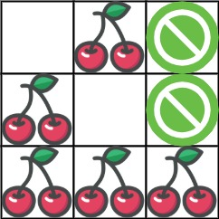

# 教你一步步思考 DP：从记忆化搜索到递推到空间优化！（Python/Java/C++/Go）

> **[741. 摘樱桃](https://leetcode.cn/problems/cherry-pickup/solutions/2766975/jiao-ni-yi-bu-bu-si-kao-dpcong-ji-yi-hua-ruue/) · Hard**

> **所属题单**
> - [动态规划 · 二、网格图 DP](../../../刷题路径/灵神原版题单/动态规划/二、网格图%20DP.md) · §2.2 进阶

> **题目描述**
> 给你一个 `n x n` 的网格 `grid` ，代表一块樱桃地，每个格子由以下三种数字的一种来表示：
>
> - `0` 表示这个格子是空的，所以你可以穿过它。
>
> - `1` 表示这个格子里装着一个樱桃，你可以摘到樱桃然后穿过它。
>
> - `-1` 表示这个格子里有荆棘，挡着你的路。
>
> 请你统计并返回：在遵守下列规则的情况下，能摘到的最多樱桃数：
>
> - 从位置 `(0, 0)` 出发，最后到达 `(n - 1, n - 1)` ，只能向下或向右走，并且只能穿越有效的格子（即只可以穿过值为 `0` 或者 `1` 的格子）；
>
> - 当到达 `(n - 1, n - 1)` 后，你要继续走，直到返回到 `(0, 0) `，只能向上或向左走，并且只能穿越有效的格子；
>
> - 当你经过一个格子且这个格子包含一个樱桃时，你将摘到樱桃并且这个格子会变成空的（值变为 `0` ）；
>
> - 如果在 `(0, 0)` 和 `(n - 1, n - 1)` 之间不存在一条可经过的路径，则无法摘到任何一个樱桃。
>
> **示例 1：**
>
> 
>
> ```
>
> 输入：grid = [[0,1,-1],[1,0,-1],[1,1,1]]
> 输出：5
> 解释：玩家从 (0, 0) 出发：向下、向下、向右、向右移动至 (2, 2) 。
> 在这一次行程中捡到 4 个樱桃，矩阵变成 [[0,1,-1],[0,0,-1],[0,0,0]] 。
> 然后，玩家向左、向上、向上、向左返回起点，再捡到 1 个樱桃。
> 总共捡到 5 个樱桃，这是最大可能值。
> ```
>
> **示例 2：**
>
> ```
>
> 输入：grid = [[1,1,-1],[1,-1,1],[-1,1,1]]
> 输出：0
> ```
>
> **提示：**
>
> - `n == grid.length`
>
> - `n == grid[i].length`
>
> - `1 <= n <= 50`
>
> - `grid[i][j]` 为 `-1`、`0` 或 `1`
>
> - `grid[0][0] != -1`
>
> - `grid[n - 1][n - 1] != -1`

> **题解**
> ## 一、寻找子问题
>
> 从左上角 $(0,0)$ 走到右下角 $(n-1,n-1)$，再走回到左上角 $(0,0)$，相当于有两条从 $(0,0)$ 到 $(n-1,n-1)$ 的路径。
>
> 我们要计算的，是这两条路径的**并集**上的樱桃个数的最大值。
>
> 如果只有一条路径，我们可以像 [64. 最小路径和](https://leetcode.cn/problems/minimum-path-sum/) 那样，定义子问题为：从 $(0,0)$ 到 $(i,j)$ 可以得到的樱桃个数的最大值。
>
> 有两条路径要怎么做呢？
>
> 跑两次 DP？先走一遍最优路径（把 $1$ 改成 $0$），再走一遍剩下的最优路径？这个做法是错的，[反例](https://leetcode.cn/problems/cherry-pickup/description/comments/500785/)，这个反例可以取到所有樱桃，但两次 DP 的做法没法取到所有樱桃。
>
> 所以必须**同时考虑两条路径**。
>
> 为方便描述，假设有两个人 A 和 B，都从 $(0,0)$ 走到右下角 $(n-1,n-1)$。
>
> 假设 $n=3$，如果 A 最后一步从 $(2,1)$ 走到 $(2,2)$，B 最后一步从 $(1,2)$ 走到 $(2,2)$，我们需要计算两人从 $(0,0)$ 分别走到 $(2,1)$ 和 $(1,2)$，这两条路径并集的樱桃个数的最大值。
>
> 虽然说，这是一个和原问题相似的子问题，但两条路径并不是互相独立的，**同一个格子上的樱桃只能统计一次**，我们需要考虑同一个格子重复经过的情况。
>
> 如果把子问题定义成：从 $(0,0)$ 出发，A 走了 $p$ 步，B 走了 $q$ 步，分别走到 $(i_1,j_1)$ 和 $(i_2,j_2)$ 可以得到的樱桃个数的最大值。在 $p\ne q$ 的情况下，比如 $p<q$，A 不知道哪些格子 B 已经走过了，无法计算重复经过的情况。所以，把子问题定义成两个人**都走了同样的步数**，也就是 $p=q$ 的情况，才能直接计算出重复经过的情况，也就是两人走到同一个格子。在上面的例子中，我们需要计算两人从 $(0,0)$ 出发，都走了 $3$ 步，分别走到 $(2,1)$ 和 $(1,2)$，可以得到的樱桃个数的最大值。
>
> ## 二、状态定义与状态转移方程
>
> 定义 $\textit{dfs}(t,i_1,j,i_2,k)$ 表示两人从 $(0,0)$ 出发，都走了 $t$ 步，分别走到 $(i_1,j)$ 和 $(i_2,k)$，可以得到的樱桃个数的最大值。
>
> 状态维度有点多，能否简化？
>
> 注意到，从 $(0,0)$ 出发，我们只能向下（这会让 $i$ 加一）或向右（这会让 $j$ 加一），所以 $i+j$ 就是走的步数 $t$，所以 $i_1$ 和 $i_2$ 是多余的，可以去掉。
>
> 于是，定义 $\textit{dfs}(t,j,k)$ 表示两人从 $(0,0)$ 出发，都走了 $t$ 步，分别走到 $(t-j,j)$ 和 $(t-k,k)$，可以得到的樱桃个数的最大值。
>
> 考虑 A 和 B 最后一步怎么走，也就是他们上一步的位置：
>
> - A 往下走，B 往下走，那么问题变成两人从 $(0,0)$ 出发，都走了 $t-1$ 步，分别走到 $(t-1-j,j)$ 和 $(t-1-k,k)$，可以得到的樱桃个数的最大值，即 $\textit{dfs}(t-1,j,k)$。
> - A 往下走，B 往右走，那么问题变成两人从 $(0,0)$ 出发，都走了 $t-1$ 步，分别走到 $(t-1-j,j)$ 和 $(t-k,k-1)$，可以得到的樱桃个数的最大值，即 $\textit{dfs}(t-1,j,k-1)$。
> - A 往右走，B 往下走，那么问题变成两人从 $(0,0)$ 出发，都走了 $t-1$ 步，分别走到 $(t-j,j-1)$ 和 $(t-1-k,k)$，可以得到的樱桃个数的最大值，即 $\textit{dfs}(t-1,j-1,k)$。
> - A 往右走，B 往右走，那么问题变成两人从 $(0,0)$ 出发，都走了 $t-1$ 步，分别走到 $(t-j,j-1)$ 和 $(t-k,k-1)$，可以得到的樱桃个数的最大值，即 $\textit{dfs}(t-1,j-1,k-1)$。
>
> 这四种情况取最大值，再加上 $\textit{grid}[t-j][j]$ 和 $\textit{grid}[t-k][k]$（两人位置重合时只加一个），就得到了 $\textit{dfs}(t,j,k)$，即
>
> $$
> \textit{dfs}(t,j,k) = \max(\textit{dfs}(t-1,j,k), \textit{dfs}(t-1,j,k-1), \textit{dfs}(t-1,j-1,k), \textit{dfs}(t-1,j-1,k-1)) + \textit{val}
> $$
>
> 其中
>
> $$
> \textit{val} =
> \begin{cases}
> \textit{grid}[t-j][j] + \textit{grid}[t-k][k],&j \ne k\\
> \textit{grid}[t-j][j],&j=k
> \end{cases}
> $$
>
> 递归边界 1：如果 $j,k,t-j,t-k,\textit{grid}[t-j][j], \textit{grid}[t-k][k]$ 中的任何一个数小于 $0$（出界或者访问到 $-1$ 格子），返回 $-\infty$。
>
> 递归边界 2：$\textit{dfs}(0,0,0) = \textit{grid}[0][0]$。
>
> 递归入口：$\textit{dfs}(2n-2,n-1,n-1)$，也就是答案。如果答案小于 $0$，说明路被荆棘（$-1$）挡住了，按照题目要求，返回 $0$。
>
> ## 三、递归搜索 + 保存递归返回值 = 记忆化搜索
>
> 考虑到整个递归过程中有大量重复递归调用（递归入参相同）。由于递归函数没有副作用，同样的入参无论计算多少次，算出来的结果都是一样的，因此可以用**记忆化搜索**来优化：
>
> - 如果一个状态（递归入参）是第一次遇到，那么可以在返回前，把状态及其结果记到一个 $\textit{memo}$ 数组中。
> - 如果一个状态不是第一次遇到（$\textit{memo}$ 中保存的结果不等于 $\textit{memo}$ 的初始值），那么可以直接返回 $\textit{memo}$ 中保存的结果。
>
> **注意**：$\textit{memo}$ 数组的**初始值**一定不能等于要记忆化的值！例如初始值设置为 $0$，并且要记忆化的 $\textit{dfs}(t,j,k)$ 也等于 $0$，那就没法判断 $0$ 到底表示第一次遇到这个状态，还是表示之前遇到过了，从而导致记忆化失效。一般把初始值设置为 $-1$。
>
> > Python 用户可以无视上面这段，直接用 `@cache` 装饰器。
>
> 具体请看视频讲解 [动态规划入门：从记忆化搜索到递推](https://www.bilibili.com/video/BV1Xj411K7oF/)，其中包含如何把记忆化搜索 1:1 翻译成递推的技巧。
>
> ```python
> class Solution:
>     def cherryPickup(self, grid: List[List[int]]) -> int:
>         @cache  # 缓存装饰器，避免重复计算 dfs 的结果（记忆化）
>         def dfs(t: int, j: int, k: int) -> int:
>             # 不能出界，不能访问 -1 格子
>             if j < 0 or k < 0 or t < j or t < k or grid[t - j][j] < 0 or grid[t - k][k] < 0:
>                 return -inf
>             if t == 0:  # 此时 j = k = 0
>                 return grid[0][0]
>             return max(dfs(t - 1, j, k), dfs(t - 1, j, k - 1), dfs(t - 1, j - 1, k), dfs(t - 1, j - 1, k - 1)) + \
>                 grid[t - j][j] + (grid[t - k][k] if k != j else 0)
>         n = len(grid)
>         return max(dfs(n * 2 - 2, n - 1, n - 1), 0)
> ```
>
>
> #### 复杂度分析
>
> - 时间复杂度：$\mathcal{O}(n^3)$，其中 $n$ 为 $\textit{grid}$ 的行数和列数。由于每个状态只会计算一次，动态规划的时间复杂度 $=$ 状态个数 $\times$ 单个状态的计算时间。本题状态个数等于 $\mathcal{O}(n^3)$，单个状态的计算时间为 $\mathcal{O}(1)$，所以动态规划的时间复杂度为 $\mathcal{O}(n^3)$。
> - 空间复杂度：$\mathcal{O}(n^3)$。保存多少状态，就需要多少空间。
>
> ## 四、1:1 翻译成递推
>
> 我们可以去掉递归中的「递」，只保留「归」的部分，即自底向上计算。
>
> 具体来说，$f[t][j][k]$ 的定义和 $\textit{dfs}(t,j,k)$ 的定义是一样的，都表示两人从 $(0,0)$ 出发，都走了 $t$ 步，分别走到 $(t-j,j)$ 和 $(t-k,k)$，可以得到的樱桃个数的最大值。
>
> 相应的递推式（状态转移方程）也和 $\textit{dfs}$ 一样：
>
> $$
> f[t][j][k] = \max(f[t-1][j][k], f[t-1][j][k-1], f[t-1][j-1][k], f[t-1][j-1][k-1]) + \textit{val}
> $$
>
> 其中
>
> $$
> \textit{val} =
> \begin{cases}
> \textit{grid}[t-j][j] + \textit{grid}[t-k][k],&j \ne k\\
> \textit{grid}[t-j][j],&j=k
> \end{cases}
> $$
>
> 但是，这种定义方式**没有状态能表示递归边界**，即 $j=-1,\ k=-1$ 这种出界的情况。
>
> 解决办法：在每个 $f[i]$ 的最左边和最上边各插入一排状态，那么其余状态全部向右和向下偏移一位，把 $f[t][j][k]$ 改为 $f[t][j+1][k+1]$。
>
> 修改后 $f[t][j+1][k+1]$ 表示两人从 $(0,0)$ 出发，都走了 $t$ 步，分别走到 $(t-j,j)$ 和 $(t-k,k)$，可以得到的樱桃个数的最大值。此时 $f[t][0][\cdot]$ 和 $f[t][\cdot][0]$ 就对应出界的情况了。
>
> 修改后的递推式为
>
> $$
> f[t][j+1][k+1] = \max(f[t-1][j+1][k+1], f[t-1][j+1][k], f[t-1][j][k+1], f[t-1][j][k]) + \textit{val}
> $$
>
> 注意我们只在 $f$ 数组上插入了状态，这只会影响 $f$ 的下标，$\textit{val}$ 的计算方式不变。
>
> 初始值 $f[t][j][k]= -\infty,\ f[0][1][1] = \textit{grid}[0][0]$。
>
> 答案为 $\max(f[2n-2][n][n],0)$。
>
> ### 循环范围
>
> 代码实现时，我们还需要讨论清楚 $j$ 和 $k$ 的范围。
>
> 由于 $i+j = t$ 且 $0\le i \le n-1$ 且 $0\le j \le n-1$，联立得
>
> $$
> \max(t-n+1, 0) \le j \le \min(t, n-1)
> $$
>
> 对于 $k$ 也同理。
>
> 此外，我们可以假定 A 走的是两条路径的下轮廓，B 走的是两条路径的上轮廓（求并集后看不出区别），所以只需计算 $k\ge j$ 的状态。
>
> ```python
> class Solution:
>     def cherryPickup(self, grid: List[List[int]]) -> int:
>         n = len(grid)
>         f = [[[-inf] * (n + 1) for _ in range(n + 1)] for _ in range(n * 2 - 1)]
>         f[0][1][1] = grid[0][0]
>         for t in range(1, n * 2 - 1):
>             for j in range(max(t - n + 1, 0), min(t + 1, n)):
>                 if grid[t - j][j] < 0: continue
>                 for k in range(j, min(t + 1, n)):
>                     if grid[t - k][k] < 0: continue
>                     f[t][j + 1][k + 1] = max(f[t - 1][j + 1][k + 1], f[t - 1][j + 1][k], f[t - 1][j][k + 1], f[t - 1][j][k]) + \
>                                          grid[t - j][j] + (grid[t - k][k] if k != j else 0)
>         return max(f[-1][n][n], 0)
> ```
>
>
> #### 复杂度分析
>
> - 时间复杂度：$\mathcal{O}(n^3)$，其中 $n$ 为 $\textit{grid}$ 的行数和列数。
> - 空间复杂度：$\mathcal{O}(n^3)$。
>
> ## 五、空间优化
>
> 观察上面的状态转移方程，在计算 $f[t]$ 时，只会用到 $f[t-1]$，不会用到比 $t-1$ 更早的状态。
>
> 因此可以像 0-1 背包那样，去掉第一个维度，倒序枚举 $j$ 和 $k$。为什么要倒序请看 [视频讲解：0-1 背包](https://www.bilibili.com/video/BV16Y411v7Y6/)。
>
> 状态转移方程改为
>
> $$
> f[j+1][k+1] = \max(f[j+1][k+1], f[j+1][k], f[j][k+1], f[j][k]) + \textit{val}
> $$
>
> 初始值 $f[j][k]= -\infty,\ f[1][1] = \textit{grid}[0][0]$。
>
> 答案为 $\max(f[n][n],0)$。
>
> ```python
> class Solution:
>     def cherryPickup(self, grid: List[List[int]]) -> int:
>         n = len(grid)
>         f = [[-inf] * (n + 1) for _ in range(n + 1)]
>         f[1][1] = grid[0][0]
>         for t in range(1, n * 2 - 1):
>             for j in range(min(t, n - 1), max(t - n, -1), -1):
>                 for k in range(min(t, n - 1), j - 1, -1):
>                     if grid[t - j][j] < 0 or grid[t - k][k] < 0:
>                         f[j + 1][k + 1] = -inf
>                     else:
>                         f[j + 1][k + 1] = max(f[j + 1][k + 1], f[j + 1][k], f[j][k + 1], f[j][k]) + \
>                                           grid[t - j][j] + (grid[t - k][k] if k != j else 0)
>         return max(f[n][n], 0)
> ```
>
>
> #### 复杂度分析
>
> - 时间复杂度：$\mathcal{O}(n^3)$，其中 $n$ 为 $\textit{grid}$ 的行数和列数。
> - 空间复杂度：$\mathcal{O}(n^2)$。
>
> ## 分类题单
>
> [如何科学刷题？](https://leetcode.cn/circle/discuss/RvFUtj/)
>
> 1. [滑动窗口与双指针（定长/不定长/单序列/双序列/三指针/分组循环）](https://leetcode.cn/circle/discuss/0viNMK/)
> 2. [二分算法（二分答案/最小化最大值/最大化最小值/第K小）](https://leetcode.cn/circle/discuss/SqopEo/)
> 3. [单调栈（基础/矩形面积/贡献法/最小字典序）](https://leetcode.cn/circle/discuss/9oZFK9/)
> 4. [网格图（DFS/BFS/综合应用）](https://leetcode.cn/circle/discuss/YiXPXW/)
> 5. [位运算（基础/性质/拆位/试填/恒等式/思维）](https://leetcode.cn/circle/discuss/dHn9Vk/)
> 6. [图论算法（DFS/BFS/拓扑排序/基环树/最短路/最小生成树/网络流）](https://leetcode.cn/circle/discuss/01LUak/)
> 7. [动态规划（入门/背包/划分/状态机/区间/状压/数位/数据结构优化/树形/博弈/概率期望）](https://leetcode.cn/circle/discuss/tXLS3i/)
> 8. [常用数据结构（前缀和/差分/栈/队列/堆/字典树/并查集/树状数组/线段树）](https://leetcode.cn/circle/discuss/mOr1u6/)
> 9. [数学算法（数论/组合/概率期望/博弈/计算几何/随机算法）](https://leetcode.cn/circle/discuss/IYT3ss/)
> 10. [贪心与思维（基本贪心策略/反悔/区间/字典序/数学/思维/脑筋急转弯/构造）](https://leetcode.cn/circle/discuss/g6KTKL/)
> 11. [链表、二叉树与回溯（前后指针/快慢指针/DFS/BFS/直径/LCA/一般树）](https://leetcode.cn/circle/discuss/K0n2gO/)
> 12. [字符串（KMP/Z函数/Manacher/字符串哈希/AC自动机/后缀数组/子序列自动机）](https://leetcode.cn/circle/discuss/SJFwQI/)
>
> [我的题解精选（已分类）](https://github.com/EndlessCheng/codeforces-go/blob/master/leetcode/SOLUTIONS.md)
>
> 欢迎关注 [B站@灵茶山艾府](https://space.bilibili.com/206214)
