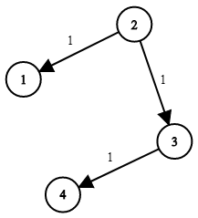

# 两种 Dijkstra 写法，附题单（Python/Java/C++/Go/JS/Rust）

> **[743. 网络延迟时间](https://leetcode.cn/problems/network-delay-time/solutions/2668220/liang-chong-dijkstra-xie-fa-fu-ti-dan-py-ooe8/) · Medium**

> **所属题单**
> - [图论算法 · 三、最短路](../../../刷题路径/灵神原版题单/图论算法/三、最短路.md) · §3.1 单源最短路：Dijkstra 算法

> **题目描述**
> 有 `n` 个网络节点，标记为 `1` 到 `n`。
>
> 给你一个列表 `times`，表示信号经过 **有向** 边的传递时间。 `times[i] = (u_i, v_i, w_i)`，其中 `u_i` 是源节点，`v_i` 是目标节点， `w_i` 是一个信号从源节点传递到目标节点的时间。
>
> 现在，从某个节点 `K` 发出一个信号。需要多久才能使所有节点都收到信号？如果不能使所有节点收到信号，返回 `-1` 。
>
> **示例 1：**
>
> 
>
> ```
>
> 输入：times = [[2,1,1],[2,3,1],[3,4,1]], n = 4, k = 2
> 输出：2
> ```
>
> **示例 2：**
>
> ```
>
> 输入：times = [[1,2,1]], n = 2, k = 1
> 输出：1
> ```
>
> **示例 3：**
>
> ```
>
> 输入：times = [[1,2,1]], n = 2, k = 2
> 输出：-1
> ```
>
> **提示：**
>
> - `1 <= k <= n <= 100`
>
> - `1 <= times.length <= 6000`
>
> - `times[i].length == 3`
>
> - `1 <= u_i, v_i <= n`
>
> - `u_i != v_i`
>
> - `0 <= w_i <= 100`
>
> - 所有 `(u_i, v_i)` 对都 **互不相同**（即，不含重复边）

> **题解**
> ## Dijkstra 算法介绍
>
> 定义 $g[i][j]$ 表示节点 $i$ 到节点 $j$ 这条边的边权。如果没有 $i$ 到 $j$ 的边，则 $g[i][j]=\infty$。
>
> 定义 $\textit{dis}[i]$ 表示起点 $k$ 到节点 $i$ 的最短路长度，一开始 $\textit{dis}[k]=0$，其余 $\textit{dis}[i]=\infty$ 表示尚未计算出。
>
> 我们的目标是计算出最终的 $\textit{dis}$ 数组。
>
> - 首先更新起点 $k$ 到其邻居 $y$ 的最短路，即更新 $\textit{dis}[y]$ 为 $g[k][y]$。
> - 然后取除了起点 $k$ 以外的 $\textit{dis}[i]$ 的最小值，假设最小值对应的节点是 $3$。此时可以断言：$\textit{dis}[3]$ 已经是 $k$ 到 $3$ 的最短路长度，不可能有其它 $k$ 到 $3$ 的路径更短！反证法：假设存在更短的路径，那我们一定会从 $k$ 出发经过一个点 $u$，它的 $\textit{dis}[u]$ 比 $\textit{dis}[3]$ 还要小，然后再经过一些边到达 $3$，得到更小的 $\textit{dis}[3]$。但 $\textit{dis}[3]$ 已经是最小的了，并且图中**没有负数边权**，所以 $u$ 是不存在的，矛盾。故原命题成立，此时我们得到了 $\textit{dis}[3]$ 的最终值。
> - 用节点 $3$ 到其邻居 $y$ 的边权 $g[3][y]$ 更新 $\textit{dis}[y]$：如果 $\textit{dis}[3] + g[3][y] < \textit{dis}[y]$，那么更新 $\textit{dis}[y]$ 为 $\textit{dis}[3] + g[3][y]$，否则不更新。
> - 然后取除了节点 $k,3$ 以外的 $\textit{dis}[i]$ 的最小值，重复上述过程。
> - 由数学归纳法可知，这一做法可以得到每个点的最短路。当所有点的最短路都已确定时，算法结束。
>
> ## 写法一：朴素 Dijkstra（适用于稠密图）
>
> > **稠密图**：边的数量级和 $n^2$ 相当的图。
>
> 对于本题，在计算最短路时，如果发现当前找到的最小最短路等于 $\infty$，说明有节点无法到达，可以提前结束算法，返回 $-1$。
>
> 如果所有节点都可以到达，返回 $\max(\textit{dis})$。
>
> 代码实现时，节点编号改成从 $0$ 开始。
>
> ```python
> class Solution:
>     def networkDelayTime(self, times: List[List[int]], n: int, k: int) -> int:
>         g = [[inf for _ in range(n)] for _ in range(n)]  # 邻接矩阵
>         for x, y, d in times:
>             g[x - 1][y - 1] = d
>
>         dis = [inf] * n
>         ans = dis[k - 1] = 0
>         done = [False] * n
>         while True:
>             x = -1
>             for i, ok in enumerate(done):
>                 if not ok and (x < 0 or dis[i] < dis[x]):
>                     x = i
>             if x < 0:
>                 return ans  # 最后一次算出的最短路就是最大的
>             if dis[x] == inf:  # 有节点无法到达
>                 return -1
>             ans = dis[x]  # 求出的最短路会越来越大
>             done[x] = True  # 最短路长度已确定（无法变得更小）
>             for y, d in enumerate(g[x]):
>                 # 更新 x 的邻居的最短路
>                 dis[y] = min(dis[y], dis[x] + d)
> ```
>
>
> #### 复杂度分析
>
> - 时间复杂度：$\mathcal{O}(n^2)$。
> - 空间复杂度：$\mathcal{O}(n^2)$。
>
> ## 写法二：堆优化 Dijkstra（适用于稀疏图）
>
> > **稀疏图**：边的数量远小于 $n^2$ 的图。
>
> 寻找最小值的过程可以用一个最小堆来快速完成：
>
> - 一开始把 $(\textit{dis}[k],k)$ 二元组入堆。
> - 当节点 $x$ 首次出堆时，$\textit{dis}[x]$ 就是写法一中寻找的最小最短路。
> - 更新 $\textit{dis}[y]$ 时，把 $(\textit{dis}[y],y)$ 二元组入堆。
>
> 注意，如果一个节点 $x$ 在出堆前，其最短路长度 $\textit{dis}[x]$ 被多次更新，那么堆中会有多个重复的 $x$，并且包含 $x$ 的二元组中的 $\textit{dis}[x]$ 是互不相同的（因为我们只在找到更小的最短路时才会把二元组入堆）。
>
> 所以写法一中的 $\textit{done}$ 数组可以省去，取而代之的是用出堆的最短路值（记作 $\textit{dx}$）与当前的 $\textit{dis}[x]$ 比较，如果 $\textit{dx} > \textit{dis}[x]$ 说明 $x$ 之前出堆过，我们已经更新了 $x$ 的邻居的最短路，所以这次就不用更新了，继续外层循环。
>
> ### 答疑
>
> **问**：为什么代码要判断 `dx > dis[x]`？
>
> **答**：对于同一个 $x$，例如先入堆一个比较大的 $\textit{dis}[x]=10$，后面又把 $\textit{dis}[x]$ 更新成 $5$，之后这个 $5$ 会先出堆，然后再把 $10$ 出堆。$10$ 出堆时候是没有必要去更新周围邻居的最短路的，因为 $5$ 出堆之后，就已经把邻居的最短路更新过了，用 $10$ 是无法把邻居的最短路变得更短的，所以直接 `continue`。
>
> ```python
> class Solution:
>     def networkDelayTime(self, times: List[List[int]], n: int, k: int) -> int:
>         g = [[] for _ in range(n)]  # 邻接表
>         for x, y, d in times:
>             g[x - 1].append((y - 1, d))
>
>         dis = [inf] * n
>         dis[k - 1] = 0
>         h = [(0, k - 1)]
>         while h:
>             dx, x = heappop(h)
>             if dx > dis[x]:  # x 之前出堆过
>                 continue
>             for y, d in g[x]:
>                 new_dis = dx + d
>                 if new_dis < dis[y]:
>                     dis[y] = new_dis  # 更新 x 的邻居的最短路
>                     heappush(h, (new_dis, y))
>         mx = max(dis)
>         return mx if mx < inf else -1
> ```
>
>
> #### 复杂度分析
>
> - 时间复杂度：$\mathcal{O}(m\log m)$，其中 $m$ 为 $\textit{times}$ 的长度。由于 $m\ge n-1$，分析复杂度时以 $m$ 为主。注意堆中会有重复节点，所以至多有 $\mathcal{O}(m)$ 个元素，单次操作的复杂度是 $\mathcal{O}(\log m)$。值得注意的是，如果输入的是稠密图，写法二的时间复杂度为 $\mathcal{O}(n^2\log n)$，不如写法一。
> - 空间复杂度：$\mathcal{O}(m)$。
>
> 更多相似题目，见下面图论题单中的「**单源最短路**」。
>
> ## 分类题单
>
> [如何科学刷题？](https://leetcode.cn/circle/discuss/RvFUtj/)
>
> 1. [滑动窗口与双指针（定长/不定长/单序列/双序列/三指针/分组循环）](https://leetcode.cn/circle/discuss/0viNMK/)
> 2. [二分算法（二分答案/最小化最大值/最大化最小值/第K小）](https://leetcode.cn/circle/discuss/SqopEo/)
> 3. [单调栈（基础/矩形面积/贡献法/最小字典序）](https://leetcode.cn/circle/discuss/9oZFK9/)
> 4. [网格图（DFS/BFS/综合应用）](https://leetcode.cn/circle/discuss/YiXPXW/)
> 5. [位运算（基础/性质/拆位/试填/恒等式/思维）](https://leetcode.cn/circle/discuss/dHn9Vk/)
> 6. [图论算法（DFS/BFS/拓扑排序/基环树/最短路/最小生成树/网络流）](https://leetcode.cn/circle/discuss/01LUak/)
> 7. [动态规划（入门/背包/划分/状态机/区间/状压/数位/数据结构优化/树形/博弈/概率期望）](https://leetcode.cn/circle/discuss/tXLS3i/)
> 8. [常用数据结构（前缀和/差分/栈/队列/堆/字典树/并查集/树状数组/线段树）](https://leetcode.cn/circle/discuss/mOr1u6/)
> 9. [数学算法（数论/组合/概率期望/博弈/计算几何/随机算法）](https://leetcode.cn/circle/discuss/IYT3ss/)
> 10. [贪心与思维（基本贪心策略/反悔/区间/字典序/数学/思维/脑筋急转弯/构造）](https://leetcode.cn/circle/discuss/g6KTKL/)
> 11. [链表、二叉树与回溯（前后指针/快慢指针/DFS/BFS/直径/LCA/一般树）](https://leetcode.cn/circle/discuss/K0n2gO/)
> 12. [字符串（KMP/Z函数/Manacher/字符串哈希/AC自动机/后缀数组/子序列自动机）](https://leetcode.cn/circle/discuss/SJFwQI/)
>
> [我的题解精选（已分类）](https://github.com/EndlessCheng/codeforces-go/blob/master/leetcode/SOLUTIONS.md)
>
> 欢迎关注 [B站@灵茶山艾府](https://space.bilibili.com/206214)
