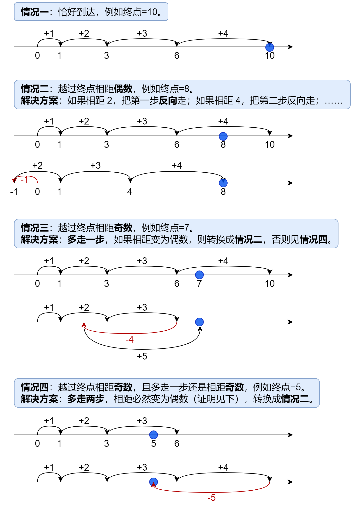

# 分类讨论+详细证明+简洁写法+优化（Python/Java/C++/Go）

> **[754. 到达终点数字](https://leetcode.cn/problems/reach-a-number/solutions/1947254/fen-lei-tao-lun-xiang-xi-zheng-ming-jian-sqj2/) · Medium · 难度分 2000**

> **所属题单**
> - [贪心算法 · 四、数学贪心](../../../刷题路径/灵神原版题单/贪心算法/四、数学贪心.md) · §4.7 其他数学贪心

> **题目描述**
> 在一根无限长的数轴上，你站在`0`的位置。终点在`target`的位置。
>
> 你可以做一些数量的移动 `numMoves` :
>
> - 每次你可以选择向左或向右移动。
>
> - 第 `i` 次移动（从  `i == 1` 开始，到 `i == numMoves` ），在选择的方向上走 `i` 步。
>
> 给定整数 `target` ，返回 <em>到达目标所需的 **最小** 移动次数(即最小 `numMoves` )</em> 。
>
> **示例 1:**
>
> ```
>
> 输入: target = 2
> 输出: 3
> 解释:
> 第一次移动，从 0 到 1 。
> 第二次移动，从 1 到 -1 。
> 第三次移动，从 -1 到 2 。
> ```
>
> **示例 2:**
>
> ```
>
> 输入: target = 3
> 输出: 2
> 解释:
> 第一次移动，从 0 到 1 。
> 第二次移动，从 1 到 3 。
> ```
>
> **提示:**
>
> - `-10⁹ <= target <= 10⁹`
>
> - `target != 0`

> **题解**
> 如果**不回头**地往终点走 $n$ 步，并恰好能走到终点，那么答案就是 $n$。
>
> 如果无法恰好走到终点，就需要仔细讨论了：
>
> 
>
> #### 答疑
>
> 为方便描述，如果终点 $\textit{target}<0$，根据对称性，可将其变为 $-\textit{target}$，这不影响结果。
>
> **问**：对于情况四，为什么多走两步一定可以把到终点的距离变为偶数？
>
> **答**：此时相距为奇数，多走两步，奇数再加上两个相邻数字（必定一偶一奇），即奇数+偶数+奇数，可以得到偶数。
>
> **问**：为什么相距为偶数时，一定可以通过把**某些**步反向，恰好到达终点？
>
> **答**：设走了 $n$ 步后，步长之和 $s=1+2+\cdots+n=\dfrac{n(n+1)}{2}$。
> &emsp;&emsp;这里需要一个小结论：$[1,s]$ 内的每个数字都可以由若干个不同的 $[1,n]$ 内的数组成。
> &emsp;&emsp;证明：$n=1,2$ 时显然。假设 $n=k\ (k\ge 2)$ 时结论成立，此时已经得到了 $[1,s]$ 内的每个数字（这里 $s=\dfrac{k(k+1)}{2}$），我们可以用 $[s-k,s]$ 内的数字加上 $k+1$，从而得到 $[s+1,s+k+1]$ 内的每个数字，即得到了 $[1,s+k+1]$ 内的每个数字，即证明了当 $n=k+1$ 时结论也成立。根据数学归纳法，原结论成立。
> &emsp;&emsp;由于相距 $d=s-\textit{target}<s$，根据结论，在 $d$ 为偶数时，一定可以选择某些步，满足这些步长的和为 $\dfrac{d}{2}$，将这些步反向，就能恰好到达终点。
>
> **问**：为什么按图中的方法，走的步数一定是最小的？
>
> **答**：将原问题转换成一个等价问题「先一直往终点走，然后选择某些步反向，所需要的最小步数」，然后在该问题上讨论。
> &emsp;&emsp;情况一二可以用反证法，不走 $n$ 步根本无法到达终点（这里第 $n$ 步恰好到达或越过终点）。
> &emsp;&emsp;情况三四，由于反向操作只能将 $s$ 减少偶数，无法处理相距奇数的情况，必须多走一两步，将相距变为偶数，才能处理。
>
> 代码实现时，我们可以不断循环，累加当前步长 $n$，当到达（越过）终点且相距偶数时停止。最后一步的步长即为答案。
>
> ```python
> class Solution:
>     def reachNumber(self, target: int) -> int:
>         target = abs(target)
>         s = n = 0
>         while s < target or (s - target) % 2:  # 没有到达（越过）终点，或者相距奇数
>             n += 1
>             s += n
>         return n
> ```
>
>
> #### 复杂度分析
>
> - 时间复杂度：$O(\sqrt{|\textit{target}|})$。
> - 空间复杂度：$O(1)$，仅用到若干变量。
>
> #### 优化
>
> 进一步地，由于 $n$ 是最小的满足 $\dfrac{n(n+1)}{2} \ge |\textit{target}|$ 的 $n$，解得
>
> $$
> n = \left\lceil\dfrac{-1+\sqrt{8\cdot |\textit{target}|+1}}{2}\right\rceil
> $$
>
> 这样可以省去循环判断。
>
> 情况三四也可以进一步讨论：
>
> - 如果是情况三，说明下一步 $n+1$ 是奇数，即 $n$ 为偶数，此时答案为 $n+1$；
> - 如果是情况四，说明下一步 $n+1$ 是偶数，即 $n$ 为奇数，此时答案为 $n+2$。
>
> 因此情况三四可以合并为一个公式：
>
> $$
> n+1+(n\bmod 2)
> $$
>
> ```python
> class Solution:
>     def reachNumber(self, target: int) -> int:
>         target = abs(target)
>         n = ceil((-1 + (8 * target + 1) ** 0.5) / 2)
>         return n if (n * (n + 1) // 2 - target) % 2 == 0 else n + 1 + n % 2
> ```
>
>
> #### 复杂度分析
>
> - 时间复杂度：$O(1)$。
> - 空间复杂度：$O(1)$，仅用到若干变量。
>
> ---
>
> 欢迎关注我的B站频道：[灵茶山艾府](https://space.bilibili.com/206214)，每周更新算法讲解视频~
