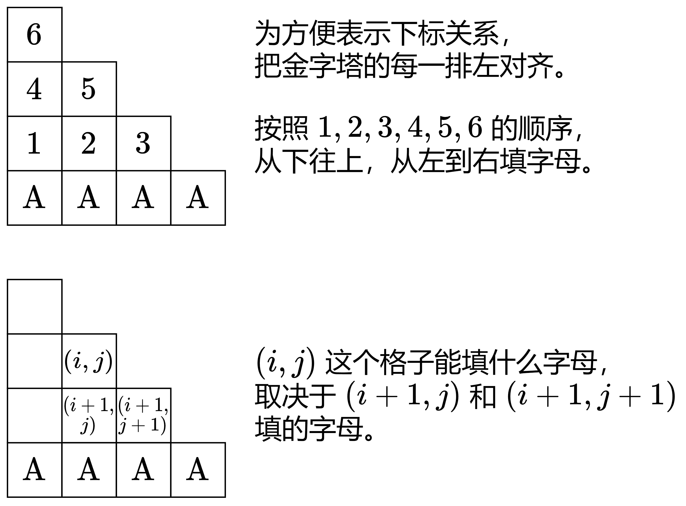
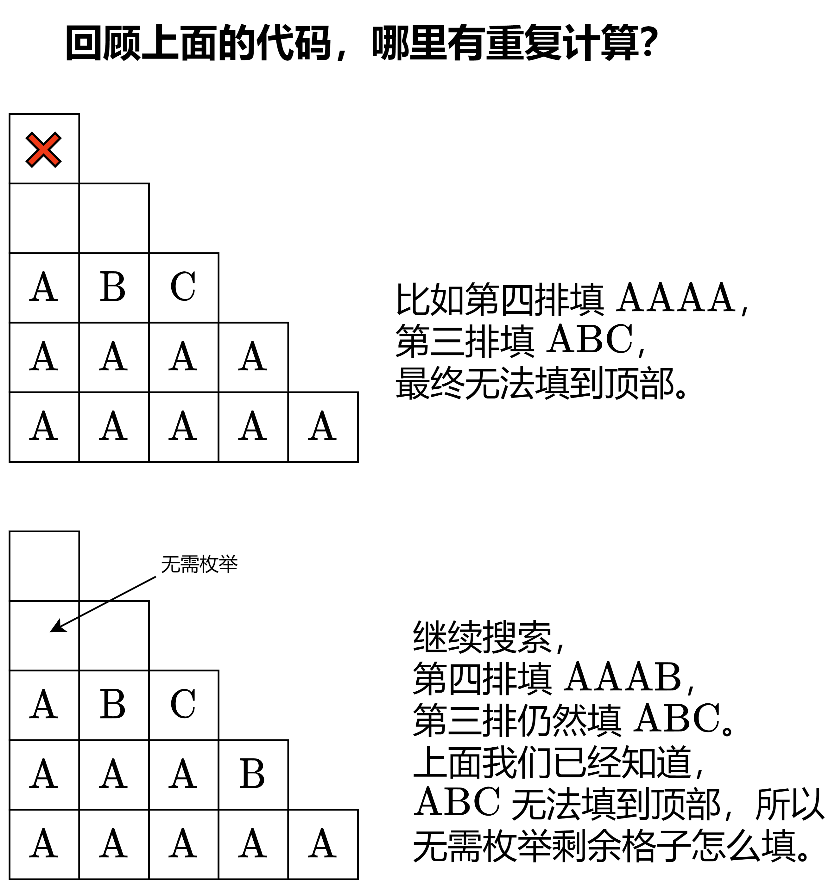
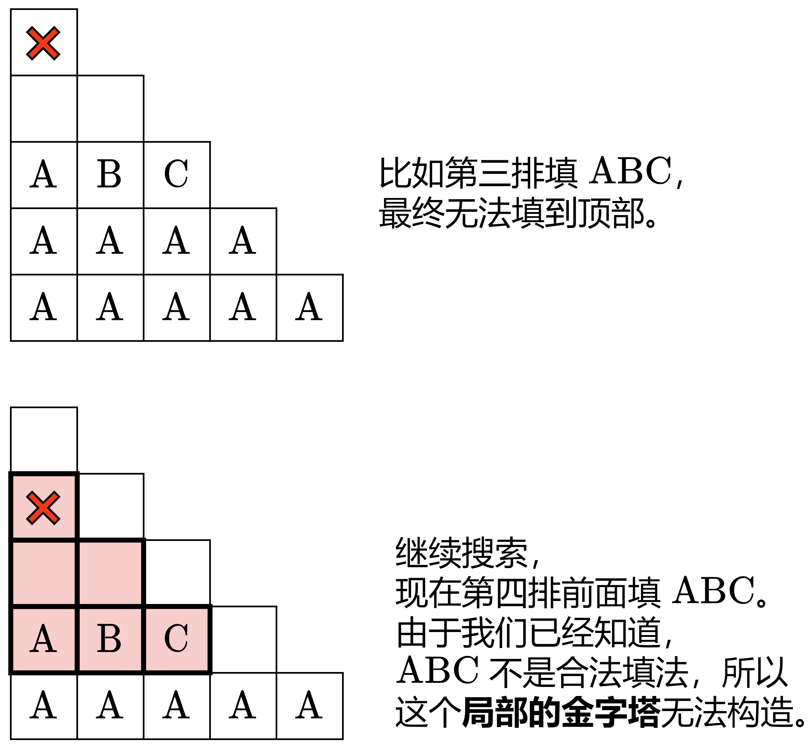

# 【图解】回溯 + vis 优化 + 位运算优化（Python/Java/C++/Go）

> **[756. 金字塔转换矩阵](https://leetcode.cn/problems/pyramid-transition-matrix/solutions/3866474/tu-jie-hui-su-vis-you-hua-pythonjavacgo-9kcb9/) · Medium · 难度分 1990**

> **所属题单**
> - [链表、二叉树与回溯 · 四、回溯](../../../刷题路径/灵神原版题单/链表、二叉树与回溯/四、回溯.md) · §4.7 搜索
> - [动态规划 · 九、状态压缩 DP（状压 DP）](../../../刷题路径/灵神原版题单/动态规划/九、状态压缩%20DP（状压%20DP）.md) · §9.5 轮廓线 DP

> **题目描述**
> 你正在把积木堆成金字塔。每个块都有一个颜色，用一个字母表示。每一行的块比它下面的行 **少一个块** ，并且居中。
>
> 为了使金字塔美观，只有特定的 **三角形图案** 是允许的。一个三角形的图案由 **两个块** 和叠在上面的 **单个块** 组成。模式是以三个字母字符串的列表形式 `allowed` 给出的，其中模式的前两个字符分别表示左右底部块，第三个字符表示顶部块。
>
> - 例如，`"ABC"` 表示一个三角形图案，其中一个 `“C”` 块堆叠在一个 `'A'` 块(左)和一个 `'B'` 块(右)之上。请注意，这与 `"BAC"` 不同，`"B"` 在左下角，`"A"` 在右下角。
>
> 你从作为单个字符串给出的底部的一排积木 `bottom` 开始，**必须** 将其作为金字塔的底部。
>
> 在给定 `bottom` 和 `allowed` 的情况下，如果你能一直构建到金字塔顶部，使金字塔中的 **每个三角形图案** 都是在 `allowed` 中的，则返回 `true` ，否则返回 `false` 。
>
> **示例 1：**
>
> 
>
> ```
>
> 输入：bottom = "BCD", allowed = ["BCC","CDE","CEA","FFF"]
> 输出：true
> 解释：允许的三角形图案显示在右边。
> 从最底层(第 3 层)开始，我们可以在第 2 层构建“CE”，然后在第 1 层构建“A”。
> 金字塔中有三种三角形图案，分别是 “BCC”、“CDE” 和 “CEA”。都是允许的。
> ```
>
> **示例 2：**
>
> 
>
> ```
>
> 输入：bottom = "AAAA", allowed = ["AAB","AAC","BCD","BBE","DEF"]
> 输出：false
> 解释：允许的三角形图案显示在右边。
> 从最底层(即第 4 层)开始，创造第 3 层有多种方法，但如果尝试所有可能性，你便会在创造第 1 层前陷入困境。
> ```
>
> **提示：**
>
> - `2 <= bottom.length <= 6`
>
> - `0 <= allowed.length <= 216`
>
> - `allowed[i].length == 3`
>
> - 所有输入字符串中的字母来自集合 `{'A', 'B', 'C', 'D', 'E', 'F'}`。
>
> -  `allowed` 中所有值都是 **唯一的**

> **题解**
> 考虑枚举金字塔的每个格子填什么字母。
>
> 写一个类似 [17. 电话号码的字母组合](https://leetcode.cn/problems/letter-combinations-of-a-phone-number/) 的回溯（搜索）。按照从下往上，从左到右的顺序填字母。
>
> {:width=600px}
>
> 比如 $\textit{allowed}$ 中有 $\texttt{AAB}$ 和 $\texttt{AAC}$，那么当 $(i+1,j)$ 和 $(i+1,j+1)$ 都填 $\texttt{A}$ 的时候，$(i,j)$ 可以填 $\texttt{B}$，也可以填 $\texttt{C}$。**枚举填哪个**。
>
> 为了快速知道 $\texttt{AA}\to [\texttt{B}, \texttt{C}]$ 的对应关系，可以把 $\textit{allowed}$ 用哈希表（或者二维数组）分组，把 $\textit{allowed}[i]$ 前两个字母对应的第三个字母，记录在一个列表中。
>
> ## 优化前
>
> ```python
> class Solution:
>     def pyramidTransition(self, bottom: str, allowed: List[str]) -> bool:
>         groups = defaultdict(list)  # 三角形底部两个字母 -> [三角形顶部字母]
>         for s in allowed:
>             groups[s[:2]].append(s[2])
>
>         n = len(bottom)
>         pyramid = [[''] * (i + 1) for i in range(n)]
>         pyramid[-1] = bottom
>
>         # 现在准备填 (i, j) 这个格子
>         # 返回继续填能否填完所有格子（从下往上填，每行从左到右填）
>         def dfs(i: int, j: int) -> bool:
>             if i < 0:  # 所有格子都已填完
>                 return True
>
>             if j == i + 1:  # i 行已填完
>                 return dfs(i - 1, 0)  # 开始填 i-1 行
>
>             # 枚举 (i, j) 填什么字母
>             # 这取决于 (i+1, j) 和 (i+1, j+1) 填的字母
>             for top in groups[pyramid[i + 1][j] + pyramid[i + 1][j + 1]]:
>                 pyramid[i][j] = top
>                 if dfs(i, j + 1):
>                     return True
>             return False
>
>         # 从倒数第二行开始填
>         return dfs(n - 2, 0)
> ```
>
>
> #### 复杂度分析
>
> - 时间复杂度：$\mathcal{O}(|\Sigma|^h)$，其中 $n$ 是 $\textit{bottom}$ 的长度，$h=1+2+\cdots+(n-1)=\dfrac{n(n-1)}{2}$，$|\Sigma|=6$ 是字符集合的大小。搜索树的高度为 $h$，每个节点至多有 $|\Sigma|$ 个儿子，所以搜索树有 $\mathcal{O}(|\Sigma|^h)$ 个节点，遍历这棵搜索树需要 $\mathcal{O}(|\Sigma|^h)$ 的时间。
> - 空间复杂度：$\mathcal{O}(m + n^2)$，其中 $m$ 是 $\textit{allowed}$ 的长度。
>
> ## 优化一：减少重复搜索
>
> {:width=600px}
>
> ```python
> class Solution:
>     def pyramidTransition(self, bottom: str, allowed: List[str]) -> bool:
>         groups = defaultdict(list)
>         for s in allowed:
>             groups[s[:2]].append(s[2])
>
>         n = len(bottom)
>         pyramid = [[''] * (i + 1) for i in range(n)]
>         pyramid[-1] = bottom
>
>         vis = set()  # 访问标记
>
>         def dfs(i: int, j: int) -> bool:
>             if i < 0:
>                 return True
>
>             if j == i + 1:
>                 row = ''.join(pyramid[i])
>                 if row in vis:  # 这一行之前填过一模一样的，继续填，没能填到塔顶
>                     return False  # 直接返回
>                 vis.add(row)
>                 return dfs(i - 1, 0)
>
>             for top in groups[pyramid[i + 1][j] + pyramid[i + 1][j + 1]]:
>                 pyramid[i][j] = top
>                 if dfs(i, j + 1):
>                     return True
>             return False
>
>         return dfs(n - 2, 0)
> ```
>
>
> ## 优化二：减少更多重复搜索
>
> {:width=600px}
>
> ```python
> class Solution:
>     def pyramidTransition(self, bottom: str, allowed: List[str]) -> bool:
>         groups = defaultdict(list)
>         for s in allowed:
>             groups[s[:2]].append(s[2])
>
>         n = len(bottom)
>         pyramid = [[] for _ in range(n)]
>         pyramid[-1] = bottom
>
>         vis = set()
>
>         def dfs(i: int, j: int) -> bool:
>             if i < 0:
>                 return True
>
>             row = ''.join(pyramid[i])
>             if row in vis:  # 之前填过一模一样的，这个局部的金字塔无法填完
>                 return False  # 继续递归也无法填完，直接返回
>
>             if j == i + 1:
>                 vis.add(row)
>                 return dfs(i - 1, 0)
>
>             for top in groups[pyramid[i + 1][j] + pyramid[i + 1][j + 1]]:
>                 pyramid[i].append(top)
>                 if dfs(i, j + 1):
>                     return True
>                 pyramid[i].pop()
>             return False
>
>         return dfs(n - 2, 0)
> ```
>
>
> #### 复杂度分析
>
> - 时间复杂度：$\mathcal{O}(n|\Sigma|^{2n-5})$，其中 $n$ 是 $\textit{bottom}$ 的长度，$|\Sigma|=6$ 是字符集合的大小。最坏情况举例：$\textit{bottom}=\texttt{AAAAAE}$，其中 $\texttt{AE}$ 上面只能填 $\texttt{F}$，$\texttt{*F}$ 上面不能填字母，其余随便填。这会导致倒数第二排的 $\mathcal{O}(|\Sigma|^{n-2})$ 种填法，在递归倒数第三排时，会枚举倒数第三排的 $\mathcal{O}(|\Sigma|^{n-3})$ 种字符串，一共有 $\mathcal{O}(|\Sigma|^{2n-5})$ 种组合。每个字符串花费 $\mathcal{O}(n)$ 的时间与 $\textit{vis}$ 交互（查询或插入）。
> - 空间复杂度：$\mathcal{O}(n|\Sigma|^n)$。$\textit{vis}$ 至多保存 $\mathcal{O}(|\Sigma|^n)$ 种不同的字符串，每个字符串需要 $\mathcal{O}(n)$ 的空间。其中 $\mathcal{O}(|\Sigma|^n)$ 来自等比数列求和 $|\Sigma| + |\Sigma|^2 + \cdots + |\Sigma|^{n-1} = \mathcal{O}(|\Sigma|^n)$。
>
> ## 优化三：位运算
>
> 把 $\texttt{A}$ 到 $\texttt{F}$ 映射为 $1$ 到 $6$。由于每个字母只占用 $3$ 个比特位，可以用二进制数表示字符串。
>
> > 由于倒数第二排最多 $5$ 个字母，所以记录到 $\textit{vis}$ 中的二进制数的长度最多为 $15$。
>
> **问**：为什么不映射为 $0$ 到 $5$？
>
> **答**：比如，我们无法区分 $\texttt{AA}$ 和 $\texttt{AAA}$，二者都是 $0$。
>
> ```python
> class Solution:
>     def pyramidTransition(self, bottom: str, allowed: List[str]) -> bool:
>         groups = [[[] for _ in range(7)] for _ in range(7)]
>         for a, b, c in allowed:
>             # A~F -> 1~6
>             groups[ord(a) & 31][ord(b) & 31].append(ord(c) & 31)
>
>         n = len(bottom)
>         pyramid = [0] * n
>         for i, ch in enumerate(bottom):
>             pyramid[-1] |= (ord(ch) & 31) << (i * 3)  # 等价于 pyramid[-1][i] = ord(ch)&31
>
>         vis = set()
>
>         def dfs(i: int, j: int) -> bool:
>             if i < 0:
>                 return True
>
>             if pyramid[i] in vis:
>                 return False
>
>             if j == i + 1:
>                 vis.add(pyramid[i])
>                 return dfs(i - 1, 0)
>
>             for top in groups[pyramid[i + 1] >> (j * 3) & 7][pyramid[i + 1] >> ((j + 1) * 3) & 7]:
>                 pyramid[i] &= ~(7 << (j * 3))  # 清除之前填的字母，等价于 pyramid[i][j] = 0
>                 pyramid[i] |= top << (j * 3)  # 等价于 pyramid[i][j] = top
>                 if dfs(i, j + 1):
>                     return True
>             return False
>
>         return dfs(n - 2, 0)
> ```
>
>
> #### 复杂度分析
>
> - 时间复杂度：$\mathcal{O}(|\Sigma|^{2n-5})$，其中 $n$ 是 $\textit{bottom}$ 的长度，$|\Sigma|=6$ 是字符集合的大小。见优化二的复杂度分析。
> - 空间复杂度：$\mathcal{O}(|\Sigma|^n)$。
>
> ## 优化四：剪枝
>
> 如果发现当前填的字母与左侧相邻字母，无法得到上面的字母，则不填。这可以避免陷入优化二复杂度分析中的最坏情况。
>
> ```python
> class Solution:
>     def pyramidTransition(self, bottom: str, allowed: List[str]) -> bool:
>         groups = [[[] for _ in range(7)] for _ in range(7)]
>         for a, b, c in allowed:
>             # A~F -> 1~6
>             groups[ord(a) & 31][ord(b) & 31].append(ord(c) & 31)
>
>         n = len(bottom)
>         pyramid = [0] * n
>         for i, ch in enumerate(bottom):
>             pyramid[-1] |= (ord(ch) & 31) << (i * 3)  # 等价于 pyramid[-1][i] = ord(ch)&31
>
>         vis = set()
>
>         def dfs(i: int, j: int) -> bool:
>             if i < 0:
>                 return True
>
>             if pyramid[i] in vis:
>                 return False
>
>             if j == i + 1:
>                 vis.add(pyramid[i])
>                 return dfs(i - 1, 0)
>
>             for top in groups[pyramid[i + 1] >> (j * 3) & 7][pyramid[i + 1] >> ((j + 1) * 3) & 7]:
>                 if j and not groups[pyramid[i] >> ((j - 1) * 3) & 7][top]:
>                     continue
>                 pyramid[i] &= ~(7 << (j * 3))  # 清除之前填的字母，等价于 pyramid[i][j] = 0
>                 pyramid[i] |= top << (j * 3)  # 等价于 pyramid[i][j] = top
>                 if dfs(i, j + 1):
>                     return True
>             return False
>
>         return dfs(n - 2, 0)
> ```
>
>
> #### 复杂度分析
>
> - 时间复杂度：$\mathcal{O}(|\Sigma|^n)$，其中 $n$ 是 $\textit{bottom}$ 的长度，$|\Sigma|=6$ 是字符集合的大小。至多有 $|\Sigma| + |\Sigma|^2 + \cdots + |\Sigma|^{n-1} = \mathcal{O}(|\Sigma|^n)$ 个不同的字符串。
> - 空间复杂度：$\mathcal{O}(|\Sigma|^n)$。
>
> ## 专题训练
>
> 见下面回溯题单的「**§4.7 搜索**」。
>
> ## 分类题单
>
> [如何科学刷题？](https://leetcode.cn/circle/discuss/RvFUtj/)
>
> 1. [滑动窗口与双指针（定长/不定长/单序列/双序列/三指针/分组循环）](https://leetcode.cn/circle/discuss/0viNMK/)
> 2. [二分算法（二分答案/最小化最大值/最大化最小值/第K小）](https://leetcode.cn/circle/discuss/SqopEo/)
> 3. [单调栈（基础/矩形面积/贡献法/最小字典序）](https://leetcode.cn/circle/discuss/9oZFK9/)
> 4. [网格图（DFS/BFS/综合应用）](https://leetcode.cn/circle/discuss/YiXPXW/)
> 5. [位运算（基础/性质/拆位/试填/恒等式/思维）](https://leetcode.cn/circle/discuss/dHn9Vk/)
> 6. [图论算法（DFS/BFS/拓扑排序/基环树/最短路/最小生成树/网络流）](https://leetcode.cn/circle/discuss/01LUak/)
> 7. [动态规划（入门/背包/划分/状态机/区间/状压/数位/数据结构优化/树形/博弈/概率期望）](https://leetcode.cn/circle/discuss/tXLS3i/)
> 8. [常用数据结构（前缀和/差分/栈/队列/堆/字典树/并查集/树状数组/线段树）](https://leetcode.cn/circle/discuss/mOr1u6/)
> 9. [数学算法（数论/组合/概率期望/博弈/计算几何/随机算法）](https://leetcode.cn/circle/discuss/IYT3ss/)
> 10. [贪心与思维（基本贪心策略/反悔/区间/字典序/数学/思维/脑筋急转弯/构造）](https://leetcode.cn/circle/discuss/g6KTKL/)
> 11. [链表、树与回溯（前后指针/快慢指针/DFS/BFS/直径/LCA）](https://leetcode.cn/circle/discuss/K0n2gO/)
> 12. [字符串（KMP/Z函数/Manacher/字符串哈希/AC自动机/后缀数组/子序列自动机）](https://leetcode.cn/circle/discuss/SJFwQI/)
>
> [我的题解精选（已分类）](https://github.com/EndlessCheng/codeforces-go/blob/master/leetcode/SOLUTIONS.md)
>
> 欢迎关注 [B站@灵茶山艾府](https://space.bilibili.com/206214)
