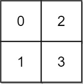

# 778. 水位上升的泳池中游泳

Hard · 难度分 2097 · [力扣原题](https://leetcode.cn/problems/swim-in-rising-water/)

所在刷题路径：灵神题单·二分算法、灵神题单·网格图、灵神题单·图论算法、灵神题单·常用数据结构

| 作者 | 题解 | 动画讲解 |
|---|---|---|
| 灵茶山艾府 | [📄 题解](灵茶山艾府.md) | [▶︎ 动画（GIF）](0778%20水位上升的泳池中游泳%20·%20灵茶山艾府.gif) · [mp4 文件](0778%20水位上升的泳池中游泳%20·%20灵茶山艾府.mp4) |
| yiduobo | [📄 题解](yiduobo.md) | [▶︎ 动画（GIF）](0778%20水位上升的泳池中游泳%20·%20yiduobo.gif) · [mp4 文件](0778%20水位上升的泳池中游泳%20·%20yiduobo.mp4) |

## 动画讲解

> 动图会循环播放；想暂停、拖进度条请下载上面表格里的 mp4 文件。

### 灵茶山艾府


### yiduobo


## 题目描述

在一个 `n x n` 的整数矩阵 `grid` 中，每一个方格的值 `grid[i][j]` 表示位置 `(i, j)` 的平台高度。

当开始下雨时，在时间为 `t` 时，水池中的水位为 `t` 。你可以从一个平台游向四周相邻的任意一个平台，但是前提是此时水位必须同时淹没这两个平台。假定你可以瞬间移动无限距离，也就是默认在方格内部游动是不耗时的。当然，在你游泳的时候你必须待在坐标方格里面。

你从坐标方格的左上平台 `(0，0)` 出发。返回 <em>你到达坐标方格的右下平台 `(n-1, n-1)` 所需的最少时间 。</em>

**示例 1:**



```

输入: grid = [[0,2],[1,3]]
输出: 3
解释:
时间为0时，你位于坐标方格的位置为 (0, 0)。
此时你不能游向任意方向，因为四个相邻方向平台的高度都大于当前时间为 0 时的水位。
等时间到达 3 时，你才可以游向平台 (1, 1). 因为此时的水位是 3，坐标方格中的平台没有比水位 3 更高的，所以你可以游向坐标方格中的任意位置
```

**示例 2:**


```

输入: grid = [[0,1,2,3,4],[24,23,22,21,5],[12,13,14,15,16],[11,17,18,19,20],[10,9,8,7,6]]
输出: 16
解释: 最终的路线用加粗进行了标记。
我们必须等到时间为 16，此时才能保证平台 (0, 0) 和 (4, 4) 是连通的
```

**提示:**

- `n == grid.length`

- `n == grid[i].length`

- `1 <= n <= 50`

- `0 <= grid[i][j] < n²`

- `grid[i][j]` 中每个值 **均无重复**

---
[↑ 返回 0700-0799](../README.md) · [总索引](../../../索引.md) · [仓库首页](../../../README.md)
