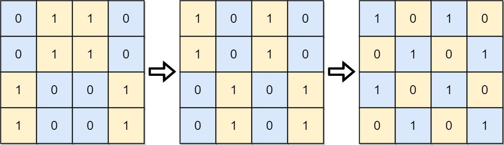
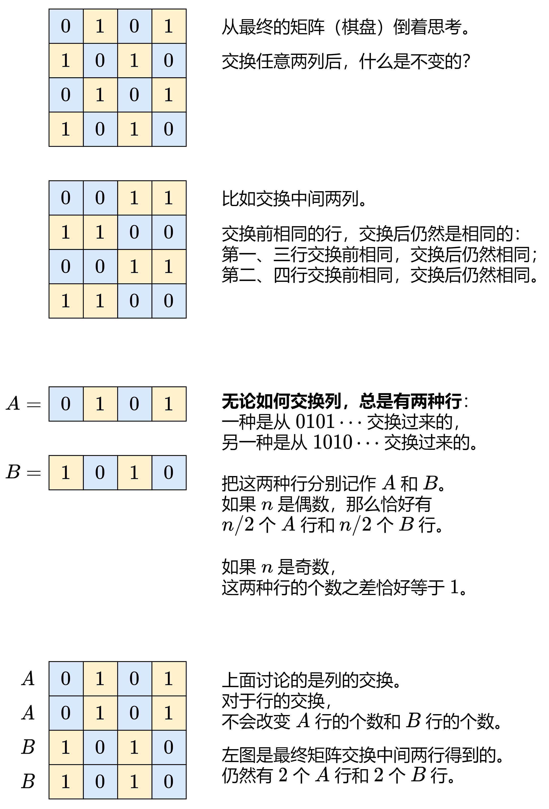

# 【图解】逆向思维（Python/Java/C++/C/Go/JS/Rust）

> **[782. 变为棋盘](https://leetcode.cn/problems/transform-to-chessboard/solutions/2997293/tu-jie-ni-xiang-si-wei-pythonjavaccgojsr-mixb/) · Hard**

> **所属题单**
> - [贪心算法 · 五、思维题](../../../刷题路径/灵神原版题单/贪心算法/五、思维题.md) · §5.4 逆向思维

> **题目描述**
> 一个 `n x n` 的二维网络 `board` 仅由 `0` 和 `1` 组成 。每次移动，你能交换任意两列或是两行的位置。
>
> 返回 <em>将这个矩阵变为  **“棋盘”**  所需的最小移动次数</em> 。如果不存在可行的变换，输出 `-1`。
>
> **“棋盘”** 是指任意一格的上下左右四个方向的值均与本身不同的矩阵。
>
> **示例 1:**
>
> 
>
> ```
>
> 输入: board = [[0,1,1,0],[0,1,1,0],[1,0,0,1],[1,0,0,1]]
> 输出: 2
> 解释:一种可行的变换方式如下，从左到右：
> 第一次移动交换了第一列和第二列。
> 第二次移动交换了第二行和第三行。
> ```
>
> **示例 2:**
>
> 
>
> ```
>
> 输入: board = [[0, 1], [1, 0]]
> 输出: 0
> 解释: 注意左上角的格值为0时也是合法的棋盘，也是合法的棋盘.
> ```
>
> **示例 3:**
>
> 
>
> ```
>
> 输入: board = [[1, 0], [1, 0]]
> 输出: -1
> 解释: 任意的变换都不能使这个输入变为合法的棋盘。
> ```
>
> **提示：**
>
> - `n == board.length`
>
> - `n == board[i].length`
>
> - `2 <= n <= 30`
>
> - `board[i][j]` 将只包含 `0`或 `1`

> **题解**
> $\textit{board}$ 要能变成棋盘，有哪些必要条件？
>
> ## 分析性质
>
> 
>
> 根据上图，$\textit{board}$ 要能变成棋盘，有两个**必要条件**：
>
> 1. 只有两种行：$A$ 行是从 $0101\cdots$ 交换得到的，也就是说，$A$ 行中的 $0$ 的个数和 $1$ 的个数相差至多为 $1$；$B$ 行是从 $1010\cdots$ 交换得到的，和 $A$ 行完全相反。
> 2. 这两种行的个数相差至多为 $1$。
>
> ## 不能变成棋盘的情况
>
> **核心思路**：统计 $A$ 行和 $B$ 行的个数。统计的过程中，如果发现有一行既不是 $A$ 行也不是 $B$ 行，直接返回 $-1$。统计结束后，如果发现 $A$ 行和 $B$ 行的个数相差超过 $1$，也返回 $-1$。
>
> 这可以用哈希表统计。但是，没有必要。
>
> 以 $\textit{board}$ 第一行（或者任意一行）为**参照物**。
>
> 统计 $\textit{board}$ 第一行中的 $0$ 和 $1$ 的个数，如果 $0$ 和 $1$ 的个数相差超过 $1$，说明这一行既不是 $A$ 行也不是 $B$ 行，无论如何交换，绝不可能得到棋盘，返回 $-1$。
>
> 对于其余行 $\textit{board}[i]$，首先比较 $\textit{board}[i][0]$ 和 $\textit{board}[0][0]$：
>
> - 相同：那么 $\textit{board}[i]$ 必须和 $\textit{board}[0]$ 完全相同，即对于任意 $j$，$\textit{board}[i][j] = \textit{board}[0][j]$ 成立。若不满足，返回 $-1$。
> - 不同：那么 $\textit{board}[i]$ 必须和 $\textit{board}[0]$ 完全不同，即对于任意 $j$，$\textit{board}[i][j]\ne \textit{board}[0][j]$ 成立。若不满足，返回 $-1$。
>
> 如果没有返回 $-1$，那么说明只有 $A$ 行和 $B$ 行。我们也只需统计 $\textit{board}[i][0]$（第一列）的 $0$ 和 $1$ 的个数，就知道有多少个 $A$ 行和 $B$ 行。如果 $0$ 和 $1$ 的个数相差超过 $1$，那么返回 $-1$。（代码实现时，关于第一列的判断可以放在前面）
>
> 如果上述情况都没有返回 $-1$，那么 $\textit{board}$ 一定可以变成棋盘，方法如下。
>
> ## 最小交换次数
>
> 比如把 $s=001110$ 通过交换元素，变成 $t=010101$。这其中 $s[i]\ne t[i]$ 出现了 $4$ 次。我们需要让 $s$ 中的 $0$ 在偶数下标上，$1$ 在奇数下标上。那么把奇数上的 $0$ 和偶数上的 $1$ 交换，就可以满足要求，所以只需要 $\dfrac{4}{2}=2$ 次交换。一般地，有如下定理。
>
> **定理**：如果有 $\textit{diff}$ 个位置与目标值不同，那么只需交换 $\dfrac{\textit{diff}}{2}$ 次。
>
> **证明**：首先 $\dfrac{\textit{diff}}{2}$ 是交换次数的下界。下面证明可以只用 $\dfrac{\textit{diff}}{2}$ 次交换。
>
> 不失一般性，假设要把 $s$ 通过交换，变成 $t=010101\cdots$。注意这意味着当 $n$ 是奇数时，$0$ 的个数更多。
>
> - 如果 $n$ 是偶数，那么恰好有 $\dfrac{n}{2}$ 个 $0$，$\dfrac{n}{2}$ 个 $1$，$\dfrac{n}{2}$ 个偶数下标，$\dfrac{n}{2}$ 个奇数下标。设有 $k$ 个 $0$ 在奇数下标上，那么有 $\dfrac{n}{2}-k$ 个 $1$ 在奇数下标上，所以有 $\dfrac{n}{2}-\left(\dfrac{n}{2}-k\right)=k$ 个 $1$ 在偶数下标上，所以只需 $k$ 次交换。注意这意味着 $\textit{diff}=2k$，所以 $\textit{diff}$ 必定是偶数。
> - 如果 $n$ 是奇数，$0$ 的个数比 $1$ 的多 $1$，那么有 $\dfrac{n-1}{2}+1$ 个 $0$ 和 $\dfrac{n-1}{2}$ 个奇数下标，所以必然存在一个 $0$ 在偶数下标上（也就是在正确的位置上），去掉这个 $0$，变成 $n$ 是偶数的情况，结论同上。
>
> 根据该定理，得到如下计算方法：
>
> - 如果 $n$ 是偶数，那么可以交换成 $010101\cdots$，也可以交换成 $101010\cdots$，设交换成 $t=010101\cdots$ 的 $s[i]\ne t[i]$ 的个数为 $\textit{diff}$，那么交换成 $t'=101010\cdots$ 的 $s[i]\ne t'[i]$ 的个数为 $n-\textit{diff}$，二者取最小值，最小交换次数为 $\dfrac{\min(\textit{diff},n-\textit{diff})}{2}$。
> - 如果 $n$ 是奇数，那么 $t$ 是唯一的，最小交换次数为 $\dfrac{\textit{diff}}{2}$。
>
> 答案是第一行的最小交换次数，加上第一列的最小交换次数。
>
> 交换完成后，就得到了棋盘。
>
> 代码实现时，可以利用异或运算（$\oplus$），累加 $s[i]\oplus t[i]$，就相当于统计 $s[i]\ne t[i]$ 的个数。
>
> 如果 $t=010101\cdots$，那么 $t[i] = i\bmod 2$。
>
> 如果 $t=101010\cdots$，那么 $t[i] = (i\bmod 2)\oplus 1$。
>
> ```python
> class Solution:
>     def movesToChessboard(self, board: List[List[int]]) -> int:
>         # 第一行，0 和 1 的个数之差不能超过 1
>         first_row = board[0]
>         row_cnt = Counter(first_row)
>         if abs(row_cnt[0] - row_cnt[1]) > 1:
>             return -1
>
>         # 第一列，0 和 1 的个数之差不能超过 1
>         first_col = list(next(zip(*board)))
>         col_cnt = Counter(first_col)
>         if abs(col_cnt[0] - col_cnt[1]) > 1:
>             return -1
>
>         # 每一行和第一行比较，要么完全相同，要么完全不同
>         for row in board:
>             same = row[0] == first_row[0]
>             for x, y in zip(row, first_row):
>                 if (x == y) != same:
>                     return -1
>
>         # 计算最小交换次数
>         def min_swap(s: List[int], cnt: Counter) -> int:
>             n = len(s)
>             x0 = 1 if cnt[1] > cnt[0] else 0  # 如果 n 是偶数，x0 是 0
>             # 计算规则见题解正文最后一段，这里 t[i] = i % 2 ^ x0
>             diff = sum(x ^ i % 2 ^ x0 for i, x in enumerate(s))
>             return diff // 2 if n % 2 else min(diff, n - diff) // 2
>
>         return min_swap(first_row, row_cnt) + min_swap(first_col, col_cnt)
> ```
>
>
> #### 复杂度分析
>
> - 时间复杂度：$\mathcal{O}(n^2)$，其中 $n$ 是 $\textit{board}$ 的长度。
> - 空间复杂度：$\mathcal{O}(n)$。如果不用 $\textit{firstCol}$ 则为 $\mathcal{O}(1)$。
>
> ## 分类题单
>
> [如何科学刷题？](https://leetcode.cn/circle/discuss/RvFUtj/)
>
> 1. [滑动窗口与双指针（定长/不定长/单序列/双序列/三指针）](https://leetcode.cn/circle/discuss/0viNMK/)
> 2. [二分算法（二分答案/最小化最大值/最大化最小值/第K小）](https://leetcode.cn/circle/discuss/SqopEo/)
> 3. [单调栈（基础/矩形面积/贡献法/最小字典序）](https://leetcode.cn/circle/discuss/9oZFK9/)
> 4. [网格图（DFS/BFS/综合应用）](https://leetcode.cn/circle/discuss/YiXPXW/)
> 5. [位运算（基础/性质/拆位/试填/恒等式/思维）](https://leetcode.cn/circle/discuss/dHn9Vk/)
> 6. [图论算法（DFS/BFS/拓扑排序/最短路/最小生成树/二分图/基环树/欧拉路径）](https://leetcode.cn/circle/discuss/01LUak/)
> 7. [动态规划（入门/背包/状态机/划分/区间/状压/数位/数据结构优化/树形/博弈/概率期望）](https://leetcode.cn/circle/discuss/tXLS3i/)
> 8. [常用数据结构（前缀和/差分/栈/队列/堆/字典树/并查集/树状数组/线段树）](https://leetcode.cn/circle/discuss/mOr1u6/)
> 9. [数学算法（数论/组合/概率期望/博弈/计算几何/随机算法）](https://leetcode.cn/circle/discuss/IYT3ss/)
> 10. 【本题相关】[贪心与思维（基本贪心策略/反悔/区间/字典序/数学/思维/脑筋急转弯/构造）](https://leetcode.cn/circle/discuss/g6KTKL/)
> 11. [链表、二叉树与一般树（前后指针/快慢指针/DFS/BFS/直径/LCA）](https://leetcode.cn/circle/discuss/K0n2gO/)
> 12. [字符串（KMP/Z函数/Manacher/字符串哈希/AC自动机/后缀数组/子序列自动机）](https://leetcode.cn/circle/discuss/SJFwQI/)
>
> [我的题解精选（已分类）](https://github.com/EndlessCheng/codeforces-go/blob/master/leetcode/SOLUTIONS.md)
>
> 欢迎关注 [B站@灵茶山艾府](https://space.bilibili.com/206214)
