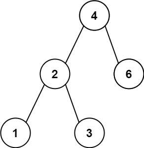
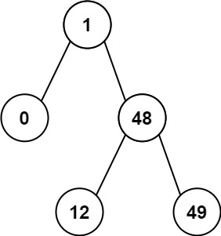

# 783. 二叉搜索树节点最小距离

Easy · [力扣原题](https://leetcode.cn/problems/minimum-distance-between-bst-nodes/)

所在刷题路径：灵神题单·链表树与回溯

| 作者 | 题解 | 动画讲解 |
|---|---|---|
| 灵茶山艾府 | [📄 题解](灵茶山艾府.md) | [▶︎ 0783 二叉搜索树节点最小距离 · 灵茶山艾府.mp4](0783%20二叉搜索树节点最小距离%20·%20灵茶山艾府.mp4) |
| yiduobo | — | — |

## 题目描述

给你一个二叉搜索树的根节点 `root` ，返回 **树中任意两不同节点值之间的最小差值** 。

差值是一个正数，其数值等于两值之差的绝对值。

**示例 1：**



```

输入：root = [4,2,6,1,3]
输出：1
```

**示例 2：**



```

输入：root = [1,0,48,null,null,12,49]
输出：1
```

**提示：**

- 树中节点的数目范围是 `[2, 100]`

- `0 <= Node.val <= 10⁵`

**注意：**本题与 530：[https://leetcode.cn/problems/minimum-absolute-difference-in-bst/](https://leetcode.cn/problems/minimum-absolute-difference-in-bst/) 相同

---
[↑ 返回 0700-0799](../README.md) · [总索引](../../../索引.md) · [仓库首页](../../../README.md)
