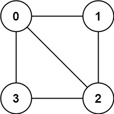
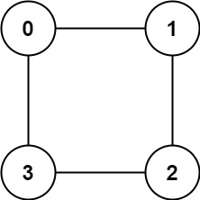
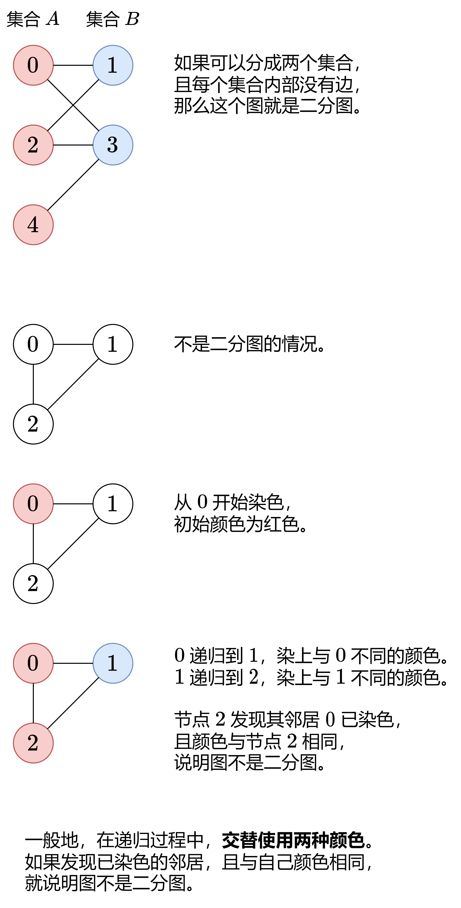

# 【图解】交替染色法（Python/Java/C++/C/Go/JS/Rust）

> **[785. 判断二分图](https://leetcode.cn/problems/is-graph-bipartite/solutions/3803670/tu-jie-jiao-ti-ran-se-fa-pythonjavaccgoj-ov27/) · Medium · 难度分 1625**

> **所属题单**
> - [图论算法 · 七、二分图染色](../../../刷题路径/灵神原版题单/图论算法/七、二分图染色.md)

> **题目描述**
> 存在一个 **无向图** ，图中有 `n` 个节点。其中每个节点都有一个介于 `0` 到 `n - 1` 之间的唯一编号。给你一个二维数组 `graph` ，其中 `graph[u]` 是一个节点数组，由节点 `u` 的邻接节点组成。形式上，对于 `graph[u]` 中的每个 `v` ，都存在一条位于节点 `u` 和节点 `v` 之间的无向边。该无向图同时具有以下属性：
>
> - 不存在自环（`graph[u]` 不包含 `u`）。
>
> - 不存在平行边（`graph[u]` 不包含重复值）。
>
> - 如果 `v` 在 `graph[u]` 内，那么 `u` 也应该在 `graph[v]` 内（该图是无向图）
>
> - 这个图可能不是连通图，也就是说两个节点 `u` 和 `v` 之间可能不存在一条连通彼此的路径。
>
> **二分图** 定义：如果能将一个图的节点集合分割成两个独立的子集 `A` 和 `B` ，并使图中的每一条边的两个节点一个来自 `A` 集合，一个来自 `B` 集合，就将这个图称为 **二分图** 。
>
> 如果图是二分图，返回 `true` ；否则，返回 `false` 。
>
> **示例 1：**
>
> 
>
> ```
>
> 输入：graph = [[1,2,3],[0,2],[0,1,3],[0,2]]
> 输出：false
> 解释：不能将节点分割成两个独立的子集，以使每条边都连通一个子集中的一个节点与另一个子集中的一个节点。
> ```
>
> **示例 2：**
>
> 
>
> ```
>
> 输入：graph = [[1,3],[0,2],[1,3],[0,2]]
> 输出：true
> 解释：可以将节点分成两组: {0, 2} 和 {1, 3} 。
> ```
>
> **提示：**
>
> - `graph.length == n`
>
> - `1 <= n <= 100`
>
> - `0 <= graph[u].length < n`
>
> - `0 <= graph[u][i] <= n - 1`
>
> - `graph[u]` 不会包含 `u`
>
> - `graph[u]` 的所有值 **互不相同**
>
> - 如果 `graph[u]` 包含 `v`，那么 `graph[v]` 也会包含 `u`

> **题解**
> {:width=650px}
>
> [本题视频讲解](https://www.bilibili.com/video/BV16E4uzLEdK/)，欢迎点赞关注~
>
> ```python
> class Solution:
>     def isBipartite(self, graph: List[List[int]]) -> bool:
>         # colors[i] = 0  表示未访问节点 i
>         # colors[i] = 1  表示节点 i 为红色
>         # colors[i] = -1 表示节点 i 为蓝色
>         colors = [0] * len(graph)
>
>         def dfs(x: int, c: int) -> bool:
>             colors[x] = c  # 节点 x 染成颜色 c
>             for y in graph[x]:
>                 # 邻居 y 的颜色与 x 的相同，说明不是二分图，返回 False
>                 # 或者继续递归，发现不是二分图，返回 False
>                 if colors[y] == c or \
>                    colors[y] == 0 and not dfs(y, -c):  # 取相反数，实现交替染色
>                     return False
>             return True
>
>         # 可能有多个连通块
>         for i, c in enumerate(colors):
>             if c == 0 and not dfs(i, 1):
>                 # 从节点 i 开始递归，发现 i 所在连通块不是二分图
>                 return False
>         return True
> ```
>
>
> #### 复杂度分析
>
> - 时间复杂度：$\mathcal{O}(n+m)$，其中 $n$ 是图的节点个数，$m$ 是图的边数，即 $\textit{graph}[i]$ 的长度之和。染色过的节点不会再递归，所以每个节点只会递归访问一次。
> - 空间复杂度：$\mathcal{O}(n)$。
>
> ## 专题训练
>
> 见下面图论题单的「**七、二分图染色**」。
>
> ## 分类题单
>
> [如何科学刷题？](https://leetcode.cn/circle/discuss/RvFUtj/)
>
> 1. [滑动窗口与双指针（定长/不定长/单序列/双序列/三指针/分组循环）](https://leetcode.cn/circle/discuss/0viNMK/)
> 2. [二分算法（二分答案/最小化最大值/最大化最小值/第K小）](https://leetcode.cn/circle/discuss/SqopEo/)
> 3. [单调栈（基础/矩形面积/贡献法/最小字典序）](https://leetcode.cn/circle/discuss/9oZFK9/)
> 4. [网格图（DFS/BFS/综合应用）](https://leetcode.cn/circle/discuss/YiXPXW/)
> 5. [位运算（基础/性质/拆位/试填/恒等式/思维）](https://leetcode.cn/circle/discuss/dHn9Vk/)
> 6. [图论算法（DFS/BFS/拓扑排序/基环树/最短路/最小生成树/网络流）](https://leetcode.cn/circle/discuss/01LUak/)
> 7. [动态规划（入门/背包/划分/状态机/区间/状压/数位/数据结构优化/树形/博弈/概率期望）](https://leetcode.cn/circle/discuss/tXLS3i/)
> 8. [常用数据结构（前缀和/差分/栈/队列/堆/字典树/并查集/树状数组/线段树）](https://leetcode.cn/circle/discuss/mOr1u6/)
> 9. [数学算法（数论/组合/概率期望/博弈/计算几何/随机算法）](https://leetcode.cn/circle/discuss/IYT3ss/)
> 10. [贪心与思维（基本贪心策略/反悔/区间/字典序/数学/思维/脑筋急转弯/构造）](https://leetcode.cn/circle/discuss/g6KTKL/)
> 11. [链表、二叉树与回溯（前后指针/快慢指针/DFS/BFS/直径/LCA/一般树）](https://leetcode.cn/circle/discuss/K0n2gO/)
> 12. [字符串（KMP/Z函数/Manacher/字符串哈希/AC自动机/后缀数组/子序列自动机）](https://leetcode.cn/circle/discuss/SJFwQI/)
>
> [我的题解精选（已分类）](https://github.com/EndlessCheng/codeforces-go/blob/master/leetcode/SOLUTIONS.md)
>
> 欢迎关注 [B站@灵茶山艾府](https://space.bilibili.com/206214)
