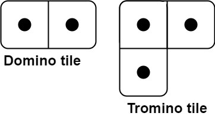
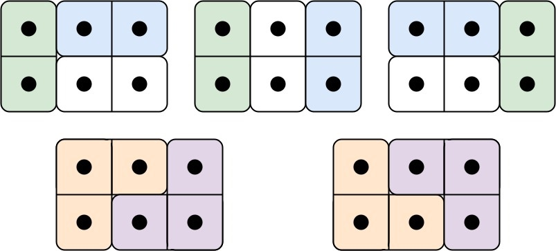
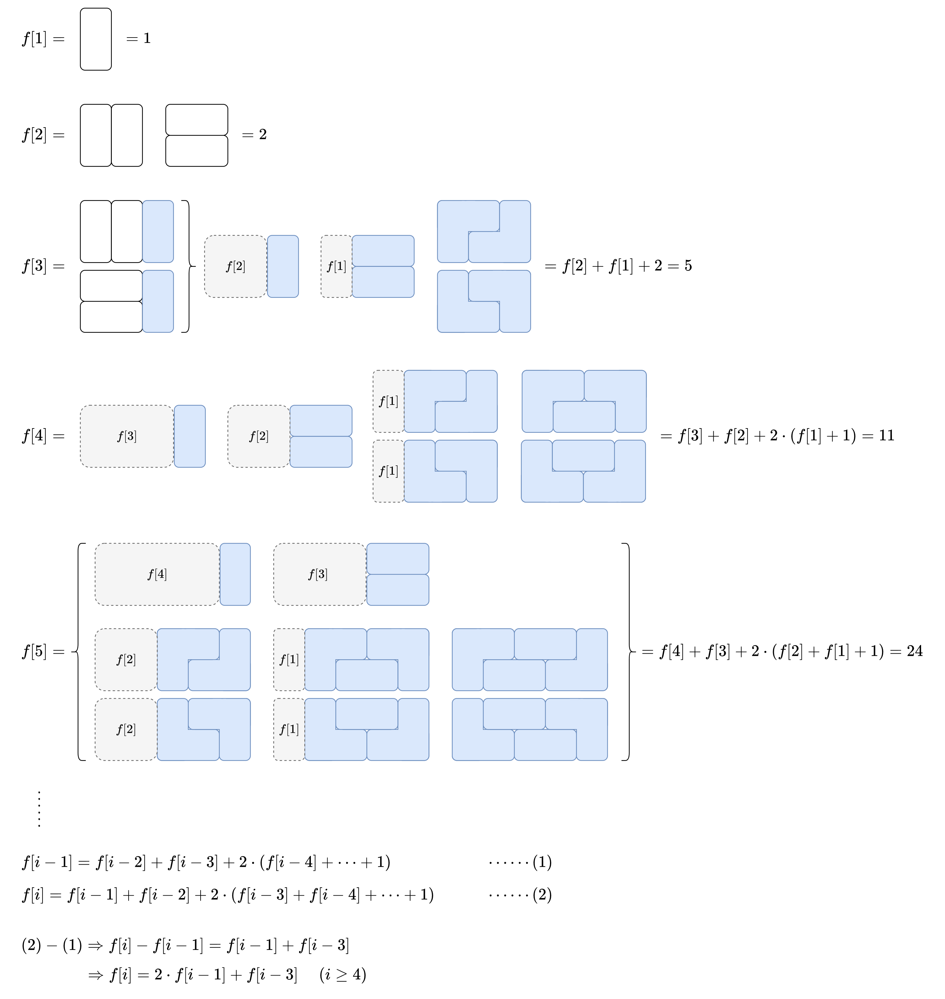

# 【图解】f[n]=2*f[n-1]+f[n-3]（Python/Java/C++/Go）

> **[790. 多米诺和托米诺平铺](https://leetcode.cn/problems/domino-and-tromino-tiling/solutions/1968516/by-endlesscheng-umpp/) · Medium**

> **所属题单**
> - [动态规划 · 十一、优化 DP](../../../刷题路径/灵神原版题单/动态规划/十一、优化%20DP.md) · §11.6 矩阵快速幂优化 DP

> **题目描述**
> 有两种形状的瓷砖：一种是 `2 x 1` 的多米诺形，另一种是形如 "L" 的托米诺形。两种形状都可以旋转。
>
> 
>
> 给定整数 n ，返回可以平铺 `2 x n` 的面板的方法的数量。**返回对** `10⁹ + 7` **取模** 的值。
>
> 平铺指的是每个正方形都必须有瓷砖覆盖。两个平铺不同，当且仅当面板上有四个方向上的相邻单元中的两个，使得恰好有一个平铺有一个瓷砖占据两个正方形。
>
> **示例 1:**
>
> 
>
> ```
>
> 输入: n = 3
> 输出: 5
> 解释: 五种不同的方法如上所示。
> ```
>
> **示例 2:**
>
> ```
>
> 输入: n = 1
> 输出: 1
> ```
>
> **提示：**
>
> - `1 <= n <= 1000`

> **题解**
> 定义 $f[i]$ 表示平铺 $2 \times i$ 面板的方案数。答案为 $f[n]$。
>
> 尝试计算 $f$ 的前几项，从中找到规律，得到 $f[i]$ 的递推式。（请点击图片放大查看）
>
> 
>
> **文字版解释**
>
> 对于 $f[i]$，考虑最右边的可以独立切割出来的矩形，有三种情况：
>
> 1. 一个竖着的 $1\times 2$。去掉这个瓷砖，问题变成平铺 $2 \times (i-1)$ 面板的方案数，即 $f[i-1]$。
> 2. 两个横着的 $2\times 1$。去掉这两瓷砖，问题变成平铺 $2 \times (i-2)$ 面板的方案数，即 $f[i-2]$。
> 3. 考虑最右边那一对 L 型的铺设方法，这一对 L 型必须一左一右，中间的都是 $2\times 1$ 横着摆。中间的 $2\times 1$ 的个数为 $0,1,2,\ldots,i-3$，对应的子问题分别为 $f[i-3],f[i-4],f[i-5],\ldots,f[0]$，每一种又有上下对称的平铺方案。
>
> 累加得
>
> $$
> f[i] = f[i-1] + f[i-2] + 2\sum_{j=0}^{i-3} f[j]
> $$
>
> 化简方式见图。
>
> 代码实现时，可以定义 $f[0]=1$，这样我们可以从 $f[3]$ 开始算。 
>
> ## 写法一
>
> ```python
> MOD = 1_000_000_007
>
> class Solution:
>     def numTilings(self, n: int) -> int:
>         if n == 1:
>             return 1
>         f = [0] * (n + 1)
>         f[0] = f[1] = 1
>         f[2] = 2
>         for i in range(3, n + 1):
>             f[i] = (f[i - 1] * 2 + f[i - 3]) % MOD
>         return f[n]
> ```
>
>
> #### 复杂度分析
>
> - 时间复杂度：$\mathcal{O}(n)$。
> - 空间复杂度：$\mathcal{O}(n)$。
>
> ## 写法二
>
> 也可以用 $3$ 个变量滚动计算 $f$。原理见 [动态规划入门：从记忆化搜索到递推【基础算法精讲 17】](https://www.bilibili.com/video/BV1Xj411K7oF/)。
>
> ```python
> MOD = 1_000_000_007
>
> class Solution:
>     def numTilings(self, n: int) -> int:
>         if n == 1:
>             return 1
>         a, b, c = 1, 1, 2
>         for _ in range(3, n + 1):
>             a, b, c = b, c, (c * 2 + a) % MOD
>         return c
> ```
>
>
> #### 复杂度分析
>
> - 时间复杂度：$\mathcal{O}(n)$。
> - 空间复杂度：$\mathcal{O}(1)$。
>
> ## 写法三
>
> 由于 $n\le 1000$，可以预处理 $1000$ 以内的 $f$ 值。
>
> 由于力扣不计入预处理的时间，所以这种写法的时间复杂度是 $\mathcal{O}(1)$。
>
> ```python
> MOD = 1_000_000_007
>
> f = [0] * 1001
> f[0] = f[1] = 1
> f[2] = 2
> for i in range(3, len(f)):
>     f[i] = (f[i - 1] * 2 + f[i - 3]) % MOD
>
> class Solution:
>     def numTilings(self, n: int) -> int:
>         return f[n]
> ```
>
>
> #### 复杂度分析
>
> 忽略预处理的时间和空间。
>
> - 时间复杂度：$\mathcal{O}(1)$。
> - 空间复杂度：$\mathcal{O}(1)$。
>
> ## 写法四：矩阵快速幂
>
> 下面的方法，即使 $n=10^{18}$ 也能轻松通过。
>
> 把状态转移方程用矩阵乘法表示，即
>
> $$
> \begin{bmatrix}
> f[i] \\
> f[i-1] \\
> f[i-2] \\
> \end{bmatrix}
> = \begin{bmatrix}
> 2 & 0 & 1 \\
> 1 & 0 & 0 \\
> 0 & 1 & 0 \\
> \end{bmatrix}
> \begin{bmatrix}
> f[i-1] \\
> f[i-2] \\
> f[i-3] \\
> \end{bmatrix}
> $$
>
> 把上式中的三个矩阵分别记作 $F[i],M,F[i-1]$，即
>
> $$
> F[i] = M\times F[i-1]
> $$
>
> 那么有
>
> $$
> \begin{aligned}
> F[n] &= M\times F[n-1]      \\
> &= M\times M\times F[n-2]        \\
> &= M\times M\times M\times  F[n-3]        \\
> &\ \ \vdots  \\
> &= M^{n-2}\times F[2] \\
> \end{aligned}
> $$
>
> 其中
>
> $$
> F[2] =
> \begin{bmatrix}
> f[2] \\
> f[1] \\
> f[0] \\
> \end{bmatrix}
> =
> \begin{bmatrix}
> 2 \\
> 1 \\
> 1 \\
> \end{bmatrix}
> $$
>
> $M^n$ 可以用**快速幂**计算，原理请看[【图解】一张图秒懂快速幂](../../0000-0099/0050%20Pow%28x,%20n%29/灵茶山艾府.md)。
>
> 最终答案为 $F[n]$ 的第一项，即 $f[n]$。
>
> ```python
> MOD = 1_000_000_007
>
> # a @ b，其中 @ 是矩阵乘法
> def mul(a: List[List[int]], b: List[List[int]]) -> List[List[int]]:
>     return [[sum(x * y for x, y in zip(row, col)) % MOD for col in zip(*b)]
>             for row in a]
>
> # a^n @ f
> def pow_mul(a: List[List[int]], n: int, f: List[List[int]]) -> List[List[int]]:
>     res = f
>     while n:
>         if n & 1:
>             res = mul(a, res)
>         a = mul(a, a)
>         n >>= 1
>     return res
>
> class Solution:
>     def numTilings(self, n: int) -> int:
>         if n == 1:
>             return 1
>         f2 = [[2], [1], [1]]
>         m = [[2, 0, 1], [1, 0, 0], [0, 1, 0]]
>         fn = pow_mul(m, n - 2, f2)
>         return fn[0][0]
> ```
>
> > [!example]- NumPy
> > ```python
> > import numpy as np
> >
> > MOD = 1_000_000_007
> >
> > # a^n @ f
> > def pow_mul(a: np.ndarray, n: int, f: np.ndarray) -> np.ndarray:
> >     res = f
> >     while n:
> >         if n & 1:
> >             res = a @ res % MOD
> >         a = a @ a % MOD
> >         n >>= 1
> >     return res
> >
> > class Solution:
> >     def numTilings(self, n: int) -> int:
> >         if n == 1:
> >             return 1
> >         f2 = np.array([2, 1, 1], dtype=object)
> >         m = np.array([[2, 0, 1], [1, 0, 0], [0, 1, 0]], dtype=object)
> >         fn = pow_mul(m, n - 2, f2)
> >         return fn[0]
> > ```
>
>
> > [!example]- NumPy 写法二
> > ```python
> > import numpy as np
> >
> > class Solution:
> >     def numTilings(self, n: int) -> int:
> >         if n == 1:
> >             return 1
> >         f2 = np.array([2, 1, 1], dtype=object)
> >         m = np.array([[2, 0, 1], [1, 0, 0], [0, 1, 0]], dtype=object)
> >         # 注：没法中途取模，参与运算的数字很大，效率低，所以我并不推荐这种写法
> >         fn = np.linalg.matrix_power(m, n - 2) @ f2
> >         return fn[0] % 1_000_000_007
> > ```
>
>
> #### 复杂度分析
>
> - 时间复杂度：$\mathcal{O}(D^3\log n)$。其中 $D=3$。
> - 空间复杂度：$\mathcal{O}(D^2)$。
>
> ## 分类题单
>
> [如何科学刷题？](https://leetcode.cn/circle/discuss/RvFUtj/)
>
> 1. [滑动窗口与双指针（定长/不定长/单序列/双序列/三指针/分组循环）](https://leetcode.cn/circle/discuss/0viNMK/)
> 2. [二分算法（二分答案/最小化最大值/最大化最小值/第K小）](https://leetcode.cn/circle/discuss/SqopEo/)
> 3. [单调栈（基础/矩形面积/贡献法/最小字典序）](https://leetcode.cn/circle/discuss/9oZFK9/)
> 4. [网格图（DFS/BFS/综合应用）](https://leetcode.cn/circle/discuss/YiXPXW/)
> 5. [位运算（基础/性质/拆位/试填/恒等式/思维）](https://leetcode.cn/circle/discuss/dHn9Vk/)
> 6. [图论算法（DFS/BFS/拓扑排序/基环树/最短路/最小生成树/网络流）](https://leetcode.cn/circle/discuss/01LUak/)
> 7. [动态规划（入门/背包/划分/状态机/区间/状压/数位/数据结构优化/树形/博弈/概率期望）](https://leetcode.cn/circle/discuss/tXLS3i/)
> 8. [常用数据结构（前缀和/差分/栈/队列/堆/字典树/并查集/树状数组/线段树）](https://leetcode.cn/circle/discuss/mOr1u6/)
> 9. [数学算法（数论/组合/概率期望/博弈/计算几何/随机算法）](https://leetcode.cn/circle/discuss/IYT3ss/)
> 10. [贪心与思维（基本贪心策略/反悔/区间/字典序/数学/思维/脑筋急转弯/构造）](https://leetcode.cn/circle/discuss/g6KTKL/)
> 11. [链表、二叉树与回溯（前后指针/快慢指针/DFS/BFS/直径/LCA/一般树）](https://leetcode.cn/circle/discuss/K0n2gO/)
> 12. [字符串（KMP/Z函数/Manacher/字符串哈希/AC自动机/后缀数组/子序列自动机）](https://leetcode.cn/circle/discuss/SJFwQI/)
>
> [我的题解精选（已分类）](https://github.com/EndlessCheng/codeforces-go/blob/master/leetcode/SOLUTIONS.md)
>
> 欢迎关注 [B站@灵茶山艾府](https://space.bilibili.com/206214)
