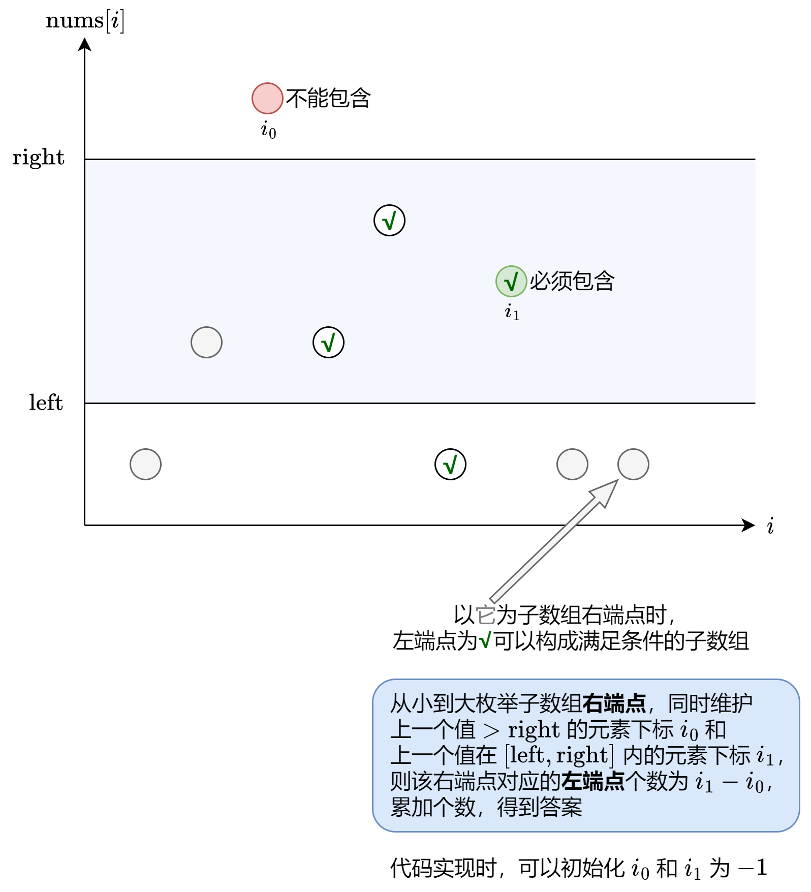

# 【图解】一次遍历+简洁写法（Python/Java/C++/Go）

> **[795. 区间子数组个数](https://leetcode.cn/problems/number-of-subarrays-with-bounded-maximum/solutions/1988198/tu-jie-yi-ci-bian-li-jian-ji-xie-fa-pyth-n75l/) · Medium · 难度分 1817**

> **所属题单**
> - [滑动窗口与双指针 · 五、三指针](../../../刷题路径/灵神原版题单/滑动窗口与双指针/五、三指针.md)

> **题目描述**
> 给你一个整数数组 `nums` 和两个整数：`left` 及 `right` 。找出 `nums` 中连续、非空且其中最大元素在范围 `[left, right]` 内的子数组，并返回满足条件的子数组的个数。
>
> 生成的测试用例保证结果符合 **32-bit** 整数范围。
>
> **示例 1：**
>
> ```
>
> 输入：nums = [2,1,4,3], left = 2, right = 3
> 输出：3
> 解释：满足条件的三个子数组：[2], [2, 1], [3]
> ```
>
> **示例 2：**
>
> ```
>
> 输入：nums = [2,9,2,5,6], left = 2, right = 8
> 输出：7
> ```
>
> **提示：**
>
> - `1 <= nums.length <= 10⁵`
>
> - `0 <= nums[i] <= 10⁹`
>
> - `0 <= left <= right <= 10⁹`

> **题解**
> 
>
> 此外，为了保证 $i_1\ge i_0$（否则相减会算出负数），可以在 $\textit{nums}[i]>\textit{right}$ 时也更新 $i_1$。也就是说，只要 $\textit{nums}[i]\ge\textit{left}$ 就更新 $i_1$（即使 $>\textit{right}$）。
>
> #### 答疑
>
> **问**：$i_1-i_0$ 是怎么得出来的？
>
> **答**：上一个不能包含的下标为 $i_0$，等价于上一个可以包含的下标为 $i_0+1$，这是子数组左端点的最小值。
>
> 设当前遍历到下标 $i$，那么子数组 $[i_0+1,i],[i_0+2,i],\ldots,[i_1,i]$ 都是满足条件的，这有 $i_1-i_0$ 个。
>
> ```python
> class Solution:
>     def numSubarrayBoundedMax(self, nums: List[int], left: int, right: int) -> int:
>         ans, i0, i1 = 0, -1, -1
>         for i, x in enumerate(nums):
>             if x > right: i0 = i
>             if x >= left: i1 = i
>             ans += i1 - i0
>         return ans
> ```
>
>
> #### 复杂度分析
>
> - 时间复杂度：$O(n)$，其中 $n$ 为 $\textit{nums}$ 的长度。
> - 空间复杂度：$O(1)$，仅用到若干额外变量。
>
> #### 相似题目
>
> - [2444. 统计定界子数组的数目](https://leetcode.cn/problems/count-subarrays-with-fixed-bounds/)
>
> ---
>
> 欢迎关注 [B站@灵茶山艾府](https://space.bilibili.com/206214)，每周更新算法讲解视频哦~
