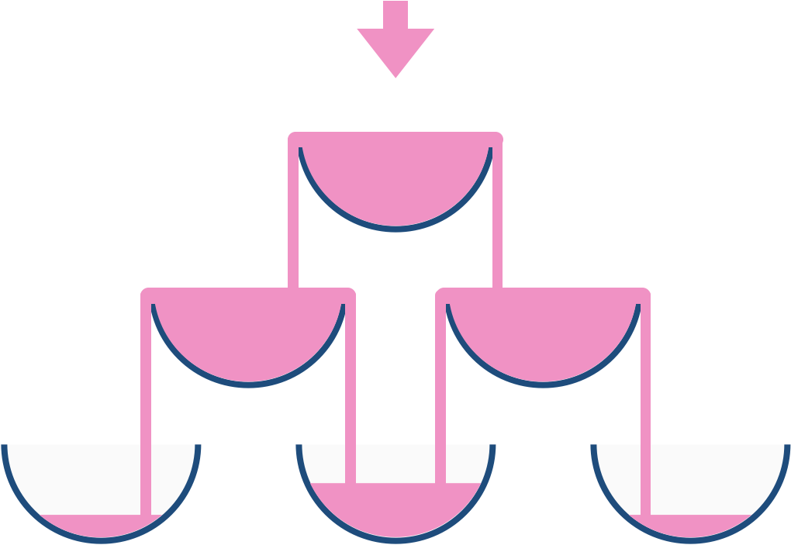

# BFS 模拟 + 优化（Python/Java/C++/C/Go/JS/Rust）

> **[799. 香槟塔](https://leetcode.cn/problems/champagne-tower/solutions/3902437/bfs-mo-ni-you-hua-pythonjavaccgojsrust-b-jxh0/) · Medium**

> **题目描述**
> 我们把玻璃杯摆成金字塔的形状，其中 **第一层** 有 `1` 个玻璃杯， **第二层** 有 `2` 个，依次类推到第 100 层，每个玻璃杯将盛有香槟。
>
> 从顶层的第一个玻璃杯开始倾倒一些香槟，当顶层的杯子满了，任何溢出的香槟都会立刻等流量的流向左右两侧的玻璃杯。当左右两边的杯子也满了，就会等流量的流向它们左右两边的杯子，依次类推。（当最底层的玻璃杯满了，香槟会流到地板上）
>
> 例如，在倾倒一杯香槟后，最顶层的玻璃杯满了。倾倒了两杯香槟后，第二层的两个玻璃杯各自盛放一半的香槟。在倒三杯香槟后，第二层的香槟满了 - 此时总共有三个满的玻璃杯。在倒第四杯后，第三层中间的玻璃杯盛放了一半的香槟，他两边的玻璃杯各自盛放了四分之一的香槟，如下图所示。
>
> 
>
> 现在当倾倒了非负整数杯香槟后，返回第 `i` 行 `j` 个玻璃杯所盛放的香槟占玻璃杯容积的比例（ `i` 和 `j` 都从0开始）。
>
> ```
>
> 示例 1:
> 输入: poured(倾倒香槟总杯数) = 1, query_glass(杯子的位置数) = 1, query_row(行数) = 1
> 输出: 0.00000
> 解释: 我们在顶层（下标是（0，0））倒了一杯香槟后，没有溢出，因此所有在顶层以下的玻璃杯都是空的。
>
> 示例 2:
> 输入: poured(倾倒香槟总杯数) = 2, query_glass(杯子的位置数) = 1, query_row(行数) = 1
> 输出: 0.50000
> 解释: 我们在顶层（下标是（0，0）倒了两杯香槟后，有一杯量的香槟将从顶层溢出，位于（1，0）的玻璃杯和（1，1）的玻璃杯平分了这一杯香槟，所以每个玻璃杯有一半的香槟。
> ```
>
> **示例 3:**
>
> ```
>
> 输入: poured = 100000009, query_row = 33, query_glass = 17
> 输出: 1.00000
> ```
>
> **提示:**
>
> - `0 <= poured <= 10⁹`
>
> - `0 <= query_glass <= query_row < 100`

> **题解**
> 类似 [102. 二叉树的层序遍历](https://leetcode.cn/problems/binary-tree-level-order-traversal/)，用一个 **BFS** 模拟香槟溢出流程：第一层溢出的香槟流到第二层，第二层溢出的香槟流到第三层，依此类推。
>
> 具体地：
>
> - 处理第一层到第二层，从 $(0,0)$ 溢出的香槟流到 $(1,0)$ 和 $(1,1)$。设溢出的香槟量为 $x$，那么 $(1,0)$ 和 $(1,1)$ 的香槟量都增加 $\dfrac{x}{2}$。
> - 处理第二层到第三层，从 $(1,0)$ 溢出的香槟流到 $(2,0)$ 和 $(2,1)$，从 $(1,1)$ 溢出的香槟流到 $(2,1)$ 和 $(2,2)$。
> - 依此类推。一般地，从 $(i,j)$ 溢出的香槟流到 $(i+1,j)$ 和 $(i+1,j+1)$。设溢出的香槟量为 $x$，那么下一层的 $j$ 和 $j+1$ 的香槟量都增加 $\dfrac{x}{2}$。用一个数组保存下一层每个玻璃杯的香槟量。
>
> ## 优化前
>
> ```python
> class Solution:
>     def champagneTower(self, poured: int, queryRow: int, queryGlass: int) -> float:
>         cur = [float(poured)]
>         for i in range(1, queryRow + 1):
>             nxt = [0.0] * (i + 1)
>             for j, x in enumerate(cur):
>                 if x > 1:  # 溢出到下一层
>                     nxt[j] += (x - 1) / 2
>                     nxt[j + 1] += (x - 1) / 2
>             cur = nxt
>         return min(cur[queryGlass], 1.0)  # 如果溢出，容量是 1
> ```
>
>
> ## 优化
>
> 无需使用两个数组，可以像 0-1 背包那样，在同一个数组上修改。
>
> ```python
> class Solution:
>     def champagneTower(self, poured: int, queryRow: int, queryGlass: int) -> float:
>         f = [0.0] * (queryRow + 1)
>         f[0] = float(poured)
>         for i in range(queryRow):
>             for j in range(i, -1, -1):
>                 x = f[j] - 1
>                 if x > 0:
>                     f[j + 1] += x / 2
>                     f[j] = x / 2
>                 else:
>                     f[j] = 0.0
>         return min(f[queryGlass], 1.0)  # 如果溢出，容量是 1
> ```
>
>
> #### 复杂度分析
>
> - 时间复杂度：$\mathcal{O}(\textit{queryRow}^2)$。
> - 空间复杂度：$\mathcal{O}(\textit{queryRow})$。
>
> ## 相似题目
>
> [118. 杨辉三角](https://leetcode.cn/problems/pascals-triangle/)
>
> ## 分类题单
>
> [如何科学刷题？](https://leetcode.cn/circle/discuss/RvFUtj/)
>
> 1. [滑动窗口与双指针（定长/不定长/单序列/双序列/三指针/分组循环）](https://leetcode.cn/circle/discuss/0viNMK/)
> 2. [二分算法（二分答案/最小化最大值/最大化最小值/第K小）](https://leetcode.cn/circle/discuss/SqopEo/)
> 3. [单调栈（基础/矩形面积/贡献法/最小字典序）](https://leetcode.cn/circle/discuss/9oZFK9/)
> 4. [网格图（DFS/BFS/综合应用）](https://leetcode.cn/circle/discuss/YiXPXW/)
> 5. [位运算（基础/性质/拆位/试填/恒等式/思维）](https://leetcode.cn/circle/discuss/dHn9Vk/)
> 6. [图论算法（DFS/BFS/拓扑排序/基环树/最短路/最小生成树/网络流）](https://leetcode.cn/circle/discuss/01LUak/)
> 7. [动态规划（入门/背包/划分/状态机/区间/状压/数位/数据结构优化/树形/博弈/概率期望）](https://leetcode.cn/circle/discuss/tXLS3i/)
> 8. [常用数据结构（前缀和/差分/栈/队列/堆/字典树/并查集/树状数组/线段树）](https://leetcode.cn/circle/discuss/mOr1u6/)
> 9. [数学算法（数论/组合/概率期望/博弈/计算几何/随机算法）](https://leetcode.cn/circle/discuss/IYT3ss/)
> 10. [贪心与思维（基本贪心策略/反悔/区间/字典序/数学/思维/脑筋急转弯/构造）](https://leetcode.cn/circle/discuss/g6KTKL/)
> 11. [链表、树与回溯（前后指针/快慢指针/DFS/BFS/直径/LCA）](https://leetcode.cn/circle/discuss/K0n2gO/)
> 12. [字符串（KMP/Z函数/Manacher/字符串哈希/AC自动机/后缀数组/子序列自动机）](https://leetcode.cn/circle/discuss/SJFwQI/)
>
> [我的题解精选（已分类）](https://github.com/EndlessCheng/codeforces-go/blob/master/leetcode/SOLUTIONS.md)
>
> 欢迎关注 [B站@灵茶山艾府](https://space.bilibili.com/206214)
