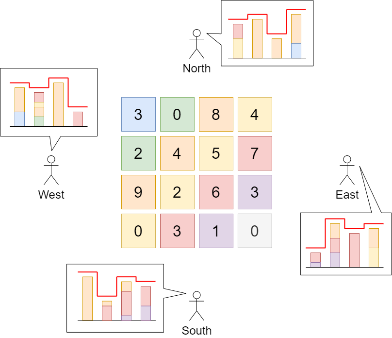

# 增加到行列最大值（Python/Java/C++/C/Go/JS/Rust）

> **[807. 保持城市天际线](https://leetcode.cn/problems/max-increase-to-keep-city-skyline/solutions/2842679/zeng-jia-dao-xing-lie-zui-da-zhi-pythonj-bvb8/) · Medium**

> **题目描述**
> 给你一座由 `n x n` 个街区组成的城市，每个街区都包含一座立方体建筑。给你一个下标从 **0** 开始的 `n x n` 整数矩阵 `grid` ，其中 `grid[r][c]` 表示坐落于 `r` 行 `c` 列的建筑物的 **高度** 。
>
> 城市的 **天际线** 是从远处观察城市时，所有建筑物形成的外部轮廓。从东、南、西、北四个主要方向观测到的 **天际线** 可能不同。
>
> 我们被允许为 **任意数量的建筑物** 的高度增加 **任意增量（不同建筑物的增量可能不同）** 。 高度为 `0` 的建筑物的高度也可以增加。然而，增加的建筑物高度 **不能影响** 从任何主要方向观察城市得到的 **天际线** 。
>
> 在 **不改变** 从任何主要方向观测到的城市 **天际线** 的前提下，返回建筑物可以增加的 **最大高度增量总和** 。
>
> **示例 1：**
>
> 
>
> ```
>
> 输入：grid = [[3,0,8,4],[2,4,5,7],[9,2,6,3],[0,3,1,0]]
> 输出：35
> 解释：建筑物的高度如上图中心所示。
> 用红色绘制从不同方向观看得到的天际线。
> 在不影响天际线的情况下，增加建筑物的高度：
> gridNew = [ [8, 4, 8, 7],
>             [7, 4, 7, 7],
>             [9, 4, 8, 7],
>             [3, 3, 3, 3] ]
> ```
>
> **示例 2：**
>
> ```
>
> 输入：grid = [[0,0,0],[0,0,0],[0,0,0]]
> 输出：0
> 解释：增加任何建筑物的高度都会导致天际线的变化。
> ```
>
> **提示：**
>
> - `n == grid.length`
>
> - `n == grid[r].length`
>
> - `2 <= n <= 50`
>
> - `0 <= grid[r][c] <= 100`

> **题解**
> 
>
> 看示例 1：
>
> - 第一行的最大值是 $8$，只要第一行的数，增大到不超过 $8$，就不会改变从西边看和从东边看的天际线。对于其他行也同理。
> - 第一列的最大值是 $9$，只要第一列的数，增大到不超过 $9$，就不会改变从北边看和从南边看的天际线。对于其他列也同理。
>
> 一般地，设 $\textit{rowMax}[i]$ 为第 $i$ 行的最大值，$\textit{colMax}[j]$ 为第 $j$ 列的最大值，那么 $\textit{grid}[i][j]$ 至多增加到
>
> $$
> \min(\textit{rowMax}[i], \textit{colMax}[j])
> $$
>
> 累加
>
> $$
> \min(\textit{rowMax}[i], \textit{colMax}[j]) - \textit{grid}[i][j]
> $$
>
> 即为答案。
>
> ```python
> class Solution:
>     def maxIncreaseKeepingSkyline(self, grid: List[List[int]]) -> int:
>         row_max = list(map(max, grid))
>         col_max = list(map(max, zip(*grid)))
>         ans = 0
>         for i, row in enumerate(grid):
>             for j, x in enumerate(row):
>                 ans += min(row_max[i], col_max[j]) - x
>         return ans
> ```
>
> > [!example]- Python3 写法二
> > ```python
> > class Solution:
> >     def maxIncreaseKeepingSkyline(self, grid: List[List[int]]) -> int:
> >         row_max = map(max, grid)
> >         col_max = map(max, zip(*grid))
> >         return sum(map(min, product(row_max, col_max))) - sum(map(sum, grid))
> > ```
>
>
> #### 复杂度分析
>
> - 时间复杂度：$\mathcal{O}(mn)$，其中 $m$ 和 $n$ 分别为 $\textit{grid}$ 的行数和列数。
> - 空间复杂度：$\mathcal{O}(m+n)$。
>
> ## 分类题单
>
> [如何科学刷题？](https://leetcode.cn/circle/discuss/RvFUtj/)
>
> 1. [滑动窗口（定长/不定长/多指针）](https://leetcode.cn/circle/discuss/0viNMK/)
> 2. [二分算法（二分答案/最小化最大值/最大化最小值/第K小）](https://leetcode.cn/circle/discuss/SqopEo/)
> 3. [单调栈（基础/矩形面积/贡献法/最小字典序）](https://leetcode.cn/circle/discuss/9oZFK9/)
> 4. [网格图（DFS/BFS/综合应用）](https://leetcode.cn/circle/discuss/YiXPXW/)
> 5. [位运算（基础/性质/拆位/试填/恒等式/思维）](https://leetcode.cn/circle/discuss/dHn9Vk/)
> 6. [图论算法（DFS/BFS/拓扑排序/最短路/最小生成树/二分图/基环树/欧拉路径）](https://leetcode.cn/circle/discuss/01LUak/)
> 7. [动态规划（入门/背包/状态机/划分/区间/状压/数位/数据结构优化/树形/博弈/概率期望）](https://leetcode.cn/circle/discuss/tXLS3i/)
> 8. [常用数据结构（前缀和/差分/栈/队列/堆/字典树/并查集/树状数组/线段树）](https://leetcode.cn/circle/discuss/mOr1u6/)
> 9. [数学算法（数论/组合/概率期望/博弈/计算几何/随机算法）](https://leetcode.cn/circle/discuss/IYT3ss/)
> 10. [贪心算法（基本贪心策略/反悔/区间/字典序/数学/思维/脑筋急转弯/构造）](https://leetcode.cn/circle/discuss/g6KTKL/)
>
> [我的题解精选（已分类）](https://github.com/EndlessCheng/codeforces-go/blob/master/leetcode/SOLUTIONS.md)
>
> 欢迎关注 [B站@灵茶山艾府](https://space.bilibili.com/206214)
