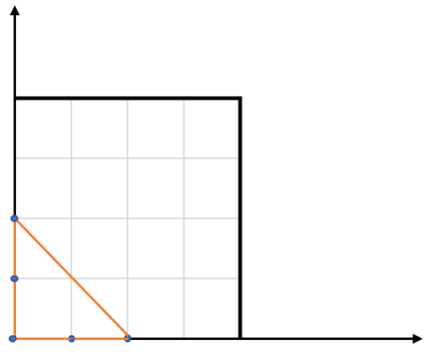

# 812. 最大三角形面积

Easy · [力扣原题](https://leetcode.cn/problems/largest-triangle-area/)

所在刷题路径：灵神题单·数学算法

| 作者 | 题解 | 动画讲解 |
|---|---|---|
| 灵茶山艾府 | [📄 题解](灵茶山艾府.md) | [▶︎ 动画（GIF）](0812%20最大三角形面积%20·%20灵茶山艾府.gif) · [mp4 文件](0812%20最大三角形面积%20·%20灵茶山艾府.mp4) |
| yiduobo | [📄 题解](yiduobo.md) | [▶︎ 动画（GIF）](0812%20最大三角形面积%20·%20yiduobo.gif) · [mp4 文件](0812%20最大三角形面积%20·%20yiduobo.mp4) |

## 动画讲解

> 动图会循环播放；想暂停、拖进度条请下载上面表格里的 mp4 文件。

### 灵茶山艾府


### yiduobo


## 题目描述

给你一个由 **X-Y** 平面上的点组成的数组 `points` ，其中 `points[i] = [x_i, y_i]` 。从其中取任意三个不同的点组成三角形，返回能组成的最大三角形的面积。与真实值误差在 `10⁻⁵` 内的答案将会视为正确答案**。**

**示例 1：**



```

输入：points = [[0,0],[0,1],[1,0],[0,2],[2,0]]
输出：2.00000
解释：输入中的 5 个点如上图所示，红色的三角形面积最大。
```

**示例 2：**

```

输入：points = [[1,0],[0,0],[0,1]]
输出：0.50000
```

**提示：**

- `3 <= points.length <= 50`

- `-50 <= x_i, y_i <= 50`

- 给出的所有点 **互不相同**

---
[↑ 返回 0800-0899](../README.md) · [总索引](../../../索引.md) · [仓库首页](../../../README.md)
