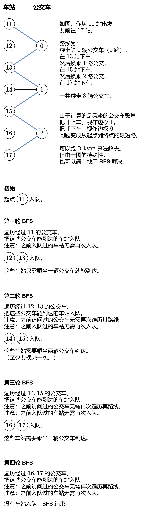

# 【图解】BFS 线性做法（Python/Java/C++/Go/JS/Rust）

> **[815. 公交路线](https://leetcode.cn/problems/bus-routes/solutions/2916806/tu-jie-bfspythonjavacgojsrust-by-endless-t7oc/) · Hard · 难度分 1964**

> **所属题单**
> - [图论算法 · 一、图的遍历](../../../刷题路径/灵神原版题单/图论算法/一、图的遍历.md) · §1.2 广度优先搜索（BFS）

> **题目描述**
> 给你一个数组 `routes` ，表示一系列公交线路，其中每个 `routes[i]` 表示一条公交线路，第 `i` 辆公交车将会在上面循环行驶。
>
> - 例如，路线 `routes[0] = [1, 5, 7]` 表示第 `0` 辆公交车会一直按序列 `1 -> 5 -> 7 -> 1 -> 5 -> 7 -> 1 -> ...` 这样的车站路线行驶。
>
> 现在从 `source` 车站出发（初始时不在公交车上），要前往 `target` 车站。 期间仅可乘坐公交车。
>
> 求出 **最少乘坐的公交车数量** 。如果不可能到达终点车站，返回 `-1` 。
>
> **示例 1：**
>
> ```
>
> 输入：routes = [[1,2,7],[3,6,7]], source = 1, target = 6
> 输出：2
> 解释：最优策略是先乘坐第一辆公交车到达车站 7 , 然后换乘第二辆公交车到车站 6 。
> ```
>
> **示例 2：**
>
> ```
>
> 输入：routes = [[7,12],[4,5,15],[6],[15,19],[9,12,13]], source = 15, target = 12
> 输出：-1
> ```
>
> **提示：**
>
> - `1 <= routes.length <= 500`.
>
> - `1 <= routes[i].length <= 10⁵`
>
> - `routes[i]` 中的所有值 **互不相同**
>
> - `sum(routes[i].length) <= 10⁵`
>
> - `0 <= routes[i][j] < 10⁶`
>
> - `0 <= source, target < 10⁶`

> **题解**
> ## 思路
>
> 
>
> 代码实现时，为方便起见，车站编号是一个一个出队的。
>
> ## 细节
>
> **有哪些公交车会经过车站 $x$？**
>
> 创建一个哈希表 $\textit{stopToBuses}$，key 为车站编号，value 为经过该车站的公交车编号列表。
>
> 遍历第 $i$ 辆公交车的路线 $\textit{routes}[i]$，对于车站 $x=\textit{routes}[i][j]$，把公交车编号 $i$ 加到 $\textit{stopToBuses}[x]$ 列表中。
>
> **在 BFS 中，如何保证每辆公交车的路线只遍历一次？**
>
> 可以创建一个 $\textit{vis}$ 数组。更简单的办法是，当公交车路线 $\textit{routes}[i]$ 遍历结束后，把 $\textit{routes}[i]$ 置为空。
>
> **在 BFS 中，如何保证每个车站只入队一次？**
>
> 为了记录起点到每个站的最短路（最少乘坐的公交车数量），创建一个哈希表 $\textit{dis}$，key 为车站编号，value 为起点到该车站的最短路。
>
> 我们可以利用 $\textit{dis}$ 来知道车站 $x$ 是否入队过：看 $x$ 是否在 $\textit{dis}$ 中即可。
>
> **小优化**
>
> 如果没有公交车经过起点或终点，直接返回：
>
> - 如果 $\textit{source}\ne \textit{target}$，无法从起点到达终点，返回 $-1$。
> - 如果 $\textit{source}=\textit{target}$，返回 $0$。
>
> ```python
> class Solution:
>     def numBusesToDestination(self, routes: List[List[int]], source: int, target: int) -> int:
>         # 记录经过车站 x 的公交车编号
>         stop_to_buses = defaultdict(list)
>         for i, route in enumerate(routes):
>             for x in route:
>                 stop_to_buses[x].append(i)
>
>         # 小优化：如果没有公交车经过起点或终点，直接返回
>         if source not in stop_to_buses or target not in stop_to_buses:
>             # 注意原地 TP 的情况
>             return -1 if source != target else 0
>
>         # BFS
>         dis = {source: 0}
>         q = deque([source])
>         while q:
>             x = q.popleft()  # 当前在车站 x
>             dis_x = dis[x]
>             for i in stop_to_buses[x]:  # 遍历所有经过车站 x 的公交车 i
>                 if routes[i]:
>                     for y in routes[i]:  # 遍历公交车 i 的路线
>                         if y not in dis:  # 没有访问过车站 y
>                             dis[y] = dis_x + 1  # 从 x 站上车然后在 y 站下车
>                             q.append(y)
>                     routes[i] = None  # 标记 routes[i] 遍历过
>
>         return dis.get(target, -1)
> ```
>
>
> #### 复杂度分析
>
> - 时间复杂度：$\mathcal{O}(S)$，其中 $S$ 是所有 $\textit{routes}[i]$ 的长度之和。每条线路至多遍历一次，每个车站至多入队一次。
> - 空间复杂度：$\mathcal{O}(S)$。
>
> ## 思考题
>
> 把乘坐的公交车的编号，即 $\textit{routes}$ 的下标，按乘坐顺序记录下来，得到一个列表 $\textit{order}$。
>
> 输出 $\textit{order}$。
>
> 如果从起点到终点有多条最短路，输出字典序最小的 $\textit{order}$。
>
> 欢迎在评论区分享你的思路/代码。
>
> ## 专题训练
>
> 见下面图论题单的「**BFS**」。
>
> ## 分类题单
>
> [如何科学刷题？](https://leetcode.cn/circle/discuss/RvFUtj/)
>
> 1. [滑动窗口与双指针（定长/不定长/单序列/双序列/三指针/分组循环）](https://leetcode.cn/circle/discuss/0viNMK/)
> 2. [二分算法（二分答案/最小化最大值/最大化最小值/第K小）](https://leetcode.cn/circle/discuss/SqopEo/)
> 3. [单调栈（基础/矩形面积/贡献法/最小字典序）](https://leetcode.cn/circle/discuss/9oZFK9/)
> 4. [网格图（DFS/BFS/综合应用）](https://leetcode.cn/circle/discuss/YiXPXW/)
> 5. [位运算（基础/性质/拆位/试填/恒等式/思维）](https://leetcode.cn/circle/discuss/dHn9Vk/)
> 6. [图论算法（DFS/BFS/拓扑排序/基环树/最短路/最小生成树/网络流）](https://leetcode.cn/circle/discuss/01LUak/)
> 7. [动态规划（入门/背包/划分/状态机/区间/状压/数位/数据结构优化/树形/博弈/概率期望）](https://leetcode.cn/circle/discuss/tXLS3i/)
> 8. [常用数据结构（前缀和/差分/栈/队列/堆/字典树/并查集/树状数组/线段树）](https://leetcode.cn/circle/discuss/mOr1u6/)
> 9. [数学算法（数论/组合/概率期望/博弈/计算几何/随机算法）](https://leetcode.cn/circle/discuss/IYT3ss/)
> 10. [贪心与思维（基本贪心策略/反悔/区间/字典序/数学/思维/脑筋急转弯/构造）](https://leetcode.cn/circle/discuss/g6KTKL/)
> 11. [链表、二叉树与回溯（前后指针/快慢指针/DFS/BFS/直径/LCA/一般树）](https://leetcode.cn/circle/discuss/K0n2gO/)
> 12. [字符串（KMP/Z函数/Manacher/字符串哈希/AC自动机/后缀数组/子序列自动机）](https://leetcode.cn/circle/discuss/SJFwQI/)
>
> [我的题解精选（已分类）](https://github.com/EndlessCheng/codeforces-go/blob/master/leetcode/SOLUTIONS.md)
>
> 欢迎关注 [B站@灵茶山艾府](https://space.bilibili.com/206214)
