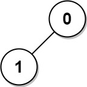

# 834. 树中距离之和

Hard · 难度分 2197 · [力扣原题](https://leetcode.cn/problems/sum-of-distances-in-tree/)

所在刷题路径：灵神题单·动态规划

| 作者 | 题解 | 动画讲解 |
|---|---|---|
| 灵茶山艾府 | [📄 题解](灵茶山艾府.md) | [▶︎ 动画（GIF）](0834%20树中距离之和%20·%20灵茶山艾府.gif) · [mp4 文件](0834%20树中距离之和%20·%20灵茶山艾府.mp4) |
| yiduobo | [📄 题解](yiduobo.md) | [▶︎ 动画（GIF）](0834%20树中距离之和%20·%20yiduobo.gif) · [mp4 文件](0834%20树中距离之和%20·%20yiduobo.mp4) |

## 动画讲解

> 动图会循环播放；想暂停、拖进度条请下载上面表格里的 mp4 文件。

### 灵茶山艾府


### yiduobo


## 题目描述

给定一个无向、连通的树。树中有 `n` 个标记为 `0...n-1` 的节点以及 `n-1` 条边 。

给定整数 `n` 和数组 `edges` ， `edges[i] = [a_i, b_i]`表示树中的节点 `a_i` 和 `b_i` 之间有一条边。

返回长度为 `n` 的数组 `answer` ，其中 `answer[i]` 是树中第 `i` 个节点与所有其他节点之间的距离之和。

**示例 1:**


```

输入: n = 6, edges = [[0,1],[0,2],[2,3],[2,4],[2,5]]
输出: [8,12,6,10,10,10]
解释: 树如图所示。
我们可以计算出 dist(0,1) + dist(0,2) + dist(0,3) + dist(0,4) + dist(0,5)
也就是 1 + 1 + 2 + 2 + 2 = 8。 因此，answer[0] = 8，以此类推。
```

**示例 2:**


```

输入: n = 1, edges = []
输出: [0]
```

**示例 3:**



```

输入: n = 2, edges = [[1,0]]
输出: [1,1]
```

**提示:**

- `1 <= n <= 3 * 10⁴`

- `edges.length == n - 1`

- `edges[i].length == 2`

- `0 <= a_i, b_i < n`

- `a_i != b_i`

- 给定的输入保证为有效的树

---
[↑ 返回 0800-0899](../README.md) · [总索引](../../../索引.md) · [仓库首页](../../../README.md)
