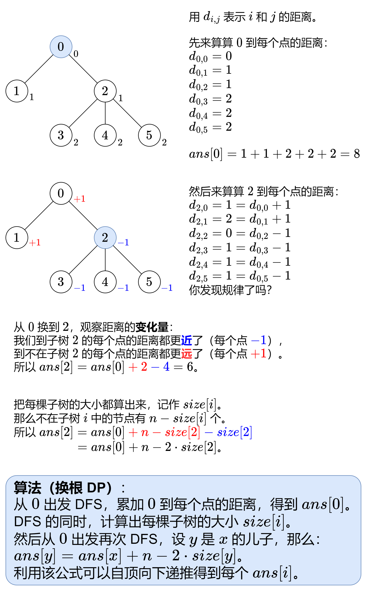

# 【图解】一张图秒懂换根 DP！（Python/Java/C++/Go/JS）

> **[834. 树中距离之和](https://leetcode.cn/problems/sum-of-distances-in-tree/solutions/2345592/tu-jie-yi-zhang-tu-miao-dong-huan-gen-dp-6bgb/) · Hard · 难度分 2197**

> **所属题单**
> - [动态规划 · 十二、树形 DP](../../../刷题路径/灵神原版题单/动态规划/十二、树形%20DP.md) · §12.4 换根 DP

> **题目描述**
> 给定一个无向、连通的树。树中有 `n` 个标记为 `0...n-1` 的节点以及 `n-1` 条边 。
>
> 给定整数 `n` 和数组 `edges` ， `edges[i] = [a_i, b_i]`表示树中的节点 `a_i` 和 `b_i` 之间有一条边。
>
> 返回长度为 `n` 的数组 `answer` ，其中 `answer[i]` 是树中第 `i` 个节点与所有其他节点之间的距离之和。
>
> **示例 1:**
>
> 
>
> ```
>
> 输入: n = 6, edges = [[0,1],[0,2],[2,3],[2,4],[2,5]]
> 输出: [8,12,6,10,10,10]
> 解释: 树如图所示。
> 我们可以计算出 dist(0,1) + dist(0,2) + dist(0,3) + dist(0,4) + dist(0,5)
> 也就是 1 + 1 + 2 + 2 + 2 = 8。 因此，answer[0] = 8，以此类推。
> ```
>
> **示例 2:**
>
> 
>
> ```
>
> 输入: n = 1, edges = []
> 输出: [0]
> ```
>
> **示例 3:**
>
> 
>
> ```
>
> 输入: n = 2, edges = [[1,0]]
> 输出: [1,1]
> ```
>
> **提示:**
>
> - `1 <= n <= 3 * 10⁴`
>
> - `edges.length == n - 1`
>
> - `edges[i].length == 2`
>
> - `0 <= a_i, b_i < n`
>
> - `a_i != b_i`
>
> - 给定的输入保证为有效的树

> **题解**
> 暴力做法是，以点 $i$ 为树根，从 $i$ 出发 DFS 这棵树，那么 $i$ 到 $j$ 的距离就是 $j$ 在这棵树的深度。所有点的深度之和就是 $\textit{answer}[i]$（简称为 $\textit{ans}[i]$）。
>
> 但这样做，DFS 一次的时间是 $\mathcal{O}(n)$，$n$ 个点各 DFS 一次，总时间就是 $\mathcal{O}(n^2)$，会超时。如何优化呢？
>
> 
>
> ### 答疑
>
> **问**：子树大小是怎么算的？
>
> **答**：先说二叉树，子树 $x$ 的大小等于左子树的大小，加上右子树的大小，再加上 $1$（节点 $x$ 本身），那么后序遍历这棵树，就可以算出每棵子树的大小。不清楚该过程的同学，需要学习「递归」「子问题」等概念，具体请看[【基础算法精讲 09】](https://www.bilibili.com/video/BV1UD4y1Y769/)。然后推广到一般树，子树 $x$ 的大小，等于 $x$ 的所有儿子的子树大小之和，再加上 $1$（节点 $x$ 本身）。
>
> **问**：在 DFS 中，如何保证每个节点只递归访问一次？
>
> **答**：通用做法是用一个 $\textit{vis}$ 数组标记访问过的点，如果某个点之前访问过，就不再递归访问。但对于树来说，一直向下递归，并不会遇到之前访问过的点，所以不需要 $\textit{vis}$ 数组。本题是无向树，除了根节点以外，其余每个点的邻居都包含其父节点，所以要避免访问父节点。我们可以定义 $\textit{dfs}(x,\textit{fa})$ 表示递归到节点 $x$ 且 $x$ 的父节点为 $\textit{fa}$。只要 $x$ 的邻居 $y\ne \textit{fa}$，就可以 $\textit{dfs}(y,x)$ 向下递归了。
>
> **问**：这种算法的**本质**是什么？
>
> **答**：以图中的这棵树为例，从「以 $0$ 为根」换到「以 $2$ 为根」时，原来 $2$ 的子节点还是 $2$ 的子节点，原来 $1$ 的子节点还是 $1$ 的子节点，**唯一改变的是** $0$ **和** $2$ **的父子关系**。由此可见，一对节点的距离的「变化量」应该是很小的，那么找出「变化量」的规律，就可以基于 $\textit{ans}[0]$ 算出 $\textit{ans}[2]$ 了。这种算法叫做**换根 DP**。
>
> ```python
> class Solution:
>     def sumOfDistancesInTree(self, n: int, edges: List[List[int]]) -> List[int]:
>         g = [[] for _ in range(n)]  # g[x] 表示 x 的所有邻居
>         for x, y in edges:
>             g[x].append(y)
>             g[y].append(x)
>
>         ans = [0] * n
>         size = [1] * n  # 注意这里初始化成 1 了，下面只需要累加儿子的子树大小
>         def dfs(x: int, fa: int, depth: int) -> None:
>             ans[0] += depth  # depth 为 0 到 x 的距离
>             for y in g[x]:  # 遍历 x 的邻居 y
>                 if y != fa:  # 避免访问父节点
>                     dfs(y, x, depth + 1)  # x 是 y 的父节点
>                     size[x] += size[y]  # 累加 x 的儿子 y 的子树大小
>         dfs(0, -1, 0)  # 0 没有父节点
>
>         def reroot(x: int, fa: int) -> None:
>             for y in g[x]:  # 遍历 x 的邻居 y
>                 if y != fa:  # 避免访问父节点
>                     ans[y] = ans[x] + n - 2 * size[y]
>                     reroot(y, x)  # x 是 y 的父节点
>         reroot(0, -1)  # 0 没有父节点
>         return ans
> ```
>
>
> #### 复杂度分析
>
> - 时间复杂度：$\mathcal{O}(n)$。DFS 两次，每次 DFS 会递归访问每个节点恰好一次，所以时间复杂度为 $\mathcal{O}(n)$。
> - 空间复杂度：$\mathcal{O}(n)$。
>
> ## 思考题
>
> 1. 如果只需要算所有点对的距离之和，你能想出一个只需要一次 DFS 的算法吗？
>
>    提示：我在前天的每日一题中讲解了一种技巧，请看[【图解】没有思路？进来秒懂！](../../0900-0999/0979%20在二叉树中分配硬币/灵茶山艾府.md)
>
> 2. 把题目中的「距离之和」改成「距离的平方和」要怎么做？
>
>    提示 1：换根，思考「变化量」是什么。
>
>    提示 2：除了计算子树大小，还需要计算子树中的每个节点的深度之和。
>
> 3. 改成「距离的立方和」要怎么做？
>
> 欢迎在评论区发表你的思路/代码。
>
> 更多相似题目，见下面动态规划题单中的「**§12.4 换根 DP**」。
>
> ## 分类题单
>
> [如何科学刷题？](https://leetcode.cn/circle/discuss/RvFUtj/)
>
> 1. [滑动窗口与双指针（定长/不定长/单序列/双序列/三指针）](https://leetcode.cn/circle/discuss/0viNMK/)
> 2. [二分算法（二分答案/最小化最大值/最大化最小值/第K小）](https://leetcode.cn/circle/discuss/SqopEo/)
> 3. [单调栈（基础/矩形面积/贡献法/最小字典序）](https://leetcode.cn/circle/discuss/9oZFK9/)
> 4. [网格图（DFS/BFS/综合应用）](https://leetcode.cn/circle/discuss/YiXPXW/)
> 5. [位运算（基础/性质/拆位/试填/恒等式/思维）](https://leetcode.cn/circle/discuss/dHn9Vk/)
> 6. [图论算法（DFS/BFS/拓扑排序/最短路/最小生成树/二分图/基环树/欧拉路径）](https://leetcode.cn/circle/discuss/01LUak/)
> 7. [动态规划（入门/背包/状态机/划分/区间/状压/数位/数据结构优化/树形/博弈/概率期望）](https://leetcode.cn/circle/discuss/tXLS3i/)
> 8. [常用数据结构（前缀和/差分/栈/队列/堆/字典树/并查集/树状数组/线段树）](https://leetcode.cn/circle/discuss/mOr1u6/)
> 9. [数学算法（数论/组合/概率期望/博弈/计算几何/随机算法）](https://leetcode.cn/circle/discuss/IYT3ss/)
> 10. [贪心与思维（基本贪心策略/反悔/区间/字典序/数学/思维/脑筋急转弯/构造）](https://leetcode.cn/circle/discuss/g6KTKL/)
> 11. [链表、二叉树与一般树（前后指针/快慢指针/DFS/BFS/直径/LCA）](https://leetcode.cn/circle/discuss/K0n2gO/)
> 12. [字符串（KMP/Z函数/Manacher/字符串哈希/AC自动机/后缀数组/子序列自动机）](https://leetcode.cn/circle/discuss/SJFwQI/)
>
> [我的题解精选（已分类）](https://github.com/EndlessCheng/codeforces-go/blob/master/leetcode/SOLUTIONS.md)
>
> 欢迎关注 [B站@灵茶山艾府](https://space.bilibili.com/206214)
