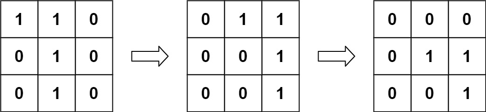
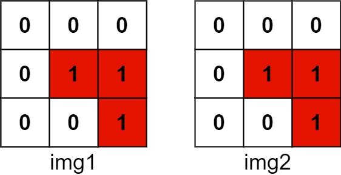

# 835. 图像重叠

Medium · [力扣原题](https://leetcode.cn/problems/image-overlap/)

所在刷题路径：灵神题单·数学算法

| 作者 | 题解 | 动画讲解 |
|---|---|---|
| 灵茶山艾府 | [📄 题解](灵茶山艾府.md) | [▶︎ 动画（GIF）](0835%20图像重叠%20·%20灵茶山艾府.gif) · [mp4 文件](0835%20图像重叠%20·%20灵茶山艾府.mp4) |
| yiduobo | [📄 题解](yiduobo.md) | [▶︎ 动画（GIF）](0835%20图像重叠%20·%20yiduobo.gif) · [mp4 文件](0835%20图像重叠%20·%20yiduobo.mp4) |

## 动画讲解

> 动图会循环播放；想暂停、拖进度条请下载上面表格里的 mp4 文件。

### 灵茶山艾府


### yiduobo


## 题目描述

给你两个图像 `img1` 和 `img2` ，两个图像的大小都是 `n x n` ，用大小相同的二进制正方形矩阵表示。二进制矩阵仅由若干 `0` 和若干 `1` 组成。

**转换** 其中一个图像，将所有的 `1` 向左，右，上，或下滑动任何数量的单位；然后把它放在另一个图像的上面。该转换的 **重叠** 是指两个图像 **都** 具有 `1` 的位置的数目。

请注意，转换 **不包括** 向任何方向旋转。越过矩阵边界的 `1` 都将被清除。

最大可能的重叠数量是多少？

**示例 1：**


```

输入：img1 = [[1,1,0],[0,1,0],[0,1,0]], img2 = [[0,0,0],[0,1,1],[0,0,1]]
输出：3
解释：将 img1 向右移动 1 个单位，再向下移动 1 个单位。



两个图像都具有 1 的位置的数目是 3（用红色标识）。


```

**示例 2：**

```

输入：img1 = [[1]], img2 = [[1]]
输出：1
```

**示例 3：**

```

输入：img1 = [[0]], img2 = [[0]]
输出：0
```

**提示：**

- `n == img1.length == img1[i].length`

- `n == img2.length == img2[i].length`

- `1 <= n <= 30`

- `img1[i][j]` 为 `0` 或 `1`

- `img2[i][j]` 为 `0` 或 `1`

---
[↑ 返回 0800-0899](../README.md) · [总索引](../../../索引.md) · [仓库首页](../../../README.md)
